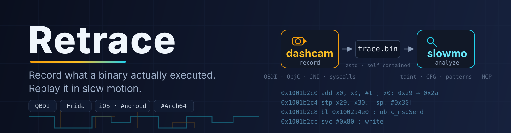
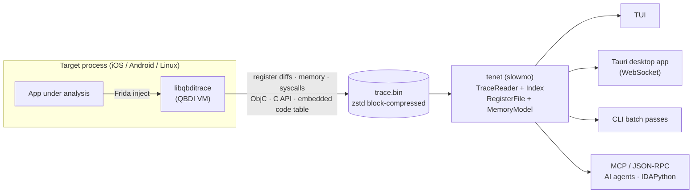

<div align="center">
  
</div>

<p align="center">
  <strong>Record what a binary <em>actually executed</em> — then replay it in slow motion.</strong>
</p>

<p align="center">
  <a href="README.zh-CN.md">简体中文</a> · English
</p>

<p align="center">
  <a href="https://github.com/fuckreverse/retrace/actions/workflows/retrace.yml"></a>
  <a href="https://github.com/fuckreverse/retrace/releases"></a>
  <a href="LICENSE"></a>
  
  
</p>

---

**Retrace** is an open-source reverse-engineering toolkit for **timeless debugging** of native
AArch64 code. It records an instruction-level, register-accurate trace of what a process *really
did* — every register diff, memory access, branch, syscall, ObjC dispatch and C API call — into a
compact self-contained `.bin` file, then lets you navigate, query and batch-analyze that execution
offline, forever after.

No breakpoints. No non-determinism. No guessing what the code *might* do — you inspect what it
*did*, at any point in time, as many times as you like.

## Why Retrace

Classic dynamic analysis loses state the moment it happens. Retrace turns one real execution of a
target function into a durable, queryable record:

- **Algorithm recovery on obfuscated code** — walk through OLLVM-flattened or MBA-obfuscated
  routines instruction by instruction, with the exact register/memory state at every step.
- **Crypto & protocol analysis** — follow key material from input to output with forward/backward
  taint; identify AES/SHA/ARX-style routines automatically.
- **Anti-debug & anti-analysis research** — syscalls, ObjC messages, C API calls
  (CommonCrypto/BoringSSL/JNI) are captured inline with their arguments.
- **AI-assisted reversing** — drive the analyzer end-to-end from LLM agents or IDA via MCP and
  JSON-RPC; the Tauri desktop app mirrors the same backend over WebSocket.

## Components

| Component | Directory | What it is |
|-----------|-----------|------------|
| **Dashcam** — the recorder | [`dashcam/`](dashcam/) | A high-performance instruction tracer built on [QBDI](https://github.com/QBDI/QBDI), injected via Frida as a dylib (iOS) or `.so` (Android). The hot path does no disassembly, no symbolization, no locking — just compact var-length records into a thread-local lock-free buffer, asynchronously flushed with optional 1 MiB-block zstd compression. |
| **Slowmo** — the analyzer | [`slowmo/`](slowmo/) | The offline engine (executable: `tenet`). Rebuilds full register state at any instruction from ANCHOR snapshots + diffs, replays memory write history, and runs 30 analysis passes: taint, CFG, call graph, loop semantics, crypto/anti-debug pattern detection, algorithm identification, syscall interception… Surfaced through a TUI, CLI batch mode, a Tauri desktop app ([`slowmo/web/`](slowmo/web/)), and MCP/RPC/WS services. |
| **Website** | [`website/`](website/) | Bilingual (EN/中文) Astro documentation site. |

Dashcam writes, Slowmo reads. The shared binary format is header-defined in
[`dashcam/TraceFormat.h`](dashcam/TraceFormat.h) and documented in
[`slowmo/docs/trace-format.md`](slowmo/docs/trace-format.md) — traces are **self-contained**: an
embedded code table lets the analyzer disassemble without any external binary image.

## How it works



1. **Record** — the Python loader ([`dashcam/qbditrace_runner.py`](dashcam/qbditrace_runner.py))
   spawns or attaches to the target and injects the recorder. Code inside the target module is
   traced; everything else runs at native speed.
2. **Persist** — the trace lands on disk as one compact `.bin` (with optional pre-trace memory
   snapshots and zstd compression). It is stable across versions and carries everything needed
   for offline disassembly.
3. **Replay & analyze** — `tenet` indexes the trace (RocksDB, seconds on reopen) and exposes
   timeless navigation plus the full pass pipeline.

## Quick start

```bash
# Slowmo (analyzer) — build & test
cd slowmo && mkdir build && cd build
cmake .. && ninja -j$(nproc)
ctest --output-on-failure

# Dashcam (recorder) — host unit tests (no QBDI needed)
cd ../../dashcam && mkdir build && cd build
cmake .. -G Ninja -DQBDITRACE_BUILD_DYLIB=OFF \
    -DFETCHCONTENT_BASE_DIR=$(pwd)/../../slowmo/_deps
ninja -j$(nproc) && ctest --output-on-failure

# iOS recorder dylib (needs patched QBDI, see below)
bash scripts/prepare-qbdi.sh ios && bash dashcam/build-dashcam-ios.sh
```

**Record a trace** (on a device with the recorder deployed):

```bash
python3 dashcam/qbditrace_runner.py \
    --target com.example.app --entry 0xEE91EC \
    --output /var/mobile/Documents/trace.bin
```

**Analyze it**:

```bash
./tenet --tui trace.bin                     # interactive TUI browsing
./tenet trace.bin --taint 0                 # forward taint from x0
./tenet trace.bin --export-cfg f.dot --call-graph cg.dot
./tenet trace.bin --pattern --algorithm-summary   # crypto / anti-debug detection
./tenet trace.bin --mcp                     # drive it from an AI agent
```

Prebuilt `tenet` binaries and the Tenet desktop app for Linux/macOS/Windows ship on the
[Releases](https://github.com/fuckreverse/retrace/releases) page.

## Trace format

The format is versioned via header flags and always backward compatible (current writer emits
v9/v7/v5/v4 depending on enabled features):

| Version | Flag | Adds |
|---------|------|------|
| v4 | baseline | 16-byte INST headers, 288-byte ANCHOR register snapshots |
| v5 | `HF_PC_DELTA` | 6-byte INST headers (~40–60% smaller files) |
| v7 | `HF_HAS_FPR` | FPR/NEON diffs + 512-byte FPR snapshots |
| v8 | `HF_CALL_META` | RETVAL facts, online ObjC selectors, `uint16` C API ids |
| v9 | `HF_MEMIMG` | pre-trace memory snapshot blocks |

All versions default to 1 MiB-block zstd compression with a trailing index. Full contract:
[`dashcam/TraceFormat.h`](dashcam/TraceFormat.h) · [`slowmo/docs/trace-format.md`](slowmo/docs/trace-format.md).

## Relationship with upstream QBDI

This repo carries **no QBDI source**. Dashcam consumes vanilla upstream QBDI plus a minimal patch
series:

- [`patches/qbdi/`](patches/qbdi/) — the patches (LSE decode fix for Darwin AArch64,
  `QBDI_LOG_FILE` post-mortem logging, iOS build config), pinned to an upstream commit recorded
  in [`patches/qbdi/PIN`](patches/qbdi/PIN)
- [`scripts/prepare-qbdi.sh`](scripts/prepare-qbdi.sh) — clones upstream QBDI at the pin, applies
  the patches, builds static libraries into the `third-party/qbdi/<platform>/` cache
- CI re-validates the patch series on every change

## Documentation

| Resource | Contents |
|----------|----------|
| [`slowmo/README.md`](slowmo/README.md) (中文) | Analyzer overview, build matrix, workflows |
| [`slowmo/docs/`](slowmo/docs/) | Architecture, IO/core/analysis layers, pass cookbook, trace format |
| [`dashcam/README.md`](dashcam/README.md) (中文) | Recorder design, full loader/C ABI reference, benchmarks |
| Website | Bilingual docs: <https://tenet-website-b24.pages.dev/> |

> Note: binary names are intentionally stable for ABI compatibility — the recorder library is
> `libqbditrace.{dylib,so}` with the `qbditrace_*` C ABI, and the analyzer executable is `tenet`.
> `dashcam`/`slowmo` are the product-level component names.

## License

Released under the [MIT License](LICENSE). Third-party dependencies keep their own licenses
(QBDI is Apache-2.0; bundled components are permissively licensed — the desktop app ships a
generated third-party notice bundle at build time).
