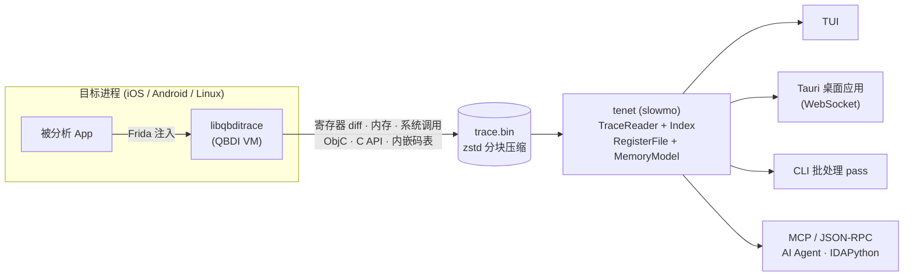

<div align="center">
  
</div>

<p align="center">
  <strong>记录二进制<em>真正执行过</em>的一切 —— 然后用慢动作回放它。</strong>
</p>

<p align="center">
  简体中文 · <a href="README.md">English</a>
</p>

<p align="center">
  <a href="https://github.com/fuckreverse/retrace/actions/workflows/retrace.yml"></a>
  <a href="https://github.com/fuckreverse/retrace/releases"></a>
  <a href="LICENSE"></a>
  
  
</p>

---

**Retrace** 是一个面向原生 AArch64 代码**时间无关调试（Timeless Debugging）**的开源逆向工具箱。
它把进程*真实发生过*的一次执行——每条寄存器 diff、每次内存访问、每个分支、系统调用、ObjC 消息派发与
C API 调用——录制成一个紧凑、自包含的 `.bin` 文件；随后你可以在离线状态下任意次地浏览、查询与批量分析这次执行。

不用断点、没有非确定性、不用猜代码*可能*做什么——你检查的是它*做过*什么，任意时刻的完整状态，随时可回看。

## 为什么需要 Retrace

传统动态分析的状态一闪即逝，而 Retrace 把目标函数的一次真实执行固化成可查询的档案：

- **混淆代码的算法还原**——逐指令走进 OLLVM 控制流平坦化或 MBA 混淆例程，每一步都有精确的寄存器/内存状态。
- **加密与协议分析**——用正向/反向污点追踪密钥材料从输入到输出的完整流向；自动识别 AES/SHA/ARX 类例程。
- **反调试与反分析研究**——系统调用、ObjC 消息、C API（CommonCrypto/BoringSSL/JNI）连同参数一起内联捕获。
- **AI 辅助逆向**——LLM Agent 或 IDA 经 MCP / JSON-RPC 全程驱动分析器；Tauri 桌面应用经 WebSocket 提供同源的图形界面。

## 组件

| 组件 | 目录 | 是什么 |
|------|------|--------|
| **Dashcam** —— 录制器 | [`dashcam/`](dashcam/) | 基于 [QBDI](https://github.com/QBDI/QBDI) 的高性能指令追踪器，经 Frida 以 dylib（iOS）或 `.so`（Android）注入。热路径零反汇编、零符号化、零锁——只把紧凑的变长记录写进 thread-local 无锁缓冲区，由后台线程异步落盘，支持 1 MiB 分块 zstd 压缩。 |
| **Slowmo** —— 分析器 | [`slowmo/`](slowmo/) | 离线分析引擎（可执行文件：`tenet`）。从 ANCHOR 快照 + diff 链重建任意指令处的完整寄存器状态，回放内存写历史，运行 30 个分析 pass：污点、CFG、调用图、循环语义、加密/反调试模式检测、算法识别、系统调用拦截……通过 TUI、CLI 批处理、Tauri 桌面应用（[`slowmo/web/`](slowmo/web/)）与 MCP/RPC/WS 服务对外呈现。 |
| **Website** | [`website/`](website/) | 中英双语文档站（Astro）。 |

Dashcam 写、Slowmo 读。共享的二进制格式由 [`dashcam/TraceFormat.h`](dashcam/TraceFormat.h) 头文件约定，
文档见 [`slowmo/docs/trace-format.md`](slowmo/docs/trace-format.md)——trace **自包含**：内嵌码表让分析器无需外部镜像即可反汇编。

## 工作原理



1. **录制**——Python loader（[`dashcam/qbditrace_runner.py`](dashcam/qbditrace_runner.py)）spawn 或 attach 目标进程并注入录制器。目标模块内的代码被追踪，模块外代码以原生速度执行。
2. **固化**——trace 落盘为一个紧凑的 `.bin`（可选 trace 前内存快照与 zstd 压缩）。格式跨版本稳定，且自带离线反汇编所需的一切。
3. **回放与分析**——`tenet` 为 trace 建索引（RocksDB，重开秒级），提供时间无关导航与完整 pass 流水线。

## 快速开始

```bash
# Slowmo（分析器）——构建与测试
cd slowmo && mkdir build && cd build
cmake .. && ninja -j$(nproc)
ctest --output-on-failure

# Dashcam（录制器）——host 单元测试（无需 QBDI）
cd ../../dashcam && mkdir build && cd build
cmake .. -G Ninja -DQBDITRACE_BUILD_DYLIB=OFF \
    -DFETCHCONTENT_BASE_DIR=$(pwd)/../../slowmo/_deps
ninja -j$(nproc) && ctest --output-on-failure

# iOS 录制器 dylib（先准备 patched QBDI，见下）
bash scripts/prepare-qbdi.sh ios && bash dashcam/build-dashcam-ios.sh
```

**录制一条 trace**（录制器已部署到设备上）：

```bash
python3 dashcam/qbditrace_runner.py \
    --target com.example.app --entry 0xEE91EC \
    --output /var/mobile/Documents/trace.bin
```

**分析它**：

```bash
./tenet --tui trace.bin                     # TUI 交互浏览
./tenet trace.bin --taint 0                 # 从 x0 正向污点
./tenet trace.bin --export-cfg f.dot --call-graph cg.dot
./tenet trace.bin --pattern --algorithm-summary   # 加密/反调试检测
./tenet trace.bin --mcp                     # 交给 AI Agent 驱动
```

Linux/macOS/Windows 的 `tenet` 预编译二进制与 Tenet 桌面应用发布在
[Releases](https://github.com/fuckreverse/retrace/releases) 页面。

## Trace 格式

格式经 header flags 版本化，始终向下兼容（当前 writer 按启用的特性产出 v9/v7/v5/v4）：

| 版本 | Flag | 新增内容 |
|------|------|----------|
| v4 | 基线 | 16 字节 INST 头、288 字节 ANCHOR 寄存器快照 |
| v5 | `HF_PC_DELTA` | INST 头缩至 6 字节（体积约减 40–60%） |
| v7 | `HF_HAS_FPR` | FPR/NEON diff + 512 字节 FPR 快照 |
| v8 | `HF_CALL_META` | RETVAL 返回事实、ObjC 在线 selector、`uint16` C API id |
| v9 | `HF_MEMIMG` | trace 前内存快照块 |

所有版本默认 1 MiB 分块 zstd 压缩并带尾部索引。完整契约：
[`dashcam/TraceFormat.h`](dashcam/TraceFormat.h) · [`slowmo/docs/trace-format.md`](slowmo/docs/trace-format.md)。

## 与上游 QBDI 的关系

本仓库**不携带 QBDI 源码**。Dashcam 消费官方上游 QBDI 加一组最小 patch 系列：

- [`patches/qbdi/`](patches/qbdi/)——patch（Darwin AArch64 的 LSE 解码修复、`QBDI_LOG_FILE`
  崩溃诊断日志、iOS 构建配置），钉在 [`patches/qbdi/PIN`](patches/qbdi/PIN) 记录的上游 commit 上
- [`scripts/prepare-qbdi.sh`](scripts/prepare-qbdi.sh)——按 pin 克隆上游 QBDI → 应用 patch →
  构建静态库缓存到 `third-party/qbdi/<platform>/`
- CI 在每次变更时重新校验 patch 系列可用性

## 文档

| 资源 | 内容 |
|------|------|
| [`dashcam/README.md`](dashcam/README.md) | 录制器设计、完整 loader/C ABI 参考、benchmark 套件 |
| [`slowmo/README.md`](slowmo/README.md) | 分析器总览、构建矩阵、常见工作流 |
| [`slowmo/docs/`](slowmo/docs/) | 架构、IO/Core/分析分层、pass 开发指南、trace 格式 |
| 官网 | 中英双语文档：<https://tenet-website-b24.pages.dev/> |

> 注：二进制名出于 ABI 兼容性有意保持稳定——录制器库为 `libqbditrace.{dylib,so}`（`qbditrace_*`
> C ABI），分析器可执行文件为 `tenet`。`dashcam`/`slowmo` 是组件级产品名。

## 许可证

以 [MIT License](LICENSE) 发布。第三方依赖保留各自许可证（QBDI 为 Apache-2.0；随包组件均为宽松
许可——桌面应用构建时会自动生成第三方声明随包分发）。
