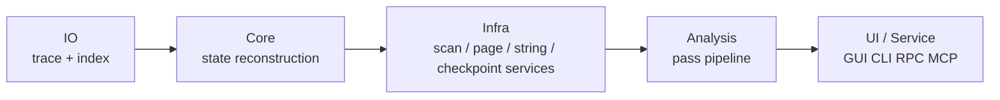

# tenet 设计说明

这份文档回答的不是“有哪些类和文件”，而是“为什么 tenet 会长成现在这样”。

如果你想看模块边界、启动流程和能力入口，优先读：

- [`docs/README.md`](docs/README.md)
- [`docs/ARCHITECTURE.md`](docs/ARCHITECTURE.md)
- [`docs/capabilities.md`](docs/capabilities.md)

## 设计目标

tenet 要解决的问题不是“做一个反汇编器”，而是“把一次真实执行过程变成可反复查询的离线分析样本”。围绕这个目标，设计重点是：

1. **保留真实执行语义**：所有分析都建立在真实 trace 上，而不是静态猜测。
2. **让随机查询足够快**：任意跳到某个 `inst_id` 时，用户不能等待秒级重建。
3. **让分析能力可叠加**：函数、CFG、污点、模式识别不能彼此写死耦合。
4. **让入口层复用同一核心**：GUI、CLI、RPC、MCP 看到的是同一套结果，而不是四套实现。
5. **让大 trace 仍然可工作**：设计要面向亿级指令、GB 级 trace，而不是 demo 数据。

## 非目标

- 不把 tenet 做成在线插桩器；录制由 `qbditrace` 负责。
- 不把 tenet 做成通用反编译器；它消费的是动态执行历史，不试图替代 IDA / Ghidra。
- 不要求所有分析都在启动时全量完成；按需和缓存优先于“一次算完所有东西”。

## 核心设计选择

### 1. 用 trace 作为唯一事实来源

tenet 的所有高层能力都建立在 trace 之上：

- 函数边界来自实际调用/返回行为
- CFG 来自真实执行过的转移
- 污点传播建立在真实寄存器和内存状态上
- 模式识别建立在真实常量、循环和调用上下文上

这让 tenet 天然适合处理：

- 间接跳转
- 运行时解密
- 动态派发
- ObjC / 系统调用上下文
- 只在某些输入下出现的执行路径

代价是：它只能回答“这次运行发生了什么”，而不是“理论上所有可能路径是什么”。这是刻意取舍。

### 2. 分层，而不是单体上下文

这样分层的原因是：

- IO 层只关心“如何快速读和定位记录”。
- Core 层只关心“如何重建某时刻状态”。
- Infra 层提供多个 pass 共用的扫描、页统计、字符串解析和 checkpoint 服务。
- Analysis 层只关心“如何把状态组织成复用结果”。
- UI / Service 层只关心“如何把结果暴露给人或程序”。

如果把这些职责混在一起，任何新入口或新分析都会反复复制逻辑。

### 3. 选择 RocksDB，而不是自研内存索引

大 trace 的问题不是“能不能扫出来”，而是“第二次还能不能快打开”。

选择 RocksDB 的原因：

- 需要持久化，而不是每次打开都重建索引
- 需要范围查询和倒排查询，而不是单一数组偏移
- 需要多 Column Family，把 offset / anchor / mem / reg / code 分开治理
- 需要在大数据量下保持工程稳定性

代价是索引构建会比较重，但这是一次性成本；第二次打开的收益远大于代价。

### 4. 选择 ANCHOR + diff，而不是每条指令全快照

寄存器状态查询必须足够快，但每条 INST 都存全量寄存器会让 trace 膨胀得不可接受。

因此采用：

- 周期性 `ANCHOR` 存全量寄存器
- 普通 `INST` 只存变化寄存器 diff
- tenet 初始化时从 ANCHOR + diff 建立稠密 checkpoint 数组
- `RegisterFile` 查询时从最近 checkpoint 最多回放 K-1 条 diff

这是磁盘空间和查询内存的两级折中：

- ANCHOR 更密：trace 更大，顺序恢复基线更近
- checkpoint 更密：内存更多，随机查询回放更短
- checkpoint 间隔由 tenet 按约 80 MiB 目标自适应估算（不是严格上限），不改变 trace 文件

### 5. 选择 Pass Pipeline，而不是硬编码调用链

如果把功能写成：

- `run_cfg()` 里直接调用 `run_xref()`
- `run_algorithm_summary()` 里直接调用 `run_pattern()`、`run_loop()`、`run_call_graph()`

那么每个入口都会复制依赖调度逻辑，功能越多越难维护。

Pass Pipeline 的好处是：

- 依赖声明显式化
- 结果缓存标准化
- GUI / CLI / MCP 可以共用 `require(name)`
- 新 pass 可以独立加入 catalog

这也是 tenet 能从“几个功能”演进成“几十个可组合能力”的关键。

### 6. 选择单遍扫描融合，而不是每个 pass 各扫一次

很多 pass 的基本形态其实是：

- 顺序扫 trace
- 看一部分字段
- 做统计或收集映射

如果每个 pass 独立扫一遍，大 trace 的 IO 成本会被线性放大。所以 tenet 引入：

- `TraceCollector`
- `TraceScanEngine`
- `prepare_scan()` / `finish_scan()`
- `run_fused_scans()`

它们的目的不是“炫技”，而是压掉重复扫描。

### 7. Triton 是语义引擎，不是整套系统核心

tenet 依赖 Triton 做精确污点与语义推理，但没有把全部系统建立在 Triton 的重 replay 上。

原因很简单：

- Triton 在单条指令上的精度很好
- 但对亿级 trace 做全量 replay 的代价太高

所以 tenet 的策略是：

- 常规浏览、结构恢复、索引、字符串、图恢复尽量不依赖 Triton
- 需要精确语义时，再在局部范围内按需使用 Triton

这让 Triton 成为“高价值、按需启用的语义预言机”，而不是启动成本中心。

## 入口层为什么要复用同一核心

GUI、CLI、RPC、MCP 的差异，本质上只是：

- 谁来发起请求
- 结果如何展示
- 输出是面板、文本、JSON 还是工具结果

它们不应该拥有不同版本的分析逻辑。

因此 tenet 保持：

- CLI 只是把 pass 结果格式化
- RPC 只是把现有对象放到 Unix socket 后面
- MCP 只是把现有对象放到工具协议后面
- GUI/TUI 只是把现有结果可视化

这个约束让“修一处，所有入口一致收益”成为可能。

## 为什么要有 MCP 专用能力

MCP 不是简单包装 CLI 命令。AI 使用 tenet 时，存在两个额外问题：

1. 它会高频做小粒度查询
2. 它会在证据不足时过度归纳

所以 MCP 额外提供：

- `batch_query`：减少往返
- `verify_evidence`：把结论落回 trace 验证
- `hypothesis_*`：显式建模“猜测、证据、结论”链路

这让 AI 接入变成“被约束的分析流程”，而不是只会拼 prompt。

## 为什么保留多种入口

这是出于实际使用场景，而不是“功能越多越好”：

- **GUI**：最适合人类长时间浏览和比对
- **TUI**：最适合远程环境和轻量分析
- **CLI**：最适合批处理、导出和脚本链路
- **RPC**：最适合本地程序接入
- **MCP**：最适合 AI 驱动与工具化推理
- **MCP HTTP**：最适合没有 stdio 的宿主或远程接入
- **Streaming**：最适合录制尚未结束时提前索引

如果只保留一种入口，往往会把不属于它的需求强塞进去，结果谁都不好用。

## 扩展原则

新增能力时，优先遵守下面这组顺序：

1. 这是不是一个新的 pass？
2. 如果不是 pass，是不是一个现有结果的新展示方式？
3. 如果要暴露给外部，是走 CLI、RPC 还是 MCP？
4. 这个能力是否会重复扫描 trace，能否进入 Scan Fusion？
5. 这个能力是否真的需要 Triton，还是普通状态查询就够了？

这组问题可以有效避免：

- 在 UI 层偷写分析逻辑
- 在 CLI 和 MCP 各写一遍实现
- 为了一个小功能引入新的全局状态
- 对本可静态统计的能力过度使用 Triton

## 当前文档分工

- [`docs/ARCHITECTURE.md`](docs/ARCHITECTURE.md)：讲系统怎么装配、怎么跑起来
- [`docs/capabilities.md`](docs/capabilities.md)：讲 tenet 能做什么
- [`docs/io-layer.md`](docs/io-layer.md)：讲如何读 trace 和建索引
- [`docs/core-layer.md`](docs/core-layer.md)：讲如何重建寄存器、内存和语义
- [`docs/analysis-layer.md`](docs/analysis-layer.md)：讲 pass 体系如何组织
- [`docs/ui-layer.md`](docs/ui-layer.md)：讲 GUI / CLI / RPC / MCP / HTTP 如何暴露能力

## 最后一句话

tenet 的核心设计哲学可以压缩成一句话：

> 用持久化索引和按需状态重建，把一次真实执行变成一个可反复提问的分析数据库。
