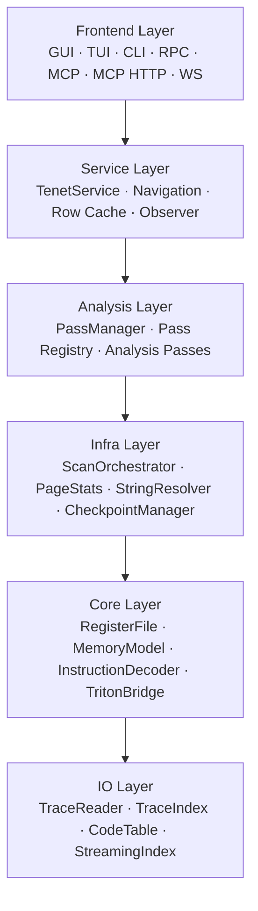
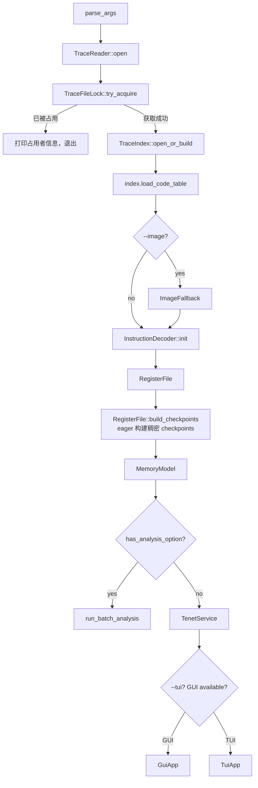

# tenet 架构总览

这份文档从“程序如何启动、对象如何装配、模式如何分流”三个角度解释 tenet 的整体架构。想看单层细节时，再跳转到对应分层文档。

## 一句话定位

`tenet` 是 `qbditrace` 的离线分析端：它读取一次真实执行形成的 trace，把它重建成可查询、可导航、可导出、可服务化接入的执行历史。

## 分层结构

- **IO 层**负责把 trace 暴露成零拷贝记录流，并建立持久化索引。
- **Core 层**负责把记录流还原成"任意时刻的程序状态"。
- **Infra 层**提供跨 pass 共享的扫描、页统计、字符串解析和寄存器 checkpoint 服务。
- **Analysis 层**负责把状态、索引和 Infra 服务组织成可复用的分析 pass。
- **Service 层**管理应用状态（导航、缓存、pass 生命周期），为所有前端提供统一操作入口。
- **Frontend 层**负责交互、导出和对外服务，不承担核心分析逻辑。

## 启动装配流程

`src/main.cpp` 是唯一装配点。它不会在各层之间写业务逻辑，只负责把固定对象顺序接起来。

### 启动阶段细分

| 阶段 | 主要对象 | 作用 |
|------|----------|------|
| 参数解析 | `CliOptions` | 决定交互模式、批处理能力、服务模式 |
| 打开 trace | `TraceReader` | `mmap` 整个 trace，解析头，提供顺序/随机记录访问 |
| 抢占会话锁 | `TraceFileLock` | 基于 `flock` 拒绝同一 trace 的并发打开（已被占用则打印占用者信息并退出，不自动重建/等待） |
| 载入或构建索引 | `TraceIndex` | 建立 offset / anchor / mem / reg / code 等 RocksDB CF |
| 载入代码字节 | `CodeTable` | 从索引或 trace 提取 opcode，供反汇编和 CFG 使用 |
| 可选镜像回填 | `ImageFallback` | 处理 trace 内缺失 code bytes 的 PC |
| 初始化 Core | `InstructionDecoder`, `RegisterFile`, `MemoryModel` | 构造寄存器、内存和指令语义对象；`main.cpp` eager 调用 `build_checkpoints()` |
| 初始化 Infra | `PassManager::init_infra()` | 创建 4 个共享服务；`CheckpointManager` 幂等确认 checkpoint 已建立 |
| 构建 Service | `TenetService` | 封装导航、缓存、pass 生命周期，供交互入口共享 |
| 分流到入口 | `run_batch_analysis`, `GuiApp`, `TuiApp` | 批处理、交互或服务化 |

## 运行时对象模型

tenet 的核心不是“一个大上下文对象”，而是一组职责稳定的长生命周期对象：

| 对象 | 生命周期 | 线程模型 | 备注 |
|------|----------|----------|------|
| `TraceReader` | 进程级 / 单 trace | 只读并发安全 | mmap 零拷贝底座 |
| `TraceFileLock` | 进程级 / 单 trace | 单实例持有 | `flock` 独占锁，析构（含进程终止）时内核自动释放 |
| `TraceIndex` | 进程级 / 单 trace | RocksDB 并发安全 | 持久化索引与元信息 |
| `CodeTable` | 进程级 / 单 trace | 读多写少 | 缓存 PC→opcode 映射 |
| `InstructionDecoder` | 进程级 | 每线程独立 Capstone handle（无锁）+ opcode 缓存读写锁 | 按 opcode（非 PC）缓存反汇编结果 |
| `RegisterFile` | 进程级 | checkpoint 建成后 lock-free | 稠密 checkpoint + diff 状态重建 |
| `MemoryModel` | 进程级 | 并发安全 | 时间感知内存读取与写历史 |
| `ScanOrchestrator` | PassManager 级 | 一次执行期内编排 | 汇总 `declare_scan()` 并让多个 collector 共享单次遍历 |
| `PageStats` / `StringResolver` | PassManager 级 | lazy 构建 | 跨 pass 共享页级统计、熵和字符串解析缓存 |
| `CheckpointManager` | PassManager 级 | 初始化时 eager、幂等 | 确保 checkpoint 只建一次，并统一创建 cursor |
| `TenetService` | 入口级 / 会话级 | 单线程（UI 线程调用） | 导航状态、行缓存、pass 生命周期、观察者通知 |
| `PassManager` | 入口级 / 会话级 | 内部同步 | 调度、缓存、依赖解析，并拥有 Infra 服务 |

## Service Layer

`TenetService`（`src/service/tenet_service.h`）是所有前端（GUI、TUI、CLI、MCP）共享的应用状态管理器。它拥有：

- **PassManager 生命周期** — `ensure_pass_manager()`、`run_pass()`、`run_default_passes()`
- **导航状态** — 光标位置、浏览器式前进/后退历史、书签
- **指令行缓存** — LRU 缓存（4096 条目），缓存已解码的指令行数据
- **Pass 结果生命周期** — 以 `shared_ptr` 钉住结果，保证线程安全的跨组件访问

前端在构造时接收 `TenetService&`，并将所有共享状态操作委托给它。观察者模式（`TenetServiceObserver`）向已订阅的前端异步推送通知（pass 完成、导航变更、书签切换等）。后端对象（TraceReader、TraceIndex、RegisterFile、MemoryModel、CodeTable、InstructionDecoder）在 `main()` 中创建并以引用传入——TenetService 不持有它们的所有权。

## 模式分流

### 交互模式

- **GUI**：macOS 默认图形入口，强调浏览体验与多面板可视化。
- **TUI**：终端环境入口，适合 SSH 和远程分析。

### 批处理模式

- `run_batch_analysis()` 负责“注册 pass → 执行 → 格式化输出”。
- 多个 CLI 能力可以组合，输出 JSON / DOT / 文本。

### 服务模式

| 模式 | 入口 | 说明 |
|------|------|------|
| RPC | `--rpc` | Unix socket JSON-RPC，适合本地工具接入 |
| MCP stdio | `--mcp` | AI 客户端拉起 tenet 子进程时使用 |
| MCP HTTP | `--mcp-http` | 单实例 Streamable HTTP，默认监听 `127.0.0.1:10444` |
| MCP Hub | `--mcp-hub` / GUI 自动启动 | `10444` 上统一承载 MCP HTTP、Worker TCP 与按实例路由的 JSON WebSocket；首实例为 Hub，其他实例为 Worker |
| Hub WS | `ws://127.0.0.1:10444/ws/<instance-id>` | 仅回环访问的 JSON-RPC/MCP 长连接，面向 IDAPython 等交互式客户端；Worker 掉线时关闭其绑定会话 |
| WS | `--ws-port <port>` | 独立高性能 WebSocket 二进制协议（uWebSockets + FlatBuffers），面向 Web/Tauri 前端 |
| Streaming | `--streaming` | tail 正在增长的 trace，做实时增量索引 |

## 关键不变量

| 不变量 | 含义 |
|--------|------|
| `inst_id` 单调递增 | 所有分析共享同一条时间轴 |
| 地址是运行时地址 | 默认含 slide；静态地址需自行减 `module_slide` |
| 寄存器重建基于 checkpoint + diff | 初始化时从 ANCHOR/diff 构建稠密 checkpoint；之后随机查询最多回放 K-1 条 diff |
| 内存读取是时间感知的 | `MemoryModel` 不读“最终值”，而读某时刻值 |
| pass 结果可缓存且幂等 | 同一个 pass 在同一上下文里不会重复执行 |
| 上层只依赖下层 | Frontend 通过 TenetService 间接使用 Analysis，Analysis 不直接改写 IO |

## 典型数据流

### 从“打开 trace”到“看见一条指令”

1. `TraceReader` 通过 `mmap` 让记录可顺序遍历。
2. `TraceIndex` 用稀疏 offset + anchor 建立快速定位。
3. `RegisterFile::state_before(inst_id)` 直接定位稠密 checkpoint，并最多回放 K-1 条 diff。
4. `CodeTable::opcode_at(pc)` 取 opcode，必要时走 `ImageFallback`。
5. `InstructionDecoder` 把 opcode 反汇编成 mnemonic / operands。
6. GUI/TUI 通过 `TenetService` 的行缓存获取 `InstructionRow` 并渲染。

### 从"点击分析按钮"到"拿到结果"

1. Frontend 调用 `TenetService::run_pass("cfg_layout")`。
2. TenetService 委托 `PassManager::require("cfg_layout")` 自动解析依赖链。
3. 依赖 pass 先执行，结果缓存进 `PassEntry`。
4. 当前 pass 消费 `PassContext` 与上游结果，生成 `PassResult`。
5. UI / CLI / MCP 读取 typed result 并做展示或序列化。

## 当前实现规模

- `src/analysis/pass_registry.cpp` 当前维护 **30 个 pass**。
- MCP 工具由 `src/io/mcp/mcp_tools_{core,analysis,ai,vm}.cpp` 分组注册；基础服务与 Hub/session 模式的实际数量不同，启动日志会打印本实例的准确值。
- CLI 参数集中在 `src/cli_options.cpp`，批处理执行集中在 `src/batch_analysis.cpp`。

## 扩展点

### 新增一个分析能力

1. 在 `src/analysis/passes/` 新增 pass。
2. 在 `pass_registry.cpp` 把它加入 catalog 和工厂。
3. 如需 CLI 入口，在 `cli_options.*` 与 `batch_analysis.cpp` 加参数和输出。
4. 如需 AI 调用，在 `src/io/mcp/` 注册工具。

### 新增一个前端能力

- **GUI**：在 `gui/panels_*.cpp` 增加面板或上下文菜单。
- **TUI**：在 `tui/panels/` 或 `tui_app.cpp` 增加面板或命令。
- **CLI**：在 `batch_analysis.cpp` 追加结果序列化逻辑。
- **服务模式**：在 `rpc_server.cpp` 或 `src/io/mcp/` 加新接口。

## 文档地图

| 文档 | 关注点 |
|------|--------|
| [`docs/README.md`](README.md) | 文档导航与阅读路径 |
| [`USAGE.md`](USAGE.md) | **端到端入门**：环境安装 → 编译 → 录制 → 分析 |
| [`../README.md`](../README.md) | 项目入口与快速开始 |
| [`capabilities.md`](capabilities.md) | 按能力看 tenet 能做什么 |
| [`io-layer.md`](io-layer.md) | trace / index / code / streaming |
| [`core-layer.md`](core-layer.md) | 寄存器 / 内存 / 解码 / Triton |
| [`analysis-layer.md`](analysis-layer.md) | Infra 服务、pass 分类、依赖、调度、融合 |
| [`pass-cookbook.md`](pass-cookbook.md) | 新增 pass 的实操开发指南 |
| [`ui-layer.md`](ui-layer.md) | GUI / TUI / CLI / RPC / MCP |
| [`trace-format.md`](trace-format.md) | 与 qbditrace 的格式契约 |
| [`profiling.md`](profiling.md) | 性能分析、Instruments、优化方法论 |
