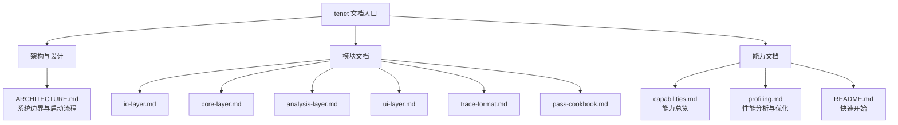

# tenet 文档导航

这组文档按两个维度组织：

- **按模块**：IO / Core / Analysis / UI / Trace Format
- **按能力**：交互浏览 / 批处理分析 / AI 自动化 / 流式索引 / 性能优化

## 按角色阅读

| 角色 | 推荐顺序 | 说明 |
|------|----------|------|
| 初次上手 | `../README.md` → `capabilities.md` → `ARCHITECTURE.md` | 先知道 tenet 能做什么，再看它怎么组织 |
| 逆向分析使用者 | `capabilities.md` → `ui-layer.md` → `analysis-layer.md` | 先找入口，再理解结果来自哪些 pass |
| 二次开发者 | `ARCHITECTURE.md` → `io-layer.md` → `core-layer.md` → `analysis-layer.md` | 先看层级边界，再看状态模型和 pass 框架 |
| AI / 自动化接入方 | `ui-layer.md` → `capabilities.md` → `analysis-layer.md` | 重点看 CLI / RPC / MCP / MCP HTTP |
| 性能优化与调优 | `profiling.md` → `analysis-layer.md` → `core-layer.md` | 先看测量方法，再定位热点来源 |

## 按模块阅读

| 文档 | 范围 | 关键对象 |
|------|------|----------|
| [`USAGE.md`](USAGE.md) | 端到端完整使用流程（环境安装→编译→录制→分析） | 入门首读 |
| [`ARCHITECTURE.md`](ARCHITECTURE.md) | 系统总览、启动流程、对象装配 | `main.cpp`, `run_batch_analysis()` |
| [`io-layer.md`](io-layer.md) | trace 读取、索引、代码字节、流式索引 | `TraceReader`, `TraceIndex`, `CodeTable`, `StreamingIndex` |
| [`core-layer.md`](core-layer.md) | 寄存器、内存、解码、语义桥接、断点 | `RegisterFile`, `MemoryModel`, `InstructionDecoder`, `TritonBridge`, `BreakpointEngine` |
| [`analysis-layer.md`](analysis-layer.md) | PassManager、TraceScanEngine、30 个 pass | `PassManager`, `TraceCollector`, `pass_registry.cpp` |
| [`ui-layer.md`](ui-layer.md) | GUI / TUI / CLI / RPC / MCP / HTTP | `GuiApp`, `TuiApp`, `TenetRpcService`, `TenetMcpService` |
| [`trace-format.md`](trace-format.md) | tenet 与 qbditrace 的接口契约 | `TraceFormat.h`, `InstView`, `AnchorView` |
| [`pass-cookbook.md`](pass-cookbook.md) | pass 开发实操 | `AnalysisPass`, `pass_registry.cpp`, `batch_analysis.cpp`, `mcp_tools_*` |

## 按能力阅读

| 能力 | 入口文档 | 说明 |
|------|----------|------|
| 打开 trace 与时间轴导航 | [`capabilities.md`](capabilities.md) | GUI / TUI / CLI 的典型工作流 |
| 结构恢复（函数 / XRef / CFG / 调用图） | [`capabilities.md`](capabilities.md), [`analysis-layer.md`](analysis-layer.md) | 结构类 pass 与导出方式 |
| 数据流与污点 | [`capabilities.md`](capabilities.md), [`analysis-layer.md`](analysis-layer.md) | 正反向污点、切片、critical path |
| 内存与字符串 | [`capabilities.md`](capabilities.md), [`core-layer.md`](core-layer.md) | 时间感知内存、快照、字符串恢复 |
| AI / 自动化接入 | [`ui-layer.md`](ui-layer.md) | `--rpc`, `--mcp`, `--mcp-http`, 47 个 MCP 工具（核心 12 + AI 推理 9 + 分析 25 + 其他 1）|
| 新增分析能力 | [`pass-cookbook.md`](pass-cookbook.md), [`analysis-layer.md`](analysis-layer.md) | 从 pass 实现到 CLI / MCP 暴露 |
| 边录边分析 | [`capabilities.md`](capabilities.md), [`io-layer.md`](io-layer.md) | `StreamingIndex` 与 `--streaming` |
| 性能分析 | [`profiling.md`](profiling.md) | Instruments、bench、优化方法论 |

## 推荐阅读路径

### 想快速定位问题

1. 看 `../README.md` 了解入口命令。
2. 看 `capabilities.md` 选择合适能力。
3. 如果结果不符合预期，再看 `analysis-layer.md` 确认对应 pass 与依赖链。

### 想修改实现

1. 先读 `ARCHITECTURE.md` 确认边界。
2. 再读对应层文档（IO / Core / Analysis / UI）。
3. 最后回到源码验证文档中提到的对象与入口是否仍然一致。

### 想给 AI 接 tenet

1. 先读 `ui-layer.md` 里的服务模式差异。
2. 再看 `capabilities.md` 选择交互式还是服务式能力。
3. 需要底层语义时，再补读 `analysis-layer.md` 和 `core-layer.md`。
