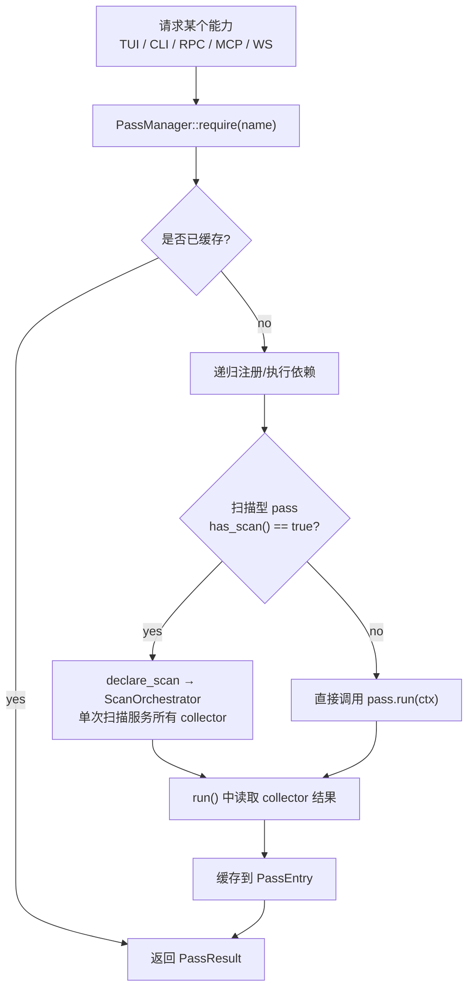
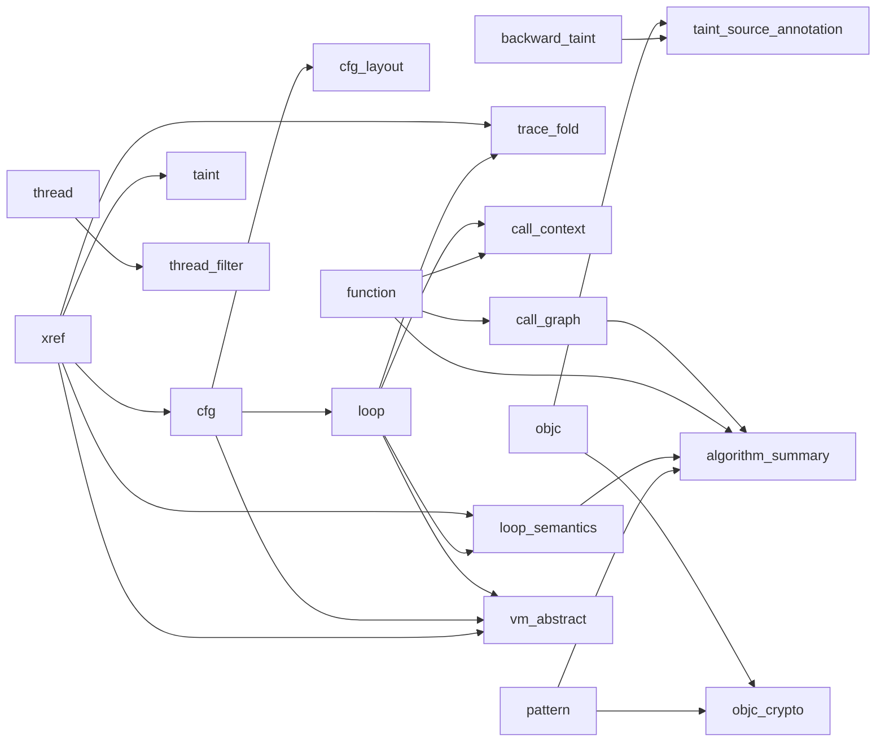

# Analysis 层

Analysis 层把 IO / Core 提供的底层能力组织成可组合的分析 pass。这里的核心不是某个具体算法，而是：

- 如何声明依赖
- 如何避免重复扫描 trace
- 如何把结果缓存成可复用中间产物
- 如何让 TUI / CLI / RPC / MCP / WS 共用同一套分析实现

## 核心对象

| 对象 | 文件 | 职责 |
|------|------|------|
| `AnalysisPass` | `pass_manager.h` | 每个分析能力的统一抽象；`declare_scan()` 声明式注册扫描需求 |
| `PassContext` | `pass_manager.h` | 向 pass 暴露 IO/Core、4 个 Infra 服务、range、progress 与依赖结果 |
| `PassResult` | `pass_manager.h` | 类型擦除结果容器，承载成功 / 失败 / 跳过状态 |
| `PassManager` | `pass_manager.{h,cpp}` | 注册、依赖解析、执行、缓存、并发调度 |
| `TraceCollector` | `trace_collector.h` | 扫描型 pass 的回调接口 |
| `TraceScanEngine` | `trace_collector.{h,cpp}` | 单遍广播、并行分片、collector 融合扫描 |
| `ScanOrchestrator` | `infra/scan_orchestrator.{h,cpp}` | 声明式扫描编排：收集 declare_scan 声明 → 单次 trace 遍历服务所有 collector |
| `PageStats` | `infra/page_stats.{h,cpp}` | lazy 缓存活跃页、读写次数、熵与字符串候选页 |
| `StringResolver` | `infra/string_resolver.{h,cpp}` | lazy、时间感知的跨 pass 字符串解析与正/负缓存 |
| `CheckpointManager` | `infra/checkpoint_manager.{h,cpp}` | eager、幂等地构建寄存器 checkpoints，并统一创建 cursor |
| `ScanDeclaration` | `infra/scan_orchestrator.h` | 扫描声明：pass 名 + collector 指针 + 是否并行 |
| `pass_catalog()` | `pass_registry.cpp` | pass 名单、分类、默认 UI 集合、工厂入口 |

## Infra 服务生命周期

`PassManager::init_infra()` 必须在设置 reader / index / code table / regfile / memory / decoder 之后、运行任何 pass 之前调用。它拥有并初始化 4 个跨 pass 服务：

- `ScanOrchestrator`：收集扫描声明，仅在一次分析执行期间持有 collector 引用。
- `PageStats`：首次访问时从 `MemoryModel::active_pages()` 建页级统计。
- `StringResolver`：首次访问时借助 `PageStats` 筛选候选页，并缓存成功和失败的地址解析。
- `CheckpointManager`：初始化时立即调用 `RegisterFile::build_checkpoints()`；之后 `state_before()` / `state_after()` 使用不可变 checkpoint 数组。

pass 通过 `PassContext::scan_orchestrator()`、`page_stats()`、`string_resolver()`、`checkpoint_manager()` 获取服务，不应各自重复构建同类缓存。

## 分析层的工作方式



## PassManager 调度模型

### `require(name)`

- 先看 `PassEntry` 是否已有结果。
- 如果没有，则按 `dependencies()` 递归要求上游 pass。
- 用原子状态机避免重复执行。
- **对于 `has_scan() == true` 的 pass**：如果尚未扫描，创建临时 `ScanOrchestrator`，调用 `declare_scan()` 注册 collector，然后执行单次扫描。`run()` 中直接读取 collector 结果。
- 适合 TUI 交互、CLI 只跑一个能力、RPC/MCP/WS 单次调用等按需分析场景。

### `run_all(num_threads)`

- **Phase 1 — 声明**：遍历所有已注册 pass，调用 `declare_scan()`，将 collector 需求注册到 `ScanOrchestrator`。
- **Phase 2 — 统一扫描**：如果 `ScanOrchestrator` 有声明，创建一个共享 `TraceScanEngine`，将所有 collector 挂载，单次 `run()`/`run_parallel()` 遍历 trace，结果广播给所有 collector。
- **Phase 3 — DAG 并行执行**：按依赖 DAG 层级并行调度各 pass 的 `run()`，`run()` 只需从 collector 读取结果（扫描已在 Phase 2 完成）。
- 适合 UI 启动阶段或需要预热一批默认 pass 的场景。

## TraceScanEngine 与 Scan Fusion

多个 pass 本质上都只是"扫一遍 trace 再统计"。如果每个 pass 各扫一次，IO 成本会线性叠加。

### 声明式扫描模型

扫描型 pass 不再自己创建 `TraceScanEngine`，而是通过 `declare_scan()` 声明需求，由框架统一编排扫描：

1. **Pass 声明**：覆写 `declare_scan(ScanOrchestrator& orch, PassContext& ctx)`，构造自己的 `Collector` 并调用 `orch.declare({name(), collector_, false})`。
2. **框架扫描**：`ScanOrchestrator` 将所有 collector 挂载到一个共享 `TraceScanEngine`，执行单次 `run()`/`run_parallel()`。
3. **Pass 读结果**：`run()` 中从 `collector_->take_result()` 提取结果，不再自建 engine。

### 已迁移的扫描型 Pass

| Pass | Collector | 并行 | 备注 |
|------|-----------|------|------|
| `thread` | `ThreadCollector` | ❌ | 线程切换统计 |
| `cfg` | `CfgCollector` | ❌ | 依赖 xref，通过 `try_require` 获取 |
| `pattern` | `PatternCollector` | ❌ | 内嵌常量链识别 |
| `function` | `FunctionCollector` | ❌ | 进度/取消回调在 declare_scan 设置 |
| `memory_strings` | `MemoryStringCollector` | ❌ | 时间感知字符串恢复 |
| `strings` | `StringCollector` | ❌ | 最终快照字符串 |
| `syscall_intercept` | `SyscallInterceptCollector` | ❌ | 三路数据源 (CAPICALL/SVC/XFER_CALL) |
| `window_stats` | `WindowStatsCollector` | ❌ | 滑动窗口统计 |

### 关键约定

- `has_scan()` 必须返回 `true`（框架据此判断是否走 Scan Fusion 路径）。
- `collector_` 为 `unique_ptr` 成员，在 `declare_scan()` 中构造。
- `run()` 首先检查 `collector_` 是否为空（缓存命中时 `collector_.reset()`，空则返回 `PassResult::failed`）。
- 缓存命中路径：反序列化结果 → `collector_.reset()` → `run()` 检测到空 collector → 直接返回缓存结果。

### 排除范围过滤（`--exclude-range`）

- `--exclude-range <start_hex> <end_hex>` 可重复指定，运行时地址。
- PC 落入排除区间的指令不会传递给分析 pass（visibility filter）。
- `RegisterFile` 和 `MemoryModel` 的状态重建不受影响——它们仍回放所有记录。
- 实现在 `TraceScanEngine`（覆盖大多数 pass）和 `XrefPass` 的自定义扫描器中。
- 典型用法：先录制完整 trace，再在离线分析时逐步排除噪声区间。

### TraceCollector 接口

Collector 可按记录类型覆写回调：

- `on_inst()`
- `on_anchor()`
- `on_code()`
- `on_svc()`
- `on_objc()`
- `on_capicall()` — 处理 REC_CAPICALL（kind=7）记录；仅 `enable_capi_intercept` 开启时出现
- `on_thread()`
- `on_event()`

### 并行分片

- 如果 collector 声明 `supports_parallel()` 且支持 `clone()` / `merge()`，引擎会按 ANCHOR 边界切分并行扫描。
- 典型受益者：`xref` 这类大范围统计型 pass。

## Pass 分类总览

当前 `pass_catalog()` 注册了 **30 个 pass**，分成 7 类。

> `index_build` 已不是独立 pass（`--index-build` 是 CLI 里单独触发索引构建/重建的选项，不经过 PassManager）；`slice`、`producer_chain` 已被 `backward_taint` 取代并从 catalog 中移除，不再是独立 pass 或 MCP 工具。

### 1. Structure

| pass | 主要用途 |
|------|----------|
| `function` | 识别函数、调用事件、调用栈 |
| `xref` | 建 PC→inst_id 倒排与执行计数 |
| `cfg` | 从动态执行恢复控制流图 |
| `cfg_layout` | 为 CFG 生成布局坐标 / DOT |
| `call_graph` | 基于函数结果生成调用图 |
| `loop` | 基于 CFG 检测循环 |
| `vm_abstract` | VMP 执行抽象（详见 3b 节）|

### 2. Taint

| pass | 主要用途 |
|------|----------|
| `taint` | 前向污点传播 |
| `backward_taint` | 反向污点回溯 |
| `taint_source_annotation` | 为反向叶子源补充 ObjC / 内存上下文 |

> `taint` 与 `backward_taint` 共享 `taint_common.h`：AArch64 ABI 常量（X0-X7 参数、X0 返回值、X30/LR）、寄存器排除规则（NZCV/SP/PC 默认不追踪）、以及 overlap-aware 的内存区间匹配（部分/非对齐访问命中已污点内存区域时仍能识别）三者集中定义，避免两个 pass 各自实现导致精度差异或悄悄漂移。

### 3. Crypto / Pattern

| pass | 主要用途 |
|------|----------|
| `pattern` | 模式检测：crypto / anti-debug / obfuscation / networking（syscall 寄存器按 target_os 自动选择 x16/x8）；同一次 trace 扫描内还内嵌了 movz+movk 常量链识别（原独立的 `constant_materialization` pass 已合并，见 `PatternResult::constants`） |
| `loop_semantics` | 判断循环是否像 Feistel / SPN / ARX / memcpy |
| `algorithm_summary` | 汇总模式、常量、循环、调用图做算法识别；结果按 `AlgorithmFamily`（结构化枚举，如 AES/SHA256/ChaCha）归并证据，不再靠子串匹配拼接不同检测器的措辞；每个候选带 `is_speculative` 标记，仅凭“高频调用”这一弱证据得出的候选会被单独标出，`confirmed_candidates()` 可过滤掉它们 |
| `objc_crypto` | 把密码学命中与 ObjC 调用上下文关联 |

> `constant_materialization` 已并入 `pattern`（`PatternCollector` 在同一次扫描中顺带追踪
> movz+movk 常量链，见 `pattern_pass.h` 的 `ConstantMaterializationResult` / `PatternResult::constants`），
> 不再是独立可注册的 pass。

> `symbol_annotation` 不是 pass：它是 `analysis/annotation_view.h` 里的一个轻量聚合函数
> `build_annotation_view()`，直接消费 `function`/`loop`/`pattern`（含其内嵌的常量结果）
> 三个 pass 已有的结果、重新按 PC/inst_id 索引，不产出任何新的分析结论。CLI 的
> `--symbol-annotation` 与 MCP 的 `symbol_annotation` tool 各自 `require()` 这些 pass
> 后现查现用，因此不需要注册为 PassManager 里的一等公民（无独立缓存、无下游依赖）。

### 3b. Obfuscation / VM

| pass | 主要用途 |
|------|----------|
| `vm_abstract` | VMP（虚拟机保护）执行抽象，**完全由静态分析 hint 驱动**（不在 trace 里猜测 dispatcher/VM-PC/拓扑/架构类型，也不再提供任何 auto-detect 回退开关——`VMConfig` 里已移除 `auto_detect`/`vm_auto_detect` 字段，无 hint 直接拒绝注册）：给定 anchor 位置（三种形式：单 PC `loop_header_pc` / PC 集 `anchor_pcs` / 内存写 `mem_anchor_addr`）后，在每个 anchor 命中点快照 VM 上下文（regs/mem），派生 handler 执行次数（纯 hint 驱动的 `handler_entry_pcs`）、解码 opcode（含 ror/bswap/neg/not_ 去混淆、`opcode_byte_offset`）、读取 VM context（可配 field 粒度 size）、VM 寄存器文件（支持混合 RF+Stack、`StackDirection`）；`DispatchType` 是**纯显示标签**（WhileSwitch/IndirectBranch/CallTable/ThreadedCode/Trampoline/FetchOnly），不选执行路径——pass 永远走统一 anchor-based 模型；`arch_type_hint` 与 dispatch 标签的机械判定（`classify_dispatch_type()`）也都只读取已 hint 位置的指令编码，不做统计推断。归类为 Structure（见上表）|

### 4. Memory / String

| pass | 主要用途 |
|------|----------|
| `strings` | 最终内存快照中的字符串恢复 |
| `memory_strings` | 调用点瞬时字符串恢复 |
| `memory_snapshot` | 在 inst_id 或调用点抓快照 |
| `mem_search` | 按字节模式/精确数值搜索内存写 / 寄存器值 / 立即数（原独立的 `literal_search` 已合并进来）|
| `entropy` | 对内存区域做 Shannon 熵分析 |
| `yara_mem_scan` | 在内存页上跑 YARA 规则 |

### 5. Platform API

| pass | 主要用途 |
|------|----------|
| `objc` | ObjC 消息发送解析（仅 Darwin 目标；Android/Linux 自动跳过，Unknown 时尽力运行） |
| `syscall_intercept` | 按 target_os 自动选择 API 表（Darwin→CommonCrypto/Security.framework，Android/Linux→BoringSSL/OpenSSL，Unknown→两者都加载）。三路数据来源（优先级递降）：① REC_CAPICALL（tracer 侧已解析，含内联字符串捕获，`from_capicall_record=true`）② REC_SVC（系统调用号分类）③ Event XFER_CALL 启发式（地址匹配 API 签名表） |

### 6. Profile / Trace

| pass | 主要用途 |
|------|----------|
| `trace_fold` | 折叠重复循环迭代，保留首尾代表性样本 + GPR/FPR 变化模式（单调/振荡/常量），自动去除嵌套循环重叠 |
| `reg_timeline` | 寄存器写时间线 |
| `call_context` | 某条指令的调用栈 / 循环 / 邻居上下文 |
| `window_stats` | 滑动窗口统计 |
| `trace_diff` | 对比两个 trace 区间 |
| `dataflow_graph` | 指令区间内的数据流图 |

### 7. Misc

| pass | 主要用途 |
|------|----------|
| `thread` | 线程时间线与切换统计 |
| `thread_filter` | 构建每线程 inst bitmap，用于过滤 |

## Pass 详解与使用入口

以下按分类逐一说明每个 pass 的作用、CLI 入口、MCP 工具与 TUI 对应。Tauri 前端（`tools/tenet/web/`）通过 WS 或 MCP 服务消费同一套后端结果，具体页面组织由前端实现决定。

> **约定**：CLI 指令以 `./tenet trace.bin <option>` 为前缀；MCP 工具名用 `mono` 格式；TUI 统一在 Results 面板（`A` 键呼出）中浏览。

### Structure 类

#### `function` — 函数识别

**作用**：扫描 trace 中的 BL/BLR/RET 指令对，识别函数边界、调用事件和调用栈。是 `call_graph`、`call_context` 等下游 pass 的基础。

**CLI**：`--symbol-annotation`（间接）；`--run-pass function`
**MCP**：`functions`、`find_function`
**TUI**：Callstack 面板（`P` 键切换）、Functions 面板（`L` 键切换，`/` 筛选，`s` 切换排序模式：调用次数/名称/地址）

---

#### `xref` — 交叉引用索引

**作用**：构建 PC→inst_id 倒排索引和执行计数。回答"某条指令在哪些 inst_id 执行过、执行了多少次"。是 `cfg`、`taint`、`trace_fold` 等众多 pass 的依赖。

**CLI**：`--run-pass xref`
**MCP**：`xref`
**TUI**：`x` / `X` 键在 XRef 之间前进/后退导航。

---

#### `cfg` — 控制流图

**作用**：从动态执行恢复控制流图（基本块 + 边），包含每个块的执行计数和终结指令类型。依赖 `xref`。

**CLI**：`--export-cfg <output.dot>`（导出 Graphviz DOT）
**MCP**：`cfg_export`——默认导出全图（含布局坐标、边路由折线、terminator 类型）；传 `entry_pc` 或 `inst_id` 时导出函数作用域子图（`extract_function` + 现场布局，disasm 全量），Tauri CFG 面板以此按函数浏览。
**TUI**：Results 面板中 `cfg` 条目的详情视图列出所有基本块（地址 / 指令数 / 执行次数 / 终结指令类型）。

---

#### `cfg_layout` — CFG 布局

**作用**：为 CFG 生成 2D 布局坐标，供 DOT 导出或 Tauri 前端可视化使用。依赖 `cfg`，通常由消费方按需触发，无需用户手动运行。

**CLI**：无独立入口（由 `--export-cfg` 内部使用）
**TUI**：不适用（终端无图布局需求）。

---

#### `call_graph` — 调用图

**作用**：基于 `function` 结果生成函数间调用图，包含调用次数、调用点和最大调用深度。

**CLI**：`--call-graph <output.dot>`（导出 Graphviz DOT 或 JSON）
**MCP**：`call_graph`
**TUI**：Results 面板中 `call_graph` 条目的详情视图列出所有节点（按接收调用数排序，显示入度/出度）。

---

#### `loop` — 循环检测

**作用**：基于 CFG 的回边检测循环，提供循环 header PC、迭代次数、嵌套深度等信息。依赖 `cfg`。

**CLI**：`--run-pass loop`；`--symbol-annotation`（间接）
**MCP**：`loops`
**TUI**：`O` 键运行循环分析；Results 面板中 `loop` 条目提供循环列表浏览。

---

#### `vm_abstract` — VMP 虚拟机保护抽象

**作用**：**完全由静态分析 hint 驱动**（来自 IDA/Ghidra）。给定 anchor 位置（单 PC / PC 集 / 内存写地址）后，在每个 anchor 命中点快照 VM 上下文（regs/mem），派生 handler 执行次数、解码 opcode（含 ror/bswap/neg/not_ 去混淆）、读取 VM context 和 VM 寄存器文件。依赖 `xref` + `cfg` + `loop`。

> ⚠️ 无 hint 时拒绝注册——pass 不做任何启发式扫描/推断。用 `--vm-hints <file.json>` 提供完整 hints，或组合使用 `--vm-dispatcher`、`--vm-indirect-br`、可重复的 `--vm-handler`。`--vm-abstract` 本身不接文件参数。

**CLI**：`--vm-abstract --vm-hints <file.json>`；或 `--vm-abstract --vm-dispatcher <pc> --vm-indirect-br <pc> --vm-handler <pc>`
**MCP**：`vm_abstract`
**TUI**：Results 面板中 `vm_abstract` 条目显示 dispatcher 信息 + handler 表（按频率排序）。

---

### Taint 类

#### `taint` — 前向污点传播

**作用**：从指定的源寄存器或内存地址开始，向后续指令传播污点标记。追踪算术运算、MOV、内存读写中的数据流。回答"这个输入值流到了哪些指令"。

**CLI**：`--taint <reg_idx> [--taint-inst <inst_id>] [--taint-stop-pc <pc>]`
**MCP**：`taint_forward`
**TUI**：`t` 键运行前向污点分析；`[` / `]` 在污点指令间跳转。

---

#### `backward_taint` — 反向污点回溯

**作用**：从指定的 sink（指令 + 寄存器）反推所有贡献源。追踪内存读写、寄存器传递，找出某个输出值是由哪些输入决定的。回答"这个输出值从哪里来"。

**CLI**：`--backward-taint <inst_id> <reg_idx> [--backward-taint-graph <output.json>]`
**MCP**：`taint_backward`
**TUI**：`B` 键运行反向污点分析。

---

#### `taint_source_annotation` — 污点来源标注

**作用**：为反向污点的叶端来源补充 ObjC / 内存 / 常量上下文。把抽象的"来自 x0"标注为"来自 `[NSData bytes]` 返回值"等人类可读信息。依赖 `backward_taint` + `objc`。

**CLI**：`--taint-source-annotation`
**MCP**：无独立工具（结果内嵌在 `taint_backward` 输出中）
**TUI**：Results 面板中 `taint_source_annotation` 条目显示来源摘要列表。

---

### Crypto / Pattern 类

#### `pattern` — 模式检测

**作用**：检测 crypto / anti-debug / obfuscation / networking / key schedule 等模式。同一次扫描内还**内嵌了 movz+movk 常量链识别**（原独立的 `constant_materialization` pass 已合并）。syscall 寄存器按 target_os 自动选择 x16/x8。

**CLI**：`--pattern`；`--constants`（仅常量）
**MCP**：`pattern_scan`、`constants_scan`
**TUI**：Results 面板中 `pattern` 条目显示所有匹配 + 已识别常量。

---

#### `loop_semantics` — 循环语义分类

**作用**：判断循环的执行模式是否像 Feistel / SPN / ARX / ShiftRotate / Accumulator / MemcpyLike / CounterLoop。基于循环体内的操作特征（S-box 查表、XOR、旋转移位、加法等）进行分类。依赖 `loop` + `xref`。

**CLI**：`--loop-semantics`
**MCP**：`loop_semantics`
**TUI**：Results 面板中 `loop_semantics` 条目显示循环 header 地址、类型、置信度、迭代次数。

---

#### `algorithm_summary` — 算法识别

**作用**：汇总 pattern + constants + loop + call graph 做算法识别。结果按 `AlgorithmFamily`（结构化枚举，如 AES/SHA256/ChaCha）归并证据。每个候选带 `is_speculative` 标记——仅凭"高频调用"这一弱证据得出的候选会被单独标出，`confirmed_candidates()` 可过滤。依赖 `pattern` + `loop_semantics` + `function` + `call_graph`。

**CLI**：`--algorithm-summary`
**MCP**：`algorithm_summary`
**TUI**：Results 面板中 `algorithm_summary` 条目显示候选列表（算法名 / 置信度 / speculative 标记 / 证据）。

---

#### `objc_crypto` — ObjC × Crypto 关联

**作用**：把密码学模式命中与 ObjC 调用上下文关联，回答"这个加密操作是由哪个 ObjC 方法触发的"。依赖 `pattern` + `objc`。仅 Darwin 目标有效。

**CLI**：`--objc-crypto`
**MCP**：`objc_crypto`（间接，通过 `objc_messages` + `pattern_scan` 组合）
**TUI**：Results 面板中 `objc_crypto` 条目显示关联摘要。

---

### Memory / String 类

#### `strings` — 字符串恢复

**作用**：从最终内存快照中恢复字符串（ASCII / UTF-16LE / UTF-8 / Wide），包含编码、静态地址、引用计数。

**CLI**：`--strings`
**MCP**：`strings_scan`
**TUI**：Strings 面板（`I` 键切换，`/` 筛选，Enter 跳转到发现指令）

---

#### `memory_strings` — 调用点瞬时字符串

**作用**：使用时间感知内存重建，在每个函数调用瞬间恢复参数指向的字符串。比 `strings` 更精确——它不依赖最终快照，而是回放到调用瞬间的内存状态。

**CLI**：`--memory-strings`
**MCP**：`memory_strings`
**TUI**：Results 面板中 `memory_strings` 条目显示字符串列表（地址 / call site / 内容）。

---

#### `memory_snapshot` — 内存快照

**作用**：在指定 inst_id 或函数调用点抓取内存区域快照，支持自动捕获 x0-x7 指向的内存（用于 ObjC 参数 dump）。

**CLI**：`--memory-snapshot <inst_id> [--memory-snapshot-size <bytes>]`
**MCP**：`memory_snapshot`
**TUI**：Results 面板中 `memory_snapshot` 条目显示快照列表（地址 / inst_id / 大小 / 标签）。

---

#### `mem_search` — 内存/值搜索

**作用**：按字节模式（支持 `??` 通配符）、精确数值或立即数搜索内存写入 / 寄存器值。原独立的 `literal_search` 已合并进来。

**CLI**：`--mem-search <hex_pattern> [--mem-search-value <hex_value>] [--mem-search-range <start> <end>]`
**MCP**：`mem_search`
**TUI**：Results 面板中 `mem_search` 条目显示匹配列表（source 类型 / inst_id / pc / addr / value）。

---

#### `entropy` — 熵分析

**作用**：对指定内存区域做 Shannon 熵分析，判断是明文（<3.5）、压缩数据（3.5-6.5）、加密数据/密钥材料（>6.5）。

**CLI**：`--entropy <addr_hex> <size>`（地址为十六进制，大小为字节数，语义对齐 `EntropyConfig::addr`/`size`）。可选 `--entropy-at <inst_id>` 指定采样点（默认 0 = trace 末尾）；`--entropy-timeline` 额外计算熵值时间线。
**MCP**：`entropy_analysis`
**TUI**：Results 面板中 `entropy` 条目显示总体熵、分类、分块熵、转变点（转变点可跳转）。

---

#### `yara_mem_scan` — YARA 扫描

**作用**：在内存页上运行 YARA 规则，检测 crypto 常量、反调试字符串、网络/证书/打包载荷签名等。需系统安装 yara。

**CLI**：`--yara-mem-scan [--yara-rules <file_or_dir>] [--yara-min-entropy <n>] [--yara-scan-code]`；`--yara-rules` 可重复
**MCP**：无独立工具（通过 `pattern_scan` 覆盖部分功能）
**TUI**：Results 面板中 `yara_mem_scan` 条目显示匹配列表（规则名 / 地址 / inst_id / 描述）。

---

### Platform API 类

#### `objc` — ObjC 消息解析

**作用**：解析 ObjC 消息发送（objc_msgSend 等），提取类名、selector、参数、返回值。仅 Darwin 目标有效；Android/Linux 自动跳过。

**CLI**：`--objc [--objc-class <class_name>]`
**MCP**：`objc_messages`
**TUI**：Results 面板中 `objc` 条目显示消息列表（class / selector / return value / inst_id）。

---

#### `syscall_intercept` — 系统 API 拦截

**作用**：按 target_os 自动选择 API 表（Darwin→CommonCrypto/Security.framework，Android/Linux→BoringSSL/OpenSSL）。三路数据来源（优先级递降）：① REC_CAPICALL（tracer 侧已解析）② REC_SVC（系统调用号分类）③ Event XFER_CALL 启发式（地址匹配 API 签名表）。

**CLI**：`--syscall-intercept`
**MCP**：`syscall_intercept`
**TUI**：Results 面板中 `syscall_intercept` 条目显示拦截调用列表（API 名 / 类别 / inst_id / 解码参数）。

---

### Profile / Trace 类

#### `trace_fold` — 循环折叠

**作用**：折叠重复循环迭代，保留首尾代表性样本 + GPR/FPR 变化模式（单调/振荡/常量），自动去除嵌套循环重叠。大幅减少浏览时的指令数。依赖 `loop` + `xref`。

**CLI**：当前 parser 要求 `--trace-fold <reserved_start> <reserved_end>`，但两个范围值尚未接入执行，实际仍处理完整 trace；可配且会生效的参数为 `--trace-fold-min-iter` / `--trace-fold-keep-iter` / `--trace-fold-samples` / `--trace-fold-no-fpr`。
**MCP**：无独立工具
**TUI**：Results 面板中 `trace_fold` 条目显示压缩统计摘要。

---

#### `reg_timeline` — 寄存器时间线

**作用**：记录指定寄存器的所有写入事件（inst_id / 旧值 → 新值），以 sparkline 可视化值变化趋势。

**CLI**：`--reg-timeline <reg_idx> [--reg-timeline-range <start> <end>]`
**MCP**：`reg_timeline`
**TUI**：Results 面板中 `reg_timeline` 条目显示写入事件列表（inst_id / pc / reg / old → new）。

---

#### `call_context` — 调用上下文

**作用**：显示某条指令的丰富上下文：周围指令列表、调用栈重建（含尾调用标记）、循环上下文（header PC / 嵌套深度 / 迭代次数）。

**CLI**：`--call-context <inst_id>`
**MCP**：`call_context`
**TUI**：Results 面板中 `call_context` 条目显示上下文信息（目标 / 栈帧 / 反汇编指令）。

---

#### `window_stats` — 滑动窗口统计

**作用**：对 trace 做滑动窗口统计，每个窗口计算指令数、助记符多样性熵、分支比例、内存读写次数等。用于发现热点区域。

**CLI**：当前 parser 要求 `--window-stats <reserved_start> <reserved_end> [--window-stats-size <n>]`，但两个范围值尚未接入执行，实际仍统计完整 trace；只有 `--window-stats-size` 生效。
**MCP**：`window_stats`
**TUI**：Results 面板中 `window_stats` 条目显示窗口列表（inst 范围 / 熵 / 分支密度 / 内存操作）。

---

#### `trace_diff` — Trace 区间对比

**作用**：对比同一 trace 中的两个区间（或两个不同 trace 文件），找出执行分叉点。适用于差分分析——用不同输入运行同一算法，找到路径分叉处。支持 resync window 自动重同步。

**CLI**：`--trace-diff <a_start> <a_end> <b_start> <b_end> [--trace-diff-file <trace_b.bin>]`，可配 `--trace-diff-window` / `--trace-diff-max-diffs`
**MCP**：`trace_diff`
**TUI**：Results 面板中 `trace_diff` 条目显示分叉段列表（类型 / 位置 / PC / 详情）。

---

#### `dataflow_graph` — 数据流图

**作用**：在指定指令区间内构建寄存器级数据流图，显示每条指令的生产者和消费者关系。

**CLI**：`--dataflow-graph <start> <end> [--dataflow-graph-output <output.dot>]`
**MCP**：`dataflow_graph`
**TUI**：Results 面板中 `dataflow_graph` 条目显示节点列表（inst_id / pc / mnemonic）。

---

### Misc 类

#### `thread` — 线程时间线

**作用**：线程时间线与切换统计，提供线程列表、每线程指令数、上下文切换事件。

**CLI**：`--run-pass thread`
**MCP**：无独立工具
**TUI**：Thread 面板（全局 `S` 键跳转到下一次线程切换，`p`/`N` 前后切换）；Results 面板中 `thread` 条目显示线程摘要。

---

#### `thread_filter` — 线程过滤

**作用**：构建每线程 inst bitmap，用于按线程过滤指令。依赖 `thread`。

**CLI**：`--thread-filter [tid1,tid2,...]`；省略列表时仍构建全部线程 bitmap
**MCP**：无独立工具
**TUI**：Results 面板中 `thread_filter` 条目显示过滤摘要。

---

## 关键依赖关系

下面是当前实现里最重要的一组依赖，和 `dependencies()` 保持一致：



### 当前实现注意点

- `cfg` **当前仍依赖 `xref`**，这要以 `cfg_pass.h` 为准。
- `loop` 依赖 `cfg`。
- `loop_semantics` 依赖 `loop + xref`。
- `trace_fold` 依赖 `loop + xref`。
- `taint_source_annotation` 依赖 `backward_taint + objc`。
- `objc` 和 `objc_crypto` 在 target_os 为 Android/Linux 时自动跳过（返回空结果）。
- `syscall_intercept` 根据 target_os 加载不同的 API 签名表（Darwin→known_apis，Android/Linux→known_android_apis）。
- `syscall_intercept` 优先消费 REC_CAPICALL 记录（`on_capicall()`），已处理的 callee PC 写入 `capicall_seen_` 防止后续 XFER_CALL Event 重复生成记录；无 REC_CAPICALL 时降级为 XFER_CALL 启发式。
- `pattern` 的 YARA syscall buffer 根据 target_os 从 x16 或 x8 读取 syscall 号。
- `vm_abstract` 依赖 `xref + cfg + loop`（loop 仅用于单 PC anchor 的显示标签自动分类）；**完全由 hint 驱动**（`VMConfig::has_any_static_hint()` 为 false 时拒绝运行，且已不存在 auto-detect 回退——`auto_detect`/`vm_auto_detect` 字段、`--vm-auto-detect` CLI 开关、MCP `auto_detect` 参数均已删除）——anchor 位置、VM-PC 寄存器、dispatch 拓扑标签、VM 架构类型均需通过 `VMConfig` 由静态分析（IDA/Ghidra）提供，pass 本身不做启发式扫描/推断。`classify_dispatch_type()` 仅在未提供 `dispatch_type_hint` 时做一次纯机械判定（读取已定位的 dispatch 指令是否为 BLR，不做统计推测）；`find_indirect_branch_in_loop()` 仅在已 hint 的 loop 内做结构补全（用户只给了 `loop_header_pc` 时，在其 body 内查找唯一的间接跳转指令）。**统一 anchor 模型**：不再有 `VMCollector`/`ThreadedCollector` 状态机——所有拓扑走同一路径，收集 "anchor inst_ids"（每条 VM 指令命中一次），在每次命中时快照 VM 上下文，native 指令范围由相邻 anchor 的 inst_id 派生。handler 归因纯 hint 驱动（`handler_entry_pcs`），无动态发现。新增能力：
- **PC-set anchor（ThreadedCode）**：`DispatcherHint::anchor_pcs`（原 `threaded_dispatch_pcs` 的正式名），一组 runtime fetch/dispatch PC，其中恰好一个每条 VM 指令命中一次。用于直接线索化 VM（每个 handler 尾部内联 fetch+dispatch，无中央 loop）。
- **Memory-write anchor**：`DispatcherHint::mem_anchor_addr` + `mem_anchor_size`，一个每条 VM 指令被写一次的内存地址（如 VM-PC/instruction-counter 字段）。用于重度 CFF 混淆、fetch/PC++ 逻辑被克隆到多条路径、无稳定 anchor PC 的 VM。
- **扩展去混淆 op**：`OpcodeDeobfStep::Op` 新增 `ror`（循环右移）、`bswap`（字节序反转）、`neg`（取负）、`not_`（按位取反）。
  - **opcode_byte_offset**：从 vm_pc 偏移 N 字节处读取 opcode，而非固定从 0 字节读。
  - **`VMContextHint::Field::size`**：可按 1/2/4/8 字节粒度读取 ctx 字段，不再固定为 8 字节。
  - **混合 RF+Stack 架构**：`VMRegisterFileHint` 允许 `regs`（命名寄存器）与 `stack_sp_offset`（操作数栈）共存（`is_mixed() = true`）；SIMD 宽寄存器（size=16）拆为 `_lo`/`_hi` 双条目。
  - **`StackDirection`**：支持 `Descending`（SP 指向栈顶，默认）与 `Ascending`（SP 指向下一个空槽，TOS = \*(SP−elem)）两种栈增长方向。

## pass_registry.cpp 的作用

`src/analysis/pass_registry.cpp` 是 Analysis 层的“目录服务”。它提供：

- `pass_catalog()`：维护 pass 名称、分类、说明、是否默认进 UI。
- `find_pass_catalog_entry()`：按名查元信息。
- `default_ui_pass_names()`：列出默认 UI 启动时建议预热的 pass。
- `register_pass_by_name()`：按名字递归注册依赖，支持 `--run-pass <name>` 这种通用入口。
- `summarize_pass_result()`：把 pass 结果压成一行摘要，供 CLI / 调试输出。

这意味着 tenet 的 pass 不只是“类很多”，而是已经被组织成一个可发现、可枚举、可程序化驱动的分析目录。

## 批处理如何使用 Analysis 层

`src/batch_analysis.cpp` 的模式基本固定：

1. 根据 CLI 选项构造配置对象。
2. 注册需要的 pass。
3. `pm.require(name)` 拿到 typed result。
4. 序列化成 JSON / DOT / 文本。

也就是说，CLI 并没有单独实现分析能力，只是给 pass 提供了一个人类可用的入口。

## MCP 如何使用 Analysis 层

`src/io/mcp/` 中的大部分工具最终也是：

- 按需注册 pass
- 调 `require_pass<T>()`
- 序列化结果

这让 TUI、CLI、RPC、MCP 和 WS 等入口共用完全相同的分析核心；Tauri 前端也通过这些服务接口获取结果。

## 结果缓存与失效

- 每个 pass 对应一个 `PassEntry`。
- 结果一旦生成，会保存在 `PassEntry.result` 里供重复读取。
- `invalidate(name)` / `invalidate_all()` 可清理缓存。
- 对于 CLI 的 `--cache-list` / `--cache-delete`，还可以进一步管理持久化 pass blob 缓存。

## 写新 pass 的建议

### 最小模板（非扫描型 pass）

```cpp
class MyPass final : public AnalysisPass {
public:
    std::string_view name() const override { return "my_pass"; }
    std::string_view description() const override { return "..."; }
    std::vector<std::string_view> dependencies() const override {
        return {"xref"};
    }

    PassResult run(PassContext& ctx) override {
        const auto& x = ctx.require<XrefResult>("xref");
        // ... 分析逻辑 ...
        return PassResult::success(MyResult{});
    }
};
```

### 扫描型 pass 模板（声明式 Scan Fusion）

```cpp
class MyScanPass final : public AnalysisPass {
public:
    std::string_view name() const override { return "my_scan_pass"; }
    std::string_view description() const override { return "..."; }
    bool has_scan() const override { return true; }

    void declare_scan(ScanOrchestrator& orch, PassContext& ctx) override {
        collector_ = std::make_unique<MyCollector>(...);  // 从 ctx 获取构造参数
        orch.declare({name(), collector_.get(), false});   // false = 不支持并行
    }

    PassResult run(PassContext& ctx) override {
        if (!collector_) return PassResult::failed("no collector (cached)");
        return PassResult::success(std::move(collector_->take_result()));
    }

private:
    std::unique_ptr<MyCollector> collector_;
};
```

### 什么时候做扫描融合

优先考虑给这类 pass 实现 `declare_scan()` + `has_scan() = true`：

- 只是顺序扫一遍 trace 做统计
- 不依赖复杂上游结果
- 结果能先暂存在 collector 中

### 什么时候不做扫描融合

这类 pass 更适合直接 `run(ctx)`：

- 明显依赖别的 pass 的中间结果
- 需要频繁查询 `RegisterFile` / `MemoryModel`
- 逻辑本质上是图遍历、回溯或局部 replay，而不是全表扫描

## 读这层文档之后下一步看什么

- 想看底层状态是怎么重建的：读 [`core-layer.md`](core-layer.md)
- 想看怎么真正落地一个 pass：读 [`pass-cookbook.md`](pass-cookbook.md)
- 想看 CLI / TUI / RPC / MCP / WS 如何把 pass 暴露出去：读 [`ui-layer.md`](ui-layer.md)
- 想看整体装配：读 [`ARCHITECTURE.md`](ARCHITECTURE.md)
