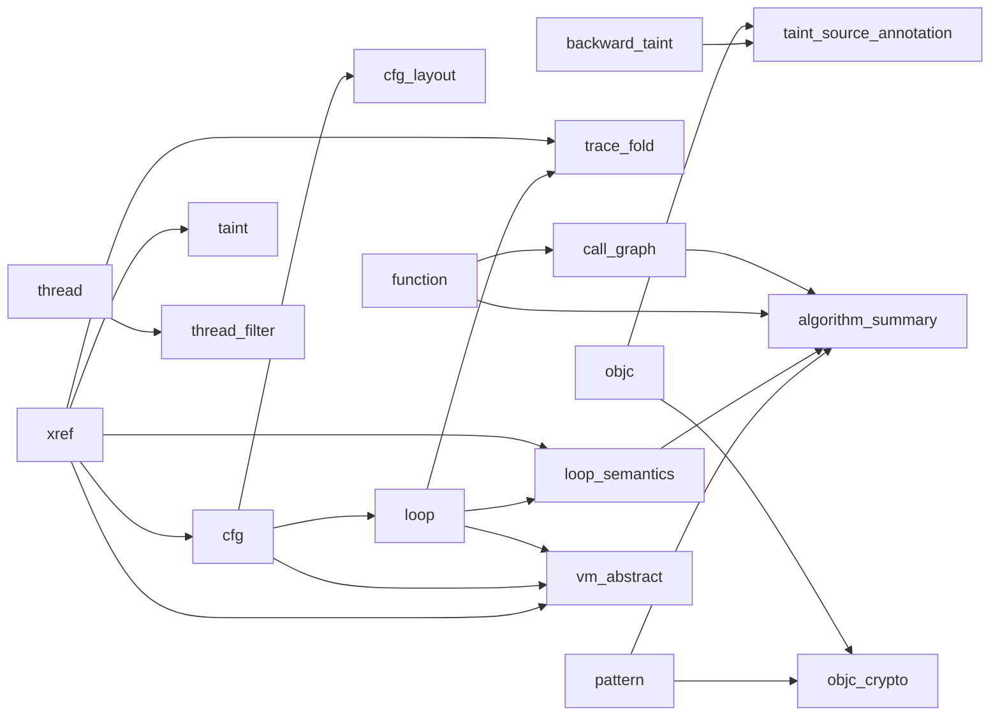

# Analysis 层

Analysis 层把 IO / Core 提供的底层能力组织成可组合的分析 pass。这里的核心不是某个具体算法，而是：

- 如何声明依赖
- 如何避免重复扫描 trace
- 如何把结果缓存成可复用中间产物
- 如何让 GUI / CLI / MCP 共用同一套分析实现

## 核心对象

| 对象 | 文件 | 职责 |
|------|------|------|
| `AnalysisPass` | `pass_manager.h` | 每个分析能力的统一抽象 |
| `PassContext` | `pass_manager.h` | 向 pass 暴露 reader / index / regfile / memory / decoder / range / progress |
| `PassResult` | `pass_manager.h` | 类型擦除结果容器，承载成功 / 失败 / 跳过状态 |
| `PassManager` | `pass_manager.{h,cpp}` | 注册、依赖解析、执行、缓存、并发调度 |
| `TraceCollector` | `trace_collector.h` | 扫描型 pass 的回调接口 |
| `TraceScanEngine` | `trace_collector.{h,cpp}` | 单遍广播、并行分片、collector 融合扫描 |
| `pass_catalog()` | `pass_registry.cpp` | pass 名单、分类、默认 UI 集合、工厂入口 |

## 分析层的工作方式

```mermaid
flowchart TD
    A[请求某个能力\nGUI / CLI / MCP] --> B[PassManager::require(name)]
    B --> C{是否已缓存?}
    C -- yes --> D[返回 PassResult]
    C -- no --> E[递归注册/执行依赖]
    E --> F{扫描型 pass?}
    F -- yes --> G[TraceScanEngine 单遍广播]
    F -- no --> H[直接调用 pass.run(ctx)]
    G --> I[finish_scan 提取结果]
    H --> I
    I --> J[缓存到 PassEntry]
    J --> D
```

## PassManager 调度模型

### `require(name)`

- 先看 `PassEntry` 是否已有结果。
- 如果没有，则按 `dependencies()` 递归要求上游 pass。
- 用原子状态机避免重复执行。
- 适合 GUI 点一下某面板、CLI 只跑一个能力、MCP 单次调用等按需分析场景。

### `run_all(num_threads)`

- 第一阶段做 **Scan Fusion**：把同层、可扫描融合的 pass 共享一次 trace 遍历。
- 第二阶段按 DAG 层级并行调度剩余 pass。
- 适合 UI 启动阶段或需要预热一批默认 pass 的场景。

## TraceScanEngine 与 Scan Fusion

多个 pass 本质上都只是“扫一遍 trace 再统计”。如果每个 pass 各扫一次，IO 成本会线性叠加。

### TraceCollector 接口

Collector 可按记录类型覆写回调：

- `on_inst()`
- `on_anchor()`
- `on_code()`
- `on_svc()`
- `on_objc()`
- `on_capicall()` — 处理 REC_CAPICALL（kind=7）记录；仅 `enable_capi_intercept` 开启时出现
- `on_thread()`
- `on_event()`

### 融合扫描

- pass 通过 `prepare_scan()` 返回自己的 collector。
- `PassManager::run_fused_scans()` 把同层 collector 挂到同一个 `TraceScanEngine`。
- 引擎只扫一遍 trace，依次广播给所有 collector。
- pass 再通过 `finish_scan()` 把 collector 内部状态转换成 `PassResult`。

### 并行分片

- 如果 collector 声明 `supports_parallel()` 且支持 `clone()` / `merge()`，引擎会按 ANCHOR 边界切分并行扫描。
- 典型受益者：`xref` 这类大范围统计型 pass。

### 排除范围过滤（`--exclude-range`）

- `--exclude-range <start_hex> <end_hex>` 可重复指定，运行时地址。
- PC 落入排除区间的指令不会传递给分析 pass（visibility filter）。
- `RegisterFile` 和 `MemoryModel` 的状态重建不受影响——它们仍回放所有记录。
- 实现在 `TraceScanEngine`（覆盖大多数 pass）和 `XrefPass` 的自定义扫描器中。
- 典型用法：先录制完整 trace，再在离线分析时逐步排除噪声区间。

## Pass 分类总览

当前 `pass_catalog()` 注册了 **30 个 pass**，分成 7 类。

> `index_build` 已不是独立 pass（`--index-build` 是 CLI 里单独触发索引构建/重建的选项，不经过 PassManager）；`slice`、`producer_chain` 已被 `backward_taint` 取代并从 catalog 中移除——GUI 里保留的 `run_producer_chain()` 只是 `BackwardTaintPass` 的一个受限步数封装（quick preview），不再是独立 pass 或 MCP 工具。

### 1. Structure

| pass | 主要用途 |
|------|----------|
| `function` | 识别函数、调用事件、调用栈 |
| `xref` | 建 PC→inst_id 倒排与执行计数 |
| `cfg` | 从动态执行恢复控制流图 |
| `cfg_layout` | 为 CFG 生成布局坐标 / DOT |
| `call_graph` | 基于函数结果生成调用图 |
| `loop` | 基于 CFG 检测循环 |
| `vm_abstract` | VMP 执行抽象（详见 3b 节）|

### 2. Taint

| pass | 主要用途 |
|------|----------|
| `taint` | 前向污点传播 |
| `backward_taint` | 反向污点回溯 |
| `taint_source_annotation` | 为反向叶子源补充 ObjC / 内存上下文 |

> `taint` 与 `backward_taint` 共享 `taint_common.h`：AArch64 ABI 常量（X0-X7 参数、X0 返回值、X30/LR）、寄存器排除规则（NZCV/SP/PC 默认不追踪）、以及 overlap-aware 的内存区间匹配（部分/非对齐访问命中已污点内存区域时仍能识别）三者集中定义，避免两个 pass 各自实现导致精度差异或悄悄漂移。

### 3. Crypto / Pattern

| pass | 主要用途 |
|------|----------|
| `pattern` | 模式检测：crypto / anti-debug / obfuscation / networking（syscall 寄存器按 target_os 自动选择 x16/x8）；同一次 trace 扫描内还内嵌了 movz+movk 常量链识别（原独立的 `constant_materialization` pass 已合并，见 `PatternResult::constants`） |
| `loop_semantics` | 判断循环是否像 Feistel / SPN / ARX / memcpy |
| `algorithm_summary` | 汇总模式、常量、循环、调用图做算法识别；结果按 `AlgorithmFamily`（结构化枚举，如 AES/SHA256/ChaCha）归并证据，不再靠子串匹配拼接不同检测器的措辞；每个候选带 `is_speculative` 标记，仅凭“高频调用”这一弱证据得出的候选会被单独标出，`confirmed_candidates()` 可过滤掉它们 |
| `objc_crypto` | 把密码学命中与 ObjC 调用上下文关联 |

> `constant_materialization` 已并入 `pattern`（`PatternCollector` 在同一次扫描中顺带追踪
> movz+movk 常量链，见 `pattern_pass.h` 的 `ConstantMaterializationResult` / `PatternResult::constants`），
> 不再是独立可注册的 pass。

> `symbol_annotation` 不是 pass：它是 `analysis/annotation_view.h` 里的一个轻量聚合函数
> `build_annotation_view()`，直接消费 `function`/`loop`/`pattern`（含其内嵌的常量结果）
> 三个 pass 已有的结果、重新按 PC/inst_id 索引，不产出任何新的分析结论。CLI 的
> `--symbol-annotation` 与 MCP 的 `symbol_annotation` tool 各自 `require()` 这些 pass
> 后现查现用，因此不需要注册为 PassManager 里的一等公民（无独立缓存、无下游依赖）。

### 3b. Obfuscation / VM

| pass | 主要用途 |
|------|----------|
| `vm_abstract` | VMP（虚拟机保护）执行抽象，**完全由静态分析 hint 驱动**（不在 trace 里猜测 dispatcher/VM-PC/拓扑/架构类型，也不再提供任何 auto-detect 回退开关——`VMConfig` 里已移除 `auto_detect`/`vm_auto_detect` 字段，无 hint 直接拒绝注册）：给定 anchor 位置（三种形式：单 PC `loop_header_pc` / PC 集 `anchor_pcs` / 内存写 `mem_anchor_addr`）后，在每个 anchor 命中点快照 VM 上下文（regs/mem），派生 handler 执行次数（纯 hint 驱动的 `handler_entry_pcs`）、解码 opcode（含 ror/bswap/neg/not_ 去混淆、`opcode_byte_offset`）、读取 VM context（可配 field 粒度 size）、VM 寄存器文件（支持混合 RF+Stack、`StackDirection`）；`DispatchType` 是**纯显示标签**（WhileSwitch/IndirectBranch/CallTable/ThreadedCode/Trampoline/FetchOnly），不选执行路径——pass 永远走统一 anchor-based 模型；`arch_type_hint` 与 dispatch 标签的机械判定（`classify_dispatch_type()`）也都只读取已 hint 位置的指令编码，不做统计推断。归类为 Structure（见上表）|

### 4. Memory / String

| pass | 主要用途 |
|------|----------|
| `strings` | 最终内存快照中的字符串恢复 |
| `memory_strings` | 调用点瞬时字符串恢复 |
| `memory_snapshot` | 在 inst_id 或调用点抓快照 |
| `mem_search` | 按字节模式/精确数值搜索内存写 / 寄存器值 / 立即数（原独立的 `literal_search` 已合并进来）|
| `entropy` | 对内存区域做 Shannon 熵分析 |
| `yara_mem_scan` | 在内存页上跑 YARA 规则 |

### 5. Platform API

| pass | 主要用途 |
|------|----------|
| `objc` | ObjC 消息发送解析（仅 Darwin 目标；Android/Linux 自动跳过，Unknown 时尽力运行） |
| `syscall_intercept` | 按 target_os 自动选择 API 表（Darwin→CommonCrypto/Security.framework，Android/Linux→BoringSSL/OpenSSL，Unknown→两者都加载）。三路数据来源（优先级递降）：① REC_CAPICALL（tracer 侧已解析，含内联字符串捕获，`from_capicall_record=true`）② REC_SVC（系统调用号分类）③ Event XFER_CALL 启发式（地址匹配 API 签名表） |

### 6. Profile / Trace

| pass | 主要用途 |
|------|----------|
| `trace_fold` | 折叠重复循环迭代，保留首尾代表性样本 + GPR/FPR 变化模式（单调/振荡/常量），自动去除嵌套循环重叠 |
| `reg_timeline` | 寄存器写时间线 |
| `call_context` | 某条指令的调用栈 / 循环 / 邻居上下文 |
| `window_stats` | 滑动窗口统计 |
| `trace_diff` | 对比两个 trace 区间 |
| `dataflow_graph` | 指令区间内的数据流图 |

### 7. Misc

| pass | 主要用途 |
|------|----------|
| `thread` | 线程时间线与切换统计 |
| `thread_filter` | 构建每线程 inst bitmap，用于过滤 |

## 关键依赖关系

下面是当前实现里最重要的一组依赖，和 `dependencies()` 保持一致：



### 当前实现注意点

- `cfg` **当前仍依赖 `xref`**，这要以 `cfg_pass.h` 为准。
- `loop` 依赖 `cfg`。
- `loop_semantics` 依赖 `loop + xref`。
- `trace_fold` 依赖 `loop + xref`。
- `taint_source_annotation` 依赖 `backward_taint + objc`。
- `objc` 和 `objc_crypto` 在 target_os 为 Android/Linux 时自动跳过（返回空结果）。
- `syscall_intercept` 根据 target_os 加载不同的 API 签名表（Darwin→known_apis，Android/Linux→known_android_apis）。
- `syscall_intercept` 优先消费 REC_CAPICALL 记录（`on_capicall()`），已处理的 callee PC 写入 `capicall_seen_` 防止后续 XFER_CALL Event 重复生成记录；无 REC_CAPICALL 时降级为 XFER_CALL 启发式。
- `pattern` 的 YARA syscall buffer 根据 target_os 从 x16 或 x8 读取 syscall 号。
- `vm_abstract` 依赖 `xref + cfg + loop`（loop 仅用于单 PC anchor 的显示标签自动分类）；**完全由 hint 驱动**（`VMConfig::has_any_static_hint()` 为 false 时拒绝运行，且已不存在 auto-detect 回退——`auto_detect`/`vm_auto_detect` 字段、`--vm-auto-detect` CLI 开关、MCP `auto_detect` 参数均已删除）——anchor 位置、VM-PC 寄存器、dispatch 拓扑标签、VM 架构类型均需通过 `VMConfig` 由静态分析（IDA/Ghidra）提供，pass 本身不做启发式扫描/推断。`classify_dispatch_type()` 仅在未提供 `dispatch_type_hint` 时做一次纯机械判定（读取已定位的 dispatch 指令是否为 BLR，不做统计推测）；`find_indirect_branch_in_loop()` 仅在已 hint 的 loop 内做结构补全（用户只给了 `loop_header_pc` 时，在其 body 内查找唯一的间接跳转指令）。**统一 anchor 模型**：不再有 `VMCollector`/`ThreadedCollector` 状态机——所有拓扑走同一路径，收集 "anchor inst_ids"（每条 VM 指令命中一次），在每次命中时快照 VM 上下文，native 指令范围由相邻 anchor 的 inst_id 派生。handler 归因纯 hint 驱动（`handler_entry_pcs`），无动态发现。新增能力：
- **PC-set anchor（ThreadedCode）**：`DispatcherHint::anchor_pcs`（原 `threaded_dispatch_pcs` 的正式名），一组 runtime fetch/dispatch PC，其中恰好一个每条 VM 指令命中一次。用于直接线索化 VM（每个 handler 尾部内联 fetch+dispatch，无中央 loop）。
- **Memory-write anchor**：`DispatcherHint::mem_anchor_addr` + `mem_anchor_size`，一个每条 VM 指令被写一次的内存地址（如 VM-PC/instruction-counter 字段）。用于重度 CFF 混淆、fetch/PC++ 逻辑被克隆到多条路径、无稳定 anchor PC 的 VM。
- **扩展去混淆 op**：`OpcodeDeobfStep::Op` 新增 `ror`（循环右移）、`bswap`（字节序反转）、`neg`（取负）、`not_`（按位取反）。
  - **opcode_byte_offset**：从 vm_pc 偏移 N 字节处读取 opcode，而非固定从 0 字节读。
  - **`VMContextHint::Field::size`**：可按 1/2/4/8 字节粒度读取 ctx 字段，不再固定为 8 字节。
  - **混合 RF+Stack 架构**：`VMRegisterFileHint` 允许 `regs`（命名寄存器）与 `stack_sp_offset`（操作数栈）共存（`is_mixed() = true`）；SIMD 宽寄存器（size=16）拆为 `_lo`/`_hi` 双条目。
  - **`StackDirection`**：支持 `Descending`（SP 指向栈顶，默认）与 `Ascending`（SP 指向下一个空槽，TOS = \*(SP−elem)）两种栈增长方向。

## pass_registry.cpp 的作用

`src/analysis/pass_registry.cpp` 是 Analysis 层的“目录服务”。它提供：

- `pass_catalog()`：维护 pass 名称、分类、说明、是否默认进 UI。
- `find_pass_catalog_entry()`：按名查元信息。
- `default_ui_pass_names()`：列出默认 UI 启动时建议预热的 pass。
- `register_pass_by_name()`：按名字递归注册依赖，支持 `--run-pass <name>` 这种通用入口。
- `summarize_pass_result()`：把 pass 结果压成一行摘要，供 CLI / 调试输出。

这意味着 tenet 的 pass 不只是“类很多”，而是已经被组织成一个可发现、可枚举、可程序化驱动的分析目录。

## 批处理如何使用 Analysis 层

`src/batch_analysis.cpp` 的模式基本固定：

1. 根据 CLI 选项构造配置对象。
2. 注册需要的 pass。
3. `pm.require(name)` 拿到 typed result。
4. 序列化成 JSON / DOT / 文本。

也就是说，CLI 并没有单独实现分析能力，只是给 pass 提供了一个人类可用的入口。

## MCP 如何使用 Analysis 层

`src/io/mcp/` 中的大部分工具最终也是：

- 按需注册 pass
- 调 `require_pass<T>()`
- 序列化结果

这让 GUI / CLI / MCP 三种入口共用完全相同的分析核心。

## 结果缓存与失效

- 每个 pass 对应一个 `PassEntry`。
- 结果一旦生成，会保存在 `PassEntry.result` 里供重复读取。
- `invalidate(name)` / `invalidate_all()` 可清理缓存。
- 对于 CLI 的 `--cache-list` / `--cache-delete`，还可以进一步管理持久化 pass blob 缓存。

## 写新 pass 的建议

### 最小模板

```cpp
class MyPass final : public AnalysisPass {
public:
    std::string_view name() const override { return "my_pass"; }
    std::string_view description() const override { return "..."; }
    std::vector<std::string_view> dependencies() const override {
        return {"xref"};
    }

    PassResult run(PassContext& ctx) override {
        const auto& x = ctx.require<XrefResult>("xref");
        // ... 分析逻辑 ...
        return PassResult::success(MyResult{});
    }
};
```

### 什么时候做扫描融合

优先考虑给这类 pass 实现 `prepare_scan()` / `finish_scan()`：

- 只是顺序扫一遍 trace 做统计
- 不依赖复杂上游结果
- 结果能先暂存在 collector 中

### 什么时候不做扫描融合

这类 pass 更适合直接 `run(ctx)`：

- 明显依赖别的 pass 的中间结果
- 需要频繁查询 `RegisterFile` / `MemoryModel`
- 逻辑本质上是图遍历、回溯或局部 replay，而不是全表扫描

## 读这层文档之后下一步看什么

- 想看底层状态是怎么重建的：读 [`core-layer.md`](core-layer.md)
- 想看怎么真正落地一个 pass：读 [`pass-cookbook.md`](pass-cookbook.md)
- 想看 CLI / MCP / GUI 如何把 pass 暴露出去：读 [`ui-layer.md`](ui-layer.md)
- 想看整体装配：读 [`ARCHITECTURE.md`](ARCHITECTURE.md)
