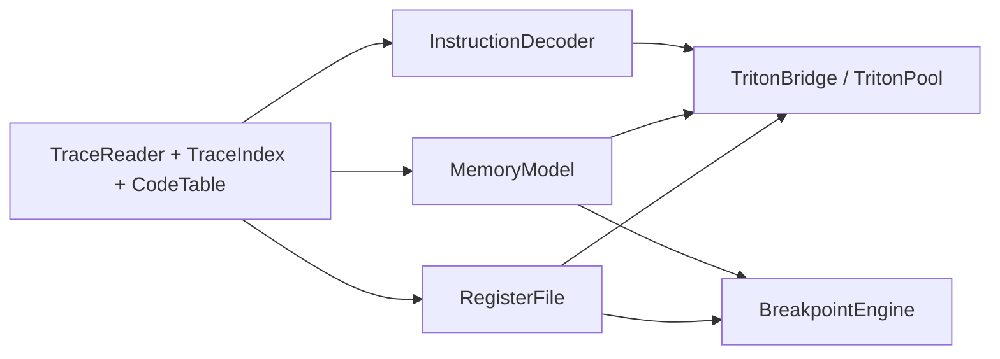
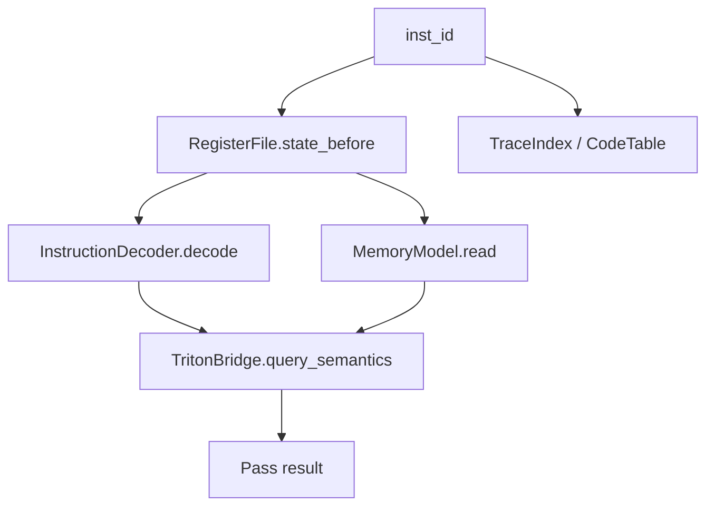

# Core 层

Core 层把 IO 层提供的“记录与索引”提升成“某一时刻程序真实状态”。

如果说 IO 层解决的是“数据怎么读”，那么 Core 层解决的是：

- 某条指令执行前寄存器是什么
- 某个地址在某个时刻内存里是什么
- 某个 PC 的 opcode 和语义是什么
- 在这些基础上，如何支撑断点、污点和高层分析

## 组件总览

| 组件 | 文件 | 作用 |
|------|------|------|
| `RegisterFile` | `register_file.{h,cpp}` | 通过 ANCHOR + diff 重建任意时刻寄存器状态 |
| `MemoryModel` | `memory_model.{h,cpp}` | 时间感知内存读取与写历史查询 |
| `InstructionDecoder` | `instruction_decoder.{h,cpp}` | Capstone 解码与缓存 |
| `TritonBridge` / `TritonPool` | `triton_bridge.{h,cpp}` | 精确语义、污点与可选 Triton 实例池 |
| `BreakpointEngine` | `breakpoint_engine.{h,cpp}` | 基于静态 trace 的断点 / 观察点 / continue |

## 1. RegisterFile：任意时刻寄存器重建

`RegisterFile` 的任务是：给定一个 `inst_id`，快速回答“这条指令执行前 / 后 34 个 GPR 分别是什么”。

### 基本机制

trace 里不会为每条指令保存完整寄存器快照，而是：

- 周期性 `ANCHOR` 记录保存全量寄存器
- 普通 `INST` 只记录改动过的寄存器 diff

于是 `RegisterFile` 的查询流程是：

1. 用 `TraceIndex::nearest_anchor_before(inst_id)` 找最近 anchor
2. 从 anchor 读出完整寄存器集
3. 从 anchor 到目标位置依次 apply diff
4. 把结果缓存进 LRU

### 为什么这样设计

- 全量快照每条都存，trace 会非常大
- 每次从头 replay 到当前位置，查询又会太慢

所以 ANCHOR + diff 是一个平衡点：

- trace 不会膨胀到不可用
- 任意跳转仍然能在微秒到亚毫秒级完成

### 关键接口

| 接口 | 作用 |
|------|------|
| `state_before(inst_id)` | 最常用，返回执行前状态 |
| `state_after(inst_id)` | 返回执行后状态 |
| `warm_range(start,end,stride,...)` | 预热一段范围的缓存 |
| `warm_at(inst_id)` | 预热某个热点点位 |
| `set_cache_capacity(size_t)` | 调整 LRU 缓存容量（默认 4096 条） |
| `cache_stats()` | 查看缓存命中情况（`CacheStats` 含 `warm_samples` 字段） |

### 什么时候会受益于预热

- 某个 pass 需要在一小段范围内大量取 `state_before()`
- GUI / TUI 在附近滚动浏览
- 需要多次采样循环多轮迭代的寄存器状态

## 2. MemoryModel：时间感知内存模型

`MemoryModel` 的职责是：

- 回答“某个地址在某个时刻的值是什么”
- 回答“谁最后写了它”
- 回答“这个区域有哪些写历史”

### 关键思想

它并不维护一个巨大的“每时刻完整内存镜像”，而是把写入记录落进 RocksDB：

- key 编码页号、页内偏移和 `inst_id`
- value 编码写入大小与数据内容

查询时再按时间回扫最近覆盖写。

### 读查询怎么工作

对 `read(addr, size, at_inst_id)`：

1. 找到地址所在页
2. 用 RocksDB iterator 跳到不晚于 `at_inst_id` 的最近记录
3. 向前回扫覆盖当前字节的写
4. 拼装出 `MemReadResult`

### 为什么 `mem_read` 也要入库

有些数据不是被当前追踪代码写出来的，而是：

- 由未插桩代码准备
- 从共享缓存、系统库或外部路径带进来

如果 trace 里有 read 访问，并且 read 记录带着当时读到的值，那么 `MemoryModel` 可以用 `mem_read` CF 去“回填”这部分历史。这是它非常有价值的一点。

### 关键接口

| 接口 | 作用 |
|------|------|
| `read(addr,size,at_inst_id)` | 小块时间感知读取 |
| `read_region(addr,size,at_inst_id)` | 任意长度区域读取（返回 `RegionReadResult`） |
| `last_writer(addr,size,before_id)` | 找最近写入者 |
| `write_history(addr,size)` | 列出所有写时刻 |
| `byte_at(addr,at_inst_id)` | 单字节查询 |
| `active_pages()` | 活跃页统计（返回 `PageActivity`） |
| `was_accessed(addr)` | 地址是否出现过 |
| `build(progress_fn)` / `is_built()` | 触发 mem_write 数据写入 RocksDB 持久化 / 查询是否已持久化 |
| `cache_stats()` | 返回 `CacheStatsSnapshot` |
| `invalidate_thread_iterators()` / `invalidate_tl_page_cache()` | RocksDB 关闭前清理线程本地资源 |

### 缓存层级

`MemoryModel` 不是每次都重新扫 RocksDB，它用了四层缓存（`memory_model.h`）：

1. `page_cache_`：`uint64_t -> vector<MemWrite>` 的 LRU，缓存整页原始写入事件（容量 512）
2. `page_index_cache_`：`uint64_t -> PageWriteIndex` 的 LRU，缓存排序后的每页写入索引以支持 O(log W) 二分查找（容量 512）——**这是最关键的快路径**
3. `byte_cache_`：缓存热点 `(addr,inst_id) -> byte`（容量 65536）
4. RocksDB block cache

## 3. InstructionDecoder：把 opcode 变成人能看的指令

`InstructionDecoder` 基于 Capstone，但做了两层工程封装：

- **每线程独立 Capstone handle**（`thread_local`），彻底消除了曾经成为瓶颈的全局 mutex
- **按 opcode 而非 PC 缓存**：AArch64 是定长指令集（4 字节），opcode 字完全决定反汇编结果，不同 PC 执行相同 opcode 时共享同一个缓存项，命中率远高于按 PC 缓存

### 典型用途

- GUI / TUI 渲染指令行
- CLI / RPC / MCP 输出反汇编文本
- 各类 pass 判断 mnemonic、操作数字符串或读写集合

### 接口

| 接口 | 作用 |
|------|------|
| `init()` | 初始化当前线程的 Capstone handle |
| `decode(pc, opcode)` | 解码一条 opcode，返回 `std::optional<DecodedInst>` |
| `decode(pc, code_table)` | 从 `CodeTable` 间接解码，返回 `std::optional<DecodedInst>` |
| `format(pc, opcode)` | 直接生成 `std::string` 形式 |

`DecodedInst` 除 mnemonic/operands 外还带 `regs_read`/`regs_written` 等寄存器读写集合信息，以及 `mnemonic_sv()`/`op_str_sv()` 零拷贝 accessor。

### 为什么很多 pass 还要绕过它

不是所有场景都值得走 Capstone。对热循环上的快速分类，tenet 还提供了 `common/aarch64_classify.h` 这类纯位运算判断，避免所有指令都做完整解码。

## 4. TritonBridge / TritonPool：按需精确语义

Triton 在 tenet 里不是“永远在线的大脑”，而是按需借用的精确语义引擎。

### 为什么要桥接层

- Triton 是可选依赖，不一定总能启用
- tenet 需要在无 Triton 时仍能运行
- 不同 pass 不应直接依赖 Triton 细节 API

所以 tenet 把它包装成：

- `TritonBridge`：统一语义接口，`query_batch()` 支持批量语义查询；`create_triton_bridge()` 工厂函数按编译开关选择实现
- `TritonBridgeStub`：无 Triton 时的降级实现
- `TritonBridgeTaint`：精确污点接口扩展，`get_tainted_gpr_mask()` 返回 `uint64_t` 位掩码——这是热循环里做按位 diff 的首选 API，避免 O(T²) 的嵌套扫描
- `TritonPool`：多个 pass 并发时的实例池

### 典型场景

- 精确寄存器 / 内存读写集合查询
- 前向污点传播
- 反向污点的精细语义判断
- 分析某些复杂 AArch64 指令对状态的影响

### 为什么要池化

Triton 实例不是零成本对象，而且并发访问时需要隔离上下文。池化让 tenet 能：

- 控制实例数量
- 避免反复创建销毁
- 在多 pass 并发时按需 borrow / return

## 5. BreakpointEngine：在静态 trace 上模拟调试体验

`BreakpointEngine` 不是在线调试器，它是在一条已经录完的时间轴上模拟调试语义。

### 支持的断点类型

| 类型 | 思路 |
|------|------|
| PC 断点 | 利用 XRef 的 `pc -> inst_ids` 直接定位命中点 |
| 内存写观察点 | 利用 `mem_write` 倒排查找地址写入 |
| 条件断点 | 顺序扫并调用 predicate |

### 关键价值

- 可以做 forward / reverse continue
- 支撑 GUI / TUI 里的时间导航体验
- 不需要重新执行程序，也不依赖在线环境

### 接口

| 接口 | 作用 |
|------|------|
| `add_breakpoint()` / `remove_breakpoint()` / `clear_breakpoints()` | 管理断点 |
| `has_breakpoints()` / `entries()` | 查询断点集合（`entries()` 供 TUI 展示） |
| `run_forward(from_id)` | 前向继续到下一命中 |
| `run_backward(from_id)` | 反向继续到上一命中 |
| `next_execution(pc, from)` / `prev_execution(pc, from)` | 找某 PC 下一次 / 上一次执行 |
| `next_write(addr, size, from)` / `prev_write(addr, size, from)` | 找某地址下一次 / 上一次写入 |

断点类型系统：`PcBreakpoint`/`WatchBreakpoint`/`ConditionalBreakpoint` 结构体，`BreakpointSpec` variant 统一持有，`BreakpointId` 为句柄类型，`BreakpointHit`/`BreakpointEntry` 为结果结构体。自由函数 `parse_breakpoint_cmd()` 供 TUI 解析断点命令字符串。

## 6. Core 层如何服务 Analysis 层

Analysis 层经常组合使用 Core 对象：

典型模式是：

1. 用 `inst_id` 找到当前 `pc`
2. 用 `RegisterFile` 拿执行前状态
3. 用 `CodeTable + InstructionDecoder` 还原指令
4. 用 `MemoryModel` 取相关地址的值
5. 需要高精度时再调 Triton

## 7. 线程安全与对象共享原则

| 组件 | 并发特性 | 实践建议 |
|------|----------|----------|
| `TraceReader` | 完全只读安全 | 可以全局共享 |
| `TraceIndex` | RocksDB 并发安全 | 可以全局共享 |
| `RegisterFile` | 偏向单线程缓存 | 热路径建议每个 worker 私有或串行用 |
| `MemoryModel` | 并发安全 | 可共享 |
| `InstructionDecoder` | 每线程独立 Capstone handle（无 mutex）+ opcode 缓存的 `shared_mutex` | 可共享，解码本身无争用，仅缓存读写需要读写锁 |
| `TritonBridge` | 实例独占 | 通过 `TritonPool` 借用 |
| `BreakpointEngine` | 偏向单线程交互 | 主要供 GUI / TUI 主线程使用 |

## 8. 这一层最重要的设计取舍

### ANCHOR 周期

- anchor 更密：查询更快，trace 更大
- anchor 更稀：查询更慢，trace 更小

### 写粒度索引，而非全量镜像

- 写粒度索引让 `MemoryModel` 可扩展到大 trace
- 代价是读取时必须做回扫拼装

### Triton 可选，而不是硬依赖

- 好处：开发、部署、调试门槛更低
- 代价：无 Triton 时某些分析精度会下降

### Core 与 UI 解耦

- GUI/TUI 直接消费 Core，但不在 Core 中写界面逻辑
- Core 的任务只是不偏不倚地回答“当时状态是什么”

## 9. 改这一层代码时优先检查什么

- 这个能力应不应该落在 Core，而不是 Analysis 或 UI？
- 会不会把缓存做成线程争用热点？
- 是否破坏了 `state_before()` / `state_after()` 的时间语义？
- `MemoryModel` 的 key / value 变化会不会影响历史兼容？
- 无 Triton 时是否仍然能优雅降级？

## 继续阅读

- 想看这些状态如何被组织成可组合分析：看 [`analysis-layer.md`](analysis-layer.md)
- 想看它们的底层数据来源：看 [`io-layer.md`](io-layer.md)
- 想看 GUI / CLI / MCP 如何消费这些对象：看 [`ui-layer.md`](ui-layer.md)
- 想写一个依赖这些对象的新 pass：看 [`pass-cookbook.md`](pass-cookbook.md)
