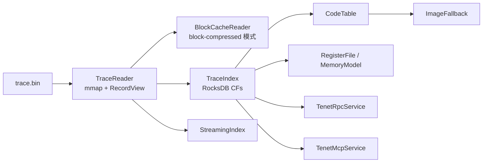

# IO 层

IO 层负责把 trace 从“磁盘文件”变成“上层可以高效查询的只读数据底座”。

它解决的是三类问题：

- 如何**零拷贝**读取大体积 trace
- 如何把顺序记录流变成**可随机定位、可倒排查询**的索引
- 如何为上层提供代码字节、流式索引和本地 RPC 这种基础设施能力

## 组件总览

| 组件 | 文件 | 作用 |
|------|------|------|
| `TraceReader` | `trace_reader.{h,cpp}` | `mmap` 映射 trace，提供顺序 / 随机访问记录视图 |
| `BlockCacheReader` | `block_cache_reader.h` | 分块压缩 trace（`HF_BLOCK_COMPRESSED`）的按需解压 + LRU 缓存，为 `TraceReader` 提供 block 模式后端 |
| `TraceIndex` | `index_builder.{h,cpp}` | 构建并持久化 RocksDB 倒排索引 |
| `CodeTable` | `code_table.{h,cpp}` | 缓存 `PC -> opcode`，供反汇编与 CFG 使用 |
| `ImageFallback` | `code_table.{h,cpp}` | 当 trace 缺少 code bytes 时，从原始镜像补码 |
| `StreamingIndex` / `YaraRuleWatcher` | `streaming_index.{h,cpp}` | tail 增长中的 trace 并增量更新索引；监听 YARA 规则目录变化并触发重载 |
| `RpcServer` / `TenetRpcService` | `rpc_server.{h,cpp}` | 本地 JSON-RPC over Unix socket |
| `TenetMcpService` 等 | `mcp/` | MCP stdio / Streamable HTTP 服务，详见下方第 5b 节 |
| `RecentFiles` | `recent_files.{h,cpp}` | GUI 最近打开文件列表 |

## 1. TraceReader：把 trace 变成零拷贝记录流

`TraceReader` 的职责很纯粹：

- 打开 trace 文件
- 解析固定文件头
- 把剩余区域映射到内存
- 以 `RecordView` / `InstView` / `AnchorView` / `CodeView` / `EventView` / `SvcView` / `ObjcView` / `CapiCallView`（含 `CapiCallStrView`）/ `ThreadView` 之类的视图暴露出去

### 为什么用 `mmap`

因为 tenet 面向的是大 trace：

- 文件可能是 GB 级
- 上层经常只读、不修改
- 顺序扫描和随机跳转都会发生

`mmap` 让系统把文件页直接映射进虚拟地址空间，避免用户态二次拷贝，也把页面换入换出的控制权交给操作系统。

### 读者最需要知道的几个点

- **记录视图不复制数据**：`InstView.raw_diffs` / `raw_mems` 都直接指向 mmap 区域（或 block-compressed 模式下指向解压后的块缓冲区）。
- **顺序访问最自然**：`begin()/end()` 提供按记录大小推进的迭代器；还有基于 `ThreadReader`（`create_thread_reader()`）的 `begin(ThreadReader&)/end(ThreadReader&)` 变体，为并行分片扫描提供无锁、线程本地的独立 LRU 缓存。
- **随机访问也支持**：结合 `TraceIndex::offset_of()` / `offset_of_with_pc()` 可以直接跳到某条 INST；`data_at(offset)` 提供对 mmap 与 block-compressed 两种模式都适用的逻辑偏移访问。
- **支持格式变体**：v4 / v5 / v6 / v7 的 PC 表示、内存布局和 FPR 记录不同，但对上层隐藏了大部分差异。
- **I/O 提示**：`advise_sequential()` / `advise_random()` 封装 madvise，引导内核预读策略。
- **block 模式内省**：`is_block_mode()` / `block_count()` / `find_block_for_offset()` / `decompress_block()`（绕过 LRU 直接解压，适合批量顺序扫描）。

### v4 / v5 / v6 / v7 兼容要点

| 版本 | 关键差异 | IO 层怎么处理 |
|------|----------|----------------|
| v4 | INST 里直接存绝对 PC；ANCHOR 288B | 直接读取 |
| v5 | INST 里存 `pc_delta` (int16)；INST 头缩至 6B | 迭代器累计 `current_pc_`，随机访问需 `offset_of_with_pc()` 提供 seed PC |
| v6 | 内存访问带旧值（memacc 48B） | `InstView` 根据 `HF_OLD_VALUE` flag 解释更宽结构体；writer 已不再写 v6 |
| v7 | INST 头新增 `n_fprdiff` 字段；ANCHOR 800B（含 512B FPR 快照） | `AnchorView` 根据 `HF_HAS_FPR` flag 决定 FPR 区域偏移；`InstView` 额外迭代 FPR diff 列表 |

**压缩格式兼容要点**：

| Flag | 含义 | IO 层怎么处理 |
|------|------|----------------|
| `HF_COMPRESSED` (bit 7) | 全文件单个 zstd 流 | `TraceReader::open()` 流式解压到临时文件再 mmap；`close()` 时清理临时文件 |
| `HF_BLOCK_COMPRESSED` (bit 8) | 多个独立 zstd frame + 尾部索引 | 交给 `BlockCacheReader`：读取末尾 footer 加载 block index table，随机访问时按需解压单块并 LRU 缓存；不需要临时文件，支持 O(1) 随机访问 |

### `BlockCacheReader`：分块压缩的按需解压引擎

专门服务 `HF_BLOCK_COMPRESSED` 格式（`src/io/block_cache_reader.h`），取代了早期“全部解压到临时文件”的方案：

- 单个 block 按需解压到堆内存，配合 LRU 驱逐
- 跨 block 读取用 `kOverlapBytes`（32 KB）重叠缓冲区拼接
- `pin_all()` / `unpin_all()` 防止多记录读取过程中被提前驱逐
- `clone()` 为每线程创建独立 reader（配合 `ThreadReader` 用于并行扫描）
- `recover_index()`：对截断 trace 扫描 zstd frame 重建 block 索引
- `decompress_block()`：绕过 LRU 直接解压，供批量顺序扫描使用
- 内部 mutex 保证线程安全

> **`data_at()` 契约**：返回的裸指针仅保证从逻辑偏移开始的 `kOverlapBytes`（32 KB）范围内连续有效——即使调用位置恰好落在最后一个 block（其解压后大小通常小于其它 block，不能假定"最后一个 block 就可以整块裸指针直读"）。调用方一次性读取的长度不得超过这个保证，否则会越界读到 block 堆缓冲区之外（真实 trace 的逻辑大小几乎从不是 block 大小的整数倍，此契约在最后一个 block 上曾引发 SIGBUS）。跨 block 的长距离顺序读取（如 trace hash 采样）应按 ≤`kOverlapBytes` 的步长分块调用 `data_at()`。

## 2. TraceIndex：把顺序流变成可查数据库

如果只有 `TraceReader`，很多分析都要线性扫整份 trace。`TraceIndex` 的存在，就是把“只能扫”变成“能定位、能倒排、能持久化重用”。

### 核心思路

- 第一次打开时扫 trace
- 把关键查询维度写入 RocksDB
- 后续打开复用同一套索引

### 主要 Column Family

| CF | Key | Value | 用途 |
|----|-----|-------|------|
| `meta` | 字符串 | 字符串 / 整数 | trace hash、inst 计数、bookmarks、last_inst |
| `offset` | `inst_id` | `file_offset` | 稀疏主索引，支持 inst_id 快速定位 |
| `anchor` | anchor 序号 | `file_offset` | 快速找到最近 anchor |
| `mem_write` | page + off + inst_id | 写入内容 | 时间感知内存写倒排 |
| `mem_read` | page + off + inst_id | 读到的内容 | 回填未追踪写入的数据 |
| `reg_writes` | reg + inst_id | 空 | 找某寄存器最近一次 writer |
| `code_bytes` | runtime PC | opcode[4] | 装载 `CodeTable` |

### 为什么 offset 是稀疏索引

如果每条指令都存一条 `inst_id -> offset`，空间会非常夸张。tenet 选择：

- 每隔一段存一个 anchor offset
- 定位时先跳到最近锚点
- 再线性扫一个较短窗口

这样换来：

- 磁盘占用大幅下降
- 定位仍然足够快
- 非常适合和 `ANCHOR` 设计一起工作

### 查询能力

`TraceIndex` 直接支撑了很多上层能力：

- `offset_of(inst_id)` / `offset_of_with_pc(inst_id, reader)`：给 GUI/TUI/CLI 随机跳转用（后者同时返回解析后的 seed PC，对 v5 pc_delta 追踪必需）
- `nearest_anchor_before(inst_id)`：给 `RegisterFile` 找重建基线
- `find_last_writer_of(reg, before_id)`：给 `backward_taint` 用（原 `slice`/`producer_chain` 的跳跃逻辑现已合并进这里）
- `load_code_table()`：给 `CodeTable` 装载 opcode
- `verify_integrity()` / `is_valid_for(reader)`：检测索引是否仍匹配当前 trace
- `inst_count()` / `stats()` / `db_path()`：统计信息与 RocksDB 路径
- `anchor_table_size()` / `anchor_table_at()`：内存内 anchor 表直接访问，供并行分片按 anchor 边界切分
- `raw_db()` / `mem_write_cf()` / `mem_read_cf()` / `code_bytes_cf()`：给 `MemoryModel`/`CodeTable` 直接暴露 CF handle
- `close()`：显式关闭 RocksDB（避免 macOS 上的关闭崩溃）
- **Pass 结果 blob 缓存**：`save_pass_blob()` / `load_pass_blob()` / `delete_pass_blob()` / `list_pass_blobs()` / `delete_all_pass_blobs()` / `pass_blob_file_path()`——这组 API 把 pass 全量结果序列化为**普通文件**（不是 RocksDB KV）存放，详见 [`profiling.md`](profiling.md) 的 Blob 持久化章节
- **会话持久化**：`save_bookmarks()`/`load_bookmarks()`（书签）、`save_last_inst()`/`load_last_inst()`（光标位置）

## 3. CodeTable 与 ImageFallback：补齐代码字节视图

### CodeTable

`CodeTable` 把 trace 中已知的代码字节整理成 `PC -> opcode` 映射，供这些场景使用：

- `InstructionDecoder` 反汇编
- `CFGPass` 分析分支类型
- 各类 pattern / literal / graph 分析

其字节来源优先级是：

1. `TraceIndex` 里的 `code_bytes` CF
2. 必要时重新扫描 trace 中的 `REC_CODE`
3. 如果仍然没有，再交给 `ImageFallback`

其他接口：`all_entries()`（返回排序后的全部条目）、`reserve()`（预分配）、`has_image_fallback()`（检查是否已配置回退）、**`image_read_cstring()`**——从镜像中直接读取 NUL 结尾的 C 字符串，用于解析 ObjC selector 名等字符串数据。

### ImageFallback

trace 不一定包含所有执行点的 code bytes，尤其是某些临界区场景。`ImageFallback` 的职责是：

- 加载原始 Mach-O / ELF 镜像
- 建立 runtime 地址到文件偏移的映射
- 在 `CodeTable` miss 时回退到镜像读取

这保证“trace 不完美”不会直接让反汇编、CFG 或污点分析失效。

其他接口：`read_bytes_at()`（任意多字节读取）、`segment_count()`（段数）、`ready()`（是否已成功加载）。

## 4. StreamingIndex：边录边建索引

`StreamingIndex` 面向增长中的 trace 文件。

### 适合场景

- 录制还没结束，但想提前看索引进度
- 长 trace 需要边生成边消费
- 想把“打开文件才开始建索引”改成“录制阶段就把索引预热好”

### 行为模型

- 后台线程轮询文件大小变化
- 每批新记录触发一次索引 flush
- 支持等待某个 `inst_id` 是否已经可用
- 支持最终 `is_complete()` 检测

### 关键接口

- `Config` 结构体：`batch_size`、`poll_interval_ms`、`idle_timeout_ms`、`max_inst_count` 等可调参数（默认构造函数与 `Config` 构造函数两种）
- `start(StreamProgressCallback, StreamCompleteCallback)` / `stop()`：启动 / 停止后台轮询线程
- `is_running()` / `file_bytes_seen()`：运行状态与已消费字节数

### YaraRuleWatcher

同一个头文件里还定义了 `YaraRuleWatcher`：监听一个目录下 `.yar` 规则文件的新增/修改，检测到变化时触发重载回调，用于流式分析场景下的 YARA 规则热更新。

## 5. RpcServer：本地程序接入入口

虽然 RPC 位于 IO 层，但它做的是**最底层的服务暴露**：把当前 trace 和核心对象以 Unix socket JSON-RPC 的形式暴露出去。

### 标准方法

当前 `TenetRpcService` 自动注册的方法包括：

- `ping`
- `get_stats`
- `get_reg`
- `get_regs`
- `read_mem`
- `get_range`
- `get_xref`
- `get_cfg`
- `get_call_graph`
- `get_taint`

> `rpc_server.h` 的头部注释里还提到 `get_inst`，但当前 `register_methods()` 实际未注册它；`get_taint` 反而是已注册但注释未提及的方法（见 `src/io/rpc_server.cpp` 的 `register_method` 调用列表）。

### 特点

- 每条消息是一行 JSON
- 单连接串行处理
- 适合本地脚本、插件、调试工具
- 不承担 AI 约束语义，和 MCP 是不同定位

## 5b. MCP 子系统：面向 AI 的服务层

`src/io/mcp/` 是一套独立于 RPC 的、面向 AI 客户端的服务实现，比 RPC 复杂得多，核心类是 `TenetMcpService`。完整设计见 [`ui-layer.md`](ui-layer.md) 的 MCP 服务章节，这里只列出 IO 层视角下的组成：

| 文件 | 核心类型 | 作用 |
|------|----------|------|
| `mcp_server.h/cpp` | `TenetMcpService`, `McpStdioTransport` | MCP 服务主体：stdio 与 HTTP 两种传输 |
| `mcp_http.h/cpp`, `mcp_http_sse.cpp` | `McpHttpTransport`, `McpHttpConfig` | Streamable HTTP 传输（MCP 2025-03-26），含 Basic Auth、会话管理、SSE |
| `discipline_injector.h/cpp` | `DisciplineInjector` | 长会话中周期性重新注入规则，对抗 LLM 语义漂移 |
| `hypothesis_ledger.h/cpp` | `HypothesisLedger` | “假设 → 证据 → 结论”状态机（proposed → active → concluded/abandoned），带证据追踪与冲突检测 |
| `mcp_helpers.h` | `PassNotReady` 等 | 非阻塞 pass 执行辅助（pass 未就绪时返回而非阻塞等待）、通用工具函数 |
| `mcp_tools_core.cpp` / `mcp_tools_analysis.cpp` / `mcp_tools_ai.cpp` | 工具注册函数 | 分别注册 trace/query、分析/图、AI 专用工具 |

要点：

- 只读工具走 `shared_mutex` 读锁，可并发执行；写工具（如 `set_image_base`）需要独占写锁
- 支持 IDA 场景下的 PC rebase，便于静态/动态地址互相映射

## 6. RecentFiles：GUI 的会话辅助

`RecentFiles` 本身不复杂，但很实用：

- 持久化最近打开的 trace
- 记录模块名和指令数等摘要信息
- 给 GUI 启动页提供最近文件列表

## 7. IO 层如何服务上层

### 给 Core 层

- `RegisterFile` 依赖 `TraceReader + TraceIndex`
- `MemoryModel` 依赖 `TraceReader + TraceIndex + RocksDB CF`
- `InstructionDecoder` 依赖 `CodeTable`

### 给 Analysis 层

- 扫描型 pass 直接顺序遍历 `TraceReader`
- 图和污点类 pass 依赖 `TraceIndex` 的倒排查询
- 需要反汇编的 pass 依赖 `CodeTable`

### 给 UI / Service 层

- GUI / TUI 随机跳转靠 `offset_of()`
- CLI `--stats`、`--streaming` 直接读取索引统计
- RPC / MCP 都依赖当前 trace 的只读对象集

## 8. 性能与资源取舍

| 项目 | 设计选择 | 原因 |
|------|----------|------|
| 文件访问 | `mmap` | 零拷贝、顺序/随机都高效 |
| 索引存储 | RocksDB | 持久化、范围查询、工程成熟 |
| 主定位表 | 稀疏 offset | 控制磁盘占用 |
| 内存写索引 | 写粒度 KV | 避免逐字节存储膨胀 |
| 代码字节 | 单独 `code_bytes` CF | 避免重复扫 trace |
| code 缺失 | `ImageFallback` | 保证上层分析不被 trace 缺码拖死 |

## 9. 改这一层代码时优先检查什么

- 这个能力是顺序扫描型，还是需要新倒排索引？
- key 设计是否会导致 RocksDB 膨胀过快？
- 是否会破坏 v5 `pc_delta` 随机访问语义？
- 是否正确处理了 v7 的 FPR diff 和 800B ANCHOR？
- 是否兼容 `HF_BLOCK_COMPRESSED` 的按块随机访问模式？
- 是否真的需要新增 CF，还是复用现有索引就够？
- 是否要同步更新 `trace-format.md` 或与 `qbditrace` 的格式契约？

## 继续阅读

- 想看这些索引如何变成寄存器 / 内存 / 语义状态：看 [`core-layer.md`](core-layer.md)
- 想看它们如何被组织成 pass：看 [`analysis-layer.md`](analysis-layer.md)
- 想把新的查询能力做成 pass 或服务接口：看 [`pass-cookbook.md`](pass-cookbook.md)
- 想看整体装配：看 [`ARCHITECTURE.md`](ARCHITECTURE.md)
