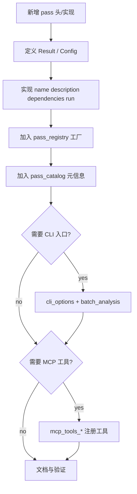

# Pass Cookbook

这份文档讲的是：**如果你要在 tenet 里新增、暴露、调试一个 pass，具体应该怎么做。**

适合场景：

- 新增一个分析 pass
- 给已有 pass 增加 CLI 入口
- 给已有 pass 增加 MCP 工具入口
- 判断一个能力该不该做成 pass
- 排查新 pass 为什么没有跑、没有缓存、没有被 UI / MCP 看见

## 先判断：这是不是一个 pass

优先把下面这类能力做成 pass：

- 会产出可复用分析结果
- 结果可能被多个入口消费（GUI / CLI / MCP）
- 逻辑依赖 `TraceReader` / `TraceIndex` / `RegisterFile` / `MemoryModel`
- 可能依赖其他分析的中间结果

不一定要做成 pass 的情况：

- 只是某个 pass 结果的展示变化
- 只是 UI 层一个交互动作
- 只是 CLI / MCP 的简单结果格式化
- 只是对现有 Core 对象的即时查询，不需要缓存中间分析结果

## 一个新 pass 最少要改哪些地方



最常见的 4 个改动点：

1. `src/analysis/passes/your_pass.h`
2. `src/analysis/passes/your_pass.cpp`
3. `src/analysis/pass_registry.cpp`
4. 文档：`docs/analysis-layer.md`，必要时 `docs/capabilities.md` / `docs/ui-layer.md`

## Step 1：定义 Result / Config / Pass 类

以 `entropy` 这种简单、无依赖的 pass 为例，头文件需要三部分：

- `Config`
- `Result`
- `class ... : public AnalysisPass`

参考位置：`src/analysis/passes/memory/entropy_pass.h`

### 最小模板

```cpp
struct MyPassConfig {
    uint64_t start_inst_id = 0;
    uint64_t end_inst_id = UINT64_MAX;
};

struct MyPassResult {
    std::vector<uint64_t> hits;
    uint64_t instructions_scanned = 0;
};

class MyPass final : public AnalysisPass {
public:
    explicit MyPass(MyPassConfig cfg = {}) : cfg_(std::move(cfg)) {}

    std::string_view name() const override { return "my_pass"; }
    std::string_view description() const override { return "..."; }
    std::vector<std::string_view> dependencies() const override { return {}; }
    PassResult run(PassContext& ctx) override;
    float estimated_cost() const override { return 1.0f; }

private:
    MyPassConfig cfg_;
};
```

### 结果类型放哪里

- **放在头文件里**，因为其他 pass、CLI、MCP 都可能要 `get<MyPassResult>()`
- 不要只放在 `.cpp` 里，否则别人拿不到 typed result

## Step 2：实现 `run(ctx)`

`run()` 里最常见的资源来源有：

- `ctx.reader()`：顺序扫 trace
- `ctx.index()`：快速定位 / 倒排查询
- `ctx.code_table()`：取 opcode
- `ctx.regfile()`：重建寄存器状态
- `ctx.memory()`：读时间感知内存
- `ctx.decoder()`：反汇编
- `ctx.require<T>(...)`：取依赖 pass 结果

### 最小骨架

```cpp
PassResult MyPass::run(PassContext& ctx) {
    auto& reader = ctx.reader();
    auto& index = ctx.index();

    MyPassResult result;
    const uint64_t total_insts = index.inst_count();
    if (total_insts == 0) {
        return PassResult::failed("Empty trace");
    }

    for (auto it = reader.begin(); it != reader.end(); ++it) {
        if (ctx.cancelled()) {
            return PassResult::failed("Cancelled");
        }

        auto rec = *it;
        if (rec.kind != RecordKind::Inst) continue;

        // ... 分析逻辑 ...
        result.instructions_scanned++;
    }

    return PassResult::success(std::move(result));
}
```

### 进度与取消

新 pass 最好支持：

- `ctx.progress(pct, "...")`
- `ctx.cancelled()`

这样 GUI 里的后台分析和退出流程才不会体验很差。

## Step 3：声明依赖

如果你的 pass 需要别人先跑完，就把依赖写在 `dependencies()` 里。

### 什么时候写硬依赖

当你的 `run()` 里**必须**拿某个 pass 结果时：

```cpp
std::vector<std::string_view> dependencies() const override {
    return {"xref", "loop"};
}
```

### 什么时候用软依赖

当你只是“有这个结果更好，没有也能跑”时：

- 不写进 `dependencies()`
- 在 `run()` 里用 `ctx.try_require<T>(...)`

这样做的好处是避免强制把整条依赖链拖起来。

## Step 4：把 pass 注册进目录系统

tenet 不是靠手工到处 `new MyPass()` 才发现 pass 的，而是靠 `pass_registry.cpp` 统一管理。

### 4.1 加入工厂

在 `create_pass_by_name()` 里加入构造逻辑。

无配置 pass：

```cpp
if (name == "my_pass") return std::make_unique<MyPass>();
```

需要上下文推导配置的 pass：

```cpp
if (name == "my_pass") {
    MyPassConfig c;
    c.start_inst_id = ctx.range_start;
    c.end_inst_id = ctx.range_end;
    return std::make_unique<MyPass>(std::move(c));
}
```

### 4.2 加入 catalog

在 `pass_catalog()` 里加元信息：

```cpp
{"my_pass", "My Pass", "One-line summary", PassCategory::Memory, PassDefault::No},
```

这一步的意义是：

- `--list-passes` 能看到它
- GUI / TUI 能知道它属于哪个类别
- 默认 UI 启动时能决定是否预热它

### 4.3 可选：加入摘要函数

如果你希望 `--run-pass my_pass` 输出好读的一行摘要，就在 `summarize_pass_result()` 补一段：

```cpp
if (name == "my_pass") {
    if (auto* r = try_get<MyPassResult>(result))
        return fmt::format("hits: {}", r->hits.size());
}
```

## Step 5：如果需要 CLI 入口

CLI 入口通常要改三处：

1. `src/cli_options.h`：加字段
2. `src/cli_options.cpp`：加参数解析和 help 文案
3. `src/batch_analysis.cpp`：注册 pass、执行、格式化输出

### 例子：`entropy`

#### 5.1 `CliOptions`

```cpp
// 字段名直接对应 EntropyConfig 的字段（addr/size/at_inst_id），而不是
// 泛化的 start/end —— 每个 pass 的 CLI 字段应该和它自己的 Config 字段
// 一一对应，避免出现"字段名叫 start/end 但实际塞进了别的语义"的歧义。
bool opt_entropy = false;
uint64_t entropy_addr = 0;
uint32_t entropy_size = 256;
uint64_t entropy_at_inst_id = 0;  // 0 = end of trace
bool entropy_timeline = false;
```

#### 5.2 参数解析

```cpp
} else if (arg == "--entropy" && i + 2 < argc) {
    opts.opt_entropy = true;
    opts.entropy_addr = std::stoull(argv[++i], nullptr, 16);  // hex address
    opts.entropy_size = static_cast<uint32_t>(std::stoul(argv[++i]));
} else if (arg == "--entropy-at" && i + 1 < argc) {
    opts.entropy_at_inst_id = std::stoull(argv[++i]);
}
```

#### 5.3 批处理执行

```cpp
if (opts.opt_entropy) {
    EntropyConfig ent_cfg;
    ent_cfg.addr = opts.entropy_addr;
    ent_cfg.size = opts.entropy_size;
    ent_cfg.at_inst_id = opts.entropy_at_inst_id;
    ent_cfg.compute_timeline = opts.entropy_timeline;
    pm.register_pass(std::make_unique<EntropyPass>(std::move(ent_cfg)));
    const auto& raw = pm.require("entropy");
    // ... 序列化输出 ...
}
```

> 提醒：给 pass 加 CLI 入口时，如果这个 pass 有 `start_inst_id`/`end_inst_id`
> 这类"区间"字段，检查它的 Config 默认值——很多 pass（`MemSearchConfig`、
> `RegTimelineConfig`、`DataflowGraphConfig`）用 `end_inst_id = UINT64_MAX`
> 表示"扫描到 trace 末尾"，如果 CLI 侧对应字段默认成 `0`，未显式传 range
> 参数时就会静默变成空区间 `[0,0)`，产出"成功但 0 条结果"的误导性输出。

> 注意：旧版本文档曾以独立的 `literal_search` pass 为例——该 pass 现在已合并进 `mem_search`（作为精确数值搜索模式），不再是独立可注册的 pass。如果你需要参考“多个搜索条件合并为一个 pass”的设计，可以看 `src/analysis/passes/memory/mem_search_pass.h`。

### 什么时候只用 `--run-pass`

如果你的 pass：

- 只是开发调试用
- 暂时不需要人类友好输出
- 已经能通过默认 `PassRunCtx` 合理运行

那可以先只注册到 `pass_registry.cpp`，靠：

```bash
./tenet trace.bin --run-pass my_pass
```

## Step 6：如果需要 MCP 工具入口

MCP 不是把 CLI 文本原样输出，而是要返回结构化 JSON。

### 选哪个文件加

- `mcp_tools_core.cpp`：底层 trace / query / taint / graph
- `mcp_tools_analysis.cpp`：高层分析、搜索、pass 封装
- `mcp_tools_ai.cpp`：证据校验、批量查询、假设账本

### 最小模板

```cpp
register_tool(
    {"my_tool",
     "One-line description",
     {{"type", "object"}, {"properties", json::object()}}},
    [this](const json& args) -> json {
        MyPassConfig cfg;
        pm_->register_pass(std::make_unique<MyPass>(std::move(cfg)));
        const auto& result = require_pass<MyPassResult>(pm_, "my_pass", "My pass failed");
        return {
            {"total", result.hits.size()}
        };
    }
);
```

### CLI 和 MCP 的区别

- CLI：偏“给人看”的 JSON / DOT / 文本
- MCP：偏“给 AI 工具链消费”的 JSON 结构

所以不要直接把 CLI 的 stderr / stdout 文本搬过来。

## Step 7：如果适合扫描融合，别忘了做 collector

这一步不是必须，但对扫描型 pass 很重要。

适合做 collector 的特征：

- 顺序扫 trace 即可产出结果
- 不强依赖别的复杂结果
- 能把中间状态暂存在 collector 中

你需要做：

- 自定义 `TraceCollector`
- pass 实现 `prepare_scan()` 返回 collector
- pass 实现 `finish_scan()` 把 collector 状态转成 `PassResult`

这能让 `run_all()` 场景下多个 pass 共用一次扫描。

## Step 8：文档同步

新增 pass 后，通常至少要同步这些文档：

- `docs/analysis-layer.md`：把 pass 加到分类目录和依赖说明里
- `docs/capabilities.md`：如果用户会直接用到，补到能力映射里
- `docs/ui-layer.md`：如果新增 CLI / MCP / RPC 暴露，更新入口说明
- 必要时 `README.md`：如果是面向用户的重要能力

## 常见坑

### 1. 只写了 pass 类，没进 `pass_registry.cpp`

结果：

- `--list-passes` 看不到
- `--run-pass` 不能跑
- UI / MCP 也很难统一发现它

### 2. 结果类型只放 `.cpp`

结果：

- `pm.require("...").get<T>()` 在别处没法用

### 3. 依赖该写硬依赖却写成软依赖

结果：

- 某些入口单独触发 pass 时，会在 `run()` 里拿不到结果

### 4. 忘了 `ctx.cancelled()`

结果：

- GUI 退出时后台线程很难停
- 长 pass 用户体验差

### 5. CLI 和 MCP 重复写了两套分析逻辑

正确做法应该是：

- 都复用同一个 pass
- 差异只体现在参数适配和结果序列化上

### 6. 本来是扫描型 pass，却没有考虑 Scan Fusion

结果：

- 单独运行没问题
- 但 `run_all()` 或 UI 启动时会平白多扫很多遍 trace

## 推荐开发顺序

### 最稳妥的路径

1. 先写 pass 头和实现
2. 加入 `pass_registry.cpp`
3. 用 `--run-pass my_pass` 跑通
4. 补 `summarize_pass_result()`
5. 再决定要不要加 CLI 专用参数
6. 最后再加 MCP 工具和文档

### 为什么推荐这样做

因为这样能最快把问题缩小到：

- 是 pass 本身错了
- 还是入口适配错了
- 还是序列化错了

## 实操检查清单

新增 pass 前后，用这张表自查：

| 检查项 | 是否完成 |
|--------|----------|
| 有 `Config` / `Result` / `Pass` 三部分 |  |
| `name()` 唯一且稳定 |  |
| `dependencies()` 正确 |  |
| `run()` 支持 progress / cancel |  |
| 进了 `create_pass_by_name()` |  |
| 进了 `pass_catalog()` |  |
| `--list-passes` 能看到 |  |
| `--run-pass <name>` 能跑通 |  |
| 需要的话已加 CLI 入口 |  |
| 需要的话已加 MCP 工具 |  |
| 文档已同步 |  |

## 继续阅读

- 想理解 pass 运行时模型：看 [`analysis-layer.md`](analysis-layer.md)
- 想理解 pass 能拿到哪些状态对象：看 [`core-layer.md`](core-layer.md)
- 想理解 CLI / MCP 如何包装 pass：看 [`ui-layer.md`](ui-layer.md)
