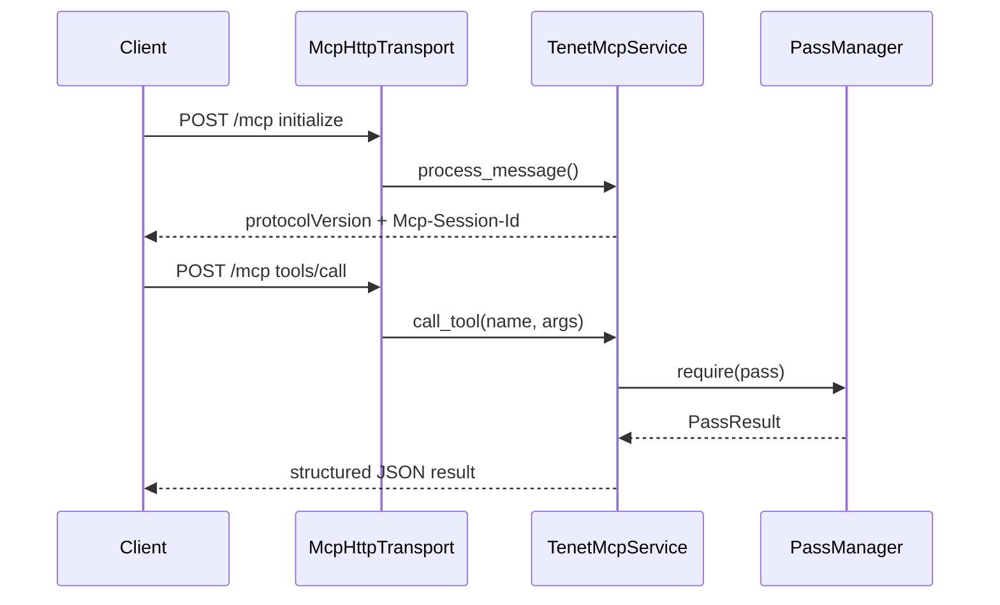
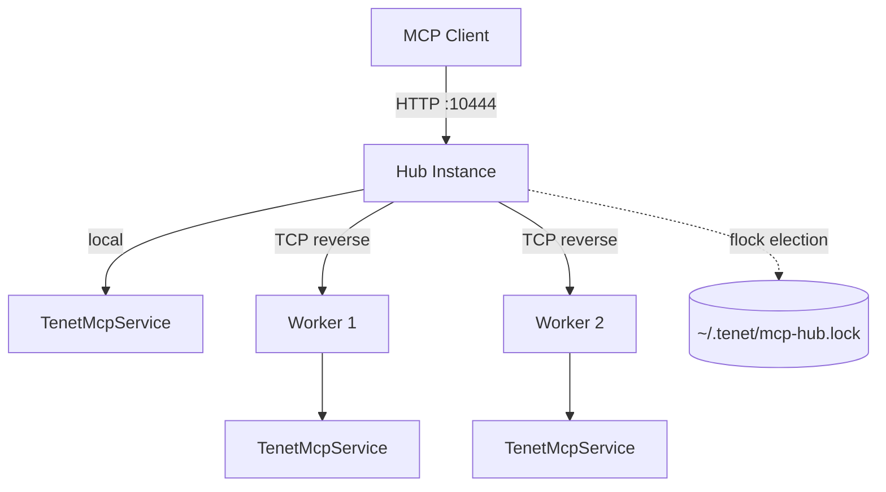

# Frontend / Service 层

这一层负责把 tenet 的核心能力暴露成"人能用、脚本能调、AI 能接"的入口。它本身不实现分析算法，而是通过 `TenetService` 统一访问 Core 与 Analysis 的结果。`TenetService` 的详细职责见 [`ARCHITECTURE.md` — Service Layer](ARCHITECTURE.md#service-layer)。

## 入口总览

| 入口 | 文件 | 触发方式 | 适用场景 |
|------|------|----------|----------|
| GUI | `src/gui/` | 默认（macOS 且启用 GUI） | 图形化浏览、大 trace 交互分析 |
| TUI | `src/tui/` | `--tui` | 终端环境、远程 SSH |
| CLI 批处理 | `src/cli_options.cpp` + `src/batch_analysis.cpp` | 任意分析选项 | 批量分析、导出、脚本化 |
| RPC | `src/io/rpc_server.cpp` | `--rpc [path]` | 本地工具经 Unix socket 接入 |
| MCP stdio | `src/io/mcp/` | `--mcp` | AI 客户端通过子进程 stdio 接入 |
| MCP HTTP | `src/io/mcp/` | `--mcp-http [host:port]` | 远程 / GUI 宿主 / 无 stdio 场景 |
| MCP Hub | `src/io/mcp/mcp_hub.*` | `--mcp-hub [host:port]` | 多实例统一入口，自动 failover |
| WS | `src/ws/` | `--ws-port <port>` | 高性能二进制 WebSocket，面向 Web/Electron 前端 |
| Streaming | `src/io/streaming_index.*` | `--streaming` | 边录制边索引边分析 |

```mermaid
flowchart TD
    A[main.cpp] --> B{has_analysis_option?}
    B -- yes --> C[run_batch_analysis]
    B -- no --> S[TenetService]
    S --> D{--tui or no GUI?}
    D -- no --> E[GuiApp]
    D -- yes --> F[TuiApp]
    C --> G{service mode?}
    G -- --rpc --> H[TenetRpcService]
    G -- --mcp --> I[TenetMcpService stdio]
    G -- --mcp-http --> J[TenetMcpService HTTP]
    G -- --mcp-hub --> M{Hub election}
    M -- win --> N[Hub: listen on 10444]
    M -- lose --> O[Worker: reverse-connect to Hub]
    C --> K{--streaming?}
    K -- yes --> L[StreamingIndex]
    S --> P{--ws-port?}
    P -- yes --> Q[TenetWSService]
```

## GUI

### 组成

- `gui_app.h`：GuiApp 成员、状态与渲染入口声明。
- `gui_app.mm`：SDL3 + Metal + ImGui 生命周期、窗口与主循环。
- `panels_*.cpp`（约 30 个翻译单元）：每个功能面板独立成文件，其中大部分是**参数驱动型 Pass 的专属悬浮窗口**（见下）。
- `navigation.cpp` / `popups.cpp` / `gui_settings.cpp`：导航、弹窗、设置与持久化。

### 与 TenetService 的关系

`GuiApp` 的唯一构造参数是 `TenetService&`。导航（光标跳转、前进/后退历史）、书签管理、指令行获取和 pass 运行均委托给 TenetService。GUI 自身保留独立的异步分析线程和渲染缓存（纹理、布局尺寸等），这些是 UI 侧特有的关注点，不属于共享状态。

### 核心特性

- 多面板：指令、寄存器、内存、调用栈、函数、字符串、线程、CFG、分析结果等。
- 浏览器式导航历史（由 TenetService 管理状态，GUI 驱动渲染）。
- 右键上下文菜单触发污点、切片、导出 CFG、设断点等动作。
- 启动后可异步预热核心 pass，不阻塞 UI。
- 关闭时走异步 shutdown 流程，先取消分析、再安全回收。

### Analysis 面板：无参数 Pass 的统一控制台

`render_analysis_panel()`（`panels_analysis.cpp`）是一个按 `PassCategory`（Structure / Taint / Crypto·Pattern / Memory·String / ObjC·Platform API / Profile·Trace / Misc）分组的**扁平 pass 列表**，遍历 `tenet::pass_catalog()` 渲染：

- 每行显示状态图标（NotRun / Running / Completed / Failed）、显示名、以及 `summarize_pass_result()` 生成的一句话摘要。
- Running 态显示进度条、百分比与实时 progress message，可单独 Cancel；顶部 Banner 提供 “Stop All”。
- Completed 态提供 “Rerun”（强制丢缓存重跑）；Failed 态提供重试。
- 该面板只负责**无参数或参数已内置**的 pass（即直接 `PassManager::require()` 即可运行的那一类）。

### 参数驱动型 Pass：独立悬浮窗口

需要用户先输入查询参数（模式串、地址范围、YARA 规则等）的 pass，**不再共用 Analysis 面板**，而是各自拥有独立窗口，自带输入表单 + 结果表格 + 右键跳转：

| 窗口标题 | 文件 | 对应 pass / 功能 |
|----------|------|------------------|
| Memory Search | `panels_mem_search.cpp` | `mem_search`（含原 `literal_search` 的精确值检索） |
| YARA Memory Scan | `panels_yara_mem_scan.cpp` | `yara_mem_scan` |
| Window Stats | `panels_window_stats.cpp` | `window_stats` |
| Dataflow Graph | `panels_dataflow_graph.cpp` | `dataflow_graph` |
| Register Timeline | `panels_reg_timeline.cpp` | `reg_timeline` |
| Trace Diff | `panels_trace_diff.cpp` | `trace_diff` |
| Trace Fold | `panels_trace_fold.cpp` | `trace_fold` |
| Memory Snapshots | `panels_memory_snapshot.cpp` | `memory_snapshot` |
| Call Context | `panels_call_context.cpp` | `call_context` |
| VM Abstract / VM Workspace | `panels_vm_abstract.cpp` | `vm_abstract`（独立悬浮工作区，含 dispatcher/handler 可视化） |

其余高层语义结果（Call Graph、CFG、Constants、Entropy、Loop Semantics、Algorithm Summary、ObjC Messages/Crypto、API Intercepts、Patterns、DWARF 符号信息）也各自拥有独立窗口，但多数无需前置参数输入，展示的是 `PassManager::require()` 的直接结果。

### GUI 与 Analysis 的关系

- 即时显示（比如当前行、寄存器、Hex Dump）通过 `TenetService` 的行缓存和底层 `RegisterFile` / `MemoryModel` / `InstructionDecoder` 获取。
- 高层结果（比如 CFG、污点、函数列表）通过 `TenetService::run_pass()` 触发，最终委托 `PassManager::require()`。
- 每个独立窗口自行管理"是否已运行 / 参数是否变化 / 是否需要重跑"的状态，不经过 Analysis 面板的统一列表。

## TUI

### 组成

- `tui_app.h/.cpp`：主循环、状态、键盘绑定、面板切换、`wire_pass_result()`（把 `PassResult` 分发进 `TuiContext` 的各个结果指针）。
- `tui/tui_context.h`：面板间共享状态，除导航/寄存器/内存引用外，还持有 GUI 侧全部 ~20 个 pass 结果指针（`cfg_result`、`pattern_result`、`vm_abstract_result` 等），以及 `run_pass_fn` 回调（供面板发起 pass 运行请求而无需直接持有 `PassManager`）。
- `tui/panels/`：寄存器、内存、调用栈、函数、字符串、线程、断点等面板。
- `tui/panels/results_panel.h/.cpp`：**Analysis Results 面板**（详见下）。
- `hex_dump_view.*`：终端 Hex Dump 视图。
- `key_bindings.h`：按键绑定与命令分发。

### 与 TenetService 的关系

`TuiApp` 的唯一构造参数是 `TenetService&`。先前 TUI 自行维护的 `pass_manager_` 和 `row_cache_` 已移除，统一由 TenetService 提供。导航、书签、行获取和 pass 管理全部委托给 TenetService，TUI 只负责终端渲染和键盘事件处理。

### 核心特性

- 与 GUI 共享 `InstructionRow` 模型和同一套 `PassManager` / `pass_catalog()`（均由 TenetService 管理）。
- 支持 Goto、搜索、书签、断点、污点跳转、XRef 跳转。
- 适合无图形环境下的长时间分析（远程 SSH）。

### Analysis Results 面板：TUI 版统一控制台

GUI 用 ~20 个独立悬浮窗口展示各 pass 结果；终端空间有限，无法照搬多窗口模式。TUI 改为一个**两级结果浏览器**（`A` 键呼出，`ResultsPanel`）：

- **Level 0（目录视图）**：遍历 `tenet::pass_catalog()`，逐行显示状态图标（NotRun `·` / Running `▶` / Completed `✓` / Failed `×`）、显示名、`summarize_pass_result()` 摘要或运行进度。`Enter` 对 NotRun/Failed 的 pass 发起运行（经 `ctx_.run_pass()` → `TuiApp::run_pass_by_name()`），对 Completed 的 pass 直接进入详情；`R` 强制重跑。
- **Level 1（详情视图）**：由 `build_result_entries()` 把当前 pass 的结构化结果（CFG blocks、pattern matches、objc messages、mem_search hits、vm_abstract handlers 等）统一适配成 `ResultEntry{text, jump_inst_id, jumpable}` 列表；`Enter` 对可跳转条目导航指令游标到对应位置，`Esc` 返回目录视图。
- `run_pass_by_name()` 成功后自动调用 `results_panel_->focus_pass(name)` 直接跳进详情视图（`:pass <name>` 命令同样受益），无需用户手动二次导航。
- 这一设计让**每个 catalog pass 在 TUI 里都有真实可浏览的结果**，而不是过去仅有的 `last_pass_status_` 单行摘要；同时只需一份 `build_result_entries()` 实现即可覆盖所有 pass，避免像 GUI 那样为每个 pass 单开一个面板类。
- `:pass <name>` / `:passes` / `:analyze` 命令与 `A` 键共享同一套 `pass_registry` 注册与摘要逻辑，保证 TUI 命令行路径与面板路径结果一致。

## WebSocket 服务

`TenetWSService`（`src/ws/`）是面向 Web/Electron 前端的高性能二进制服务，使用 uWebSockets 做传输、FlatBuffers 做序列化。

### 组成

- `tenet_ws_service.h/.cpp`：WS 服务生命周期（start/stop）、uWS 事件循环、消息分发、观察者回调。
- `ws_handlers_hotpath.cpp`：高频操作——FetchRows、GetRegs、ReadMemory。
- `ws_handlers_nav.cpp`：导航、书签、trace 信息、搜索。
- `ws_handlers_analysis.cpp`：pass 管理、调用栈、内存写历史、函数列表等数据查询。
- `schema/tenet_ws.fbs`：FlatBuffers 协议定义（40+ 消息类型）。

### 协议设计

所有消息包装在 Envelope 中：`{msg_id, type: MessageType, payload: [ubyte]}`。msg_id 由客户端分配，服务端原样返回；服务端主动推送事件时 msg_id 为 0。payload 里装各 MessageType 对应的 FlatBuffers 表。

### 线程模型

uWS 事件循环在独立线程运行。由于 TenetService 不是线程安全的，所有 handler 均在事件循环线程上同步执行（包括重操作如 RunPass）。观察者回调（on_navigation、on_pass_completed、on_bookmark_changed）可能从任意线程触发，通过 `uWS::Loop::defer()` 安全地转回事件循环线程。

### 与 TenetService 的关系

`TenetWSService` 实现 `TenetServiceObserver` 接口，通过 `TenetService&` 共享全部核心对象。它与 GUI、TUI、MCP 是并列的前端入口，不重复实现分析逻辑。

### 开启方式

`--ws-port <port>` 启动 WS 服务，可与 GUI、TUI、MCP 等其他前端同时运行。port=0 时由操作系统分配端口。CMake 选项 `TENET_ENABLE_WS=ON/OFF` 控制是否编译 WS 服务（默认 ON）。

## CLI 批处理

CLI 由两部分组成：

- `CliOptions`：把参数解析成结构化配置。
- `run_batch_analysis()`：把配置映射到 pass 注册与结果序列化。

### CLI 的能力分组

| 类别 | 代表参数 |
|------|----------|
| 基础浏览 | `-c`, `-n`, `-s`, `-r`, `-m`, `-i` |
| 结构恢复 | `--export-cfg`, `--call-graph`, `--symbol-annotation` |
| 数据流 | `--taint*`, `--backward-taint*`, `--critical-path`, `--dataflow-graph*` |
| 内存与字符串 | `--memread`, `--mem-history`, `--strings`, `--memory-strings`, `--memory-snapshot*`, `--mem-search*`（`--literal-search*` 为弃用别名）, `--entropy` |
| 算法与语义 | `--pattern`, `--constants*`, `--loop-semantics`, `--algorithm-summary`, `--objc*`, `--syscall-intercept*`, `--taint-source-annotation`, `--vm-abstract` |
| 轨迹与性能 | `--trace-diff`, `--trace-fold*`, `--reg-timeline*`, `--window-stats*`, `--yara-mem-scan*`, `--thread-filter` |
| 运行模式 | `--rpc`, `--mcp`, `--mcp-http`, `--mcp-hub`, `--ws-port`, `--streaming`, `--stats` |
| 调试 / 管理 | `--run-pass`, `--list-passes`, `--index-build`, `--cache-list`, `--cache-delete`, `--no-parallel-scan` |

### CLI 的特点

- 多个能力可以组合。
- 输出以 JSON / DOT / 文本为主，适合脚本消费。
- 日志始终走 stderr，避免污染 stdout 的结构化输出。

## RPC 服务

`TenetRpcService` 提供本地 JSON-RPC over Unix socket。

### 特点

- 适合本地工具链接入。
- 默认是单连接串行处理。
- 通过 `TenetService` 与 GUI / CLI 共用相同的 reader / index / regfile / memory / pass manager。

### 适合的场景

- 本地 Python / shell / editor 插件想调用 tenet。
- 不需要完整 MCP 语义，只要本地 JSON-RPC。

## MCP 服务

MCP 是 tenet 面向 AI 的核心服务模式，当前实现位于 `src/io/mcp/`。

### 当前实现特征

- 协议版本：**MCP 2025-03-26**
- 传输模式：
  - stdio（`--mcp`）
  - Streamable HTTP（`--mcp-http`）
  - Hub 模式（`--mcp-hub`）：多实例统一入口，固定端口 10444，自动 failover
- 工具总数：**51 个**（`mcp_tools_core.cpp` 12 + `mcp_tools_ai.cpp` 9 + `mcp_tools_analysis.cpp` 25 + `mcp_server.cpp` 里直接注册的 `set_image_base` 1 + Hub 模式注册的 `list_instances` 1 + session 模式注册的 `select_instance` 1）
- 注册入口：`register_all_tools()`，Hub 模式额外注册 `list_instances` / `select_instance`
- 工具分成 10 组（Hub 模式额外 1-2 个）：
  - `register_trace_tools()`
  - `register_query_tools()`
  - `register_taint_tools()`
  - `register_graph_tools()`
  - `register_analysis_tools()`
  - `register_search_tools()`
  - `register_pass_tools()`
  - `register_evidence_tools()`
  - `register_batch_tools()`
  - `register_hypothesis_tools()`

### MCP 工具能力分布

| 类型 | 代表工具 | 用途 |
|------|----------|------|
| trace / query | `trace_info`, `disasm`, `get_regs`, `memread`, `mem_write_history`, `search_pc` | 基础 trace 查询 |
| taint / graph | `taint_forward`, `taint_backward`, `critical_path`, `cfg_export`, `call_graph`, `dataflow_graph` | 数据流与图恢复 |
| analysis | `pattern_scan`, `strings_scan`, `constants_scan`, `loop_semantics`, `algorithm_summary`, `objc_messages`, `memory_snapshot` | 高层语义分析 |
| search / pass | `mem_search`, `reg_timeline`, `call_context`, `window_stats`, `entropy_analysis`, `functions`, `loops`, `xref`, `trace_diff`, `find_function` | 搜索、摘要、按名发现 pass（`literal_search` 已合并进 `mem_search`，`producer_chain` 已被 `backward_taint` 取代，不再作为独立 MCP 工具）|
| AI tools | `verify_evidence`, `batch_query`, `hypothesis_*` | 证据校验、批量查询、假设账本 |

### MCP HTTP 模式补充

`McpHttpTransport` 提供：

- `POST /mcp`：发送 JSON-RPC 请求
- `GET /health`：活性探针
- Basic Auth（可选）
- Session ID 校验
- 每个客户端一个 handler 线程



### MCP Hub 模式（多实例协调）

`--mcp-hub [host:port]` 启用 Hub 架构，解决多 tenet 实例端口管理问题。实现位于 `src/io/mcp/mcp_hub.h/.cpp`。

**架构**：第一个启动的 tenet 实例通过 `flock` 选举成为 Hub，在固定端口（默认 10444）监听；后续实例自动成为 Worker，通过反向 TCP 连接到 Hub，不监听任何端口。MCP 客户端只需连接 Hub 的单一端口即可访问所有实例。

**两种工作模式**：

- **无 Session 模式（默认）**：每个工具调用必须显式指定 `instance` 参数，`select_instance` 工具不注册。这是默认模式，因为不同 AI 工具对会话管理实现各异，共享 session 可能导致路由混乱。
- **Session 模式（`--mcp-hub-session` 开启）**：`select_instance` 工具设置会话默认实例，后续调用可省略 `instance` 参数。适合单用户、单会话场景。

**Hub 新增工具**：

- `list_instances`：列出所有已注册的实例（Hub + Workers），返回实例 ID、PID、trace 文件路径等信息。始终注册。
- `select_instance`：设置当前会话的默认实例。仅 Session 模式注册。

**工具 schema 注入**：Hub 模式下，所有现有工具的 schema 自动注入 `instance` 参数（无 Session 模式下为 required，Session 模式下为 optional）。

**请求转发**：Hub 收到 `tools/call` 请求后，从参数中提取 `instance`，移除该参数后将剩余 JSON-RPC 转发给目标 Worker。Hub 自身的实例请求在本地处理。

**自动 failover**：Hub 通过 `flock(LOCK_EX | LOCK_NB)` 竿选。进程崩溃时内核自动释放锁，其他实例的选举线程检测到锁可用后重新竞选，新 Hub 在秒级内恢复服务。Worker 通过心跳（10s 间隔，90s 超时）检测 Hub 存活，Hub 崩溃后 Worker 自动重连并触发选举。

**协议复用**：Hub 监听单一端口，通过 `MSG_PEEK` 探测首字节区分连接类型——以 `WORKER/1.0\n` 开头的是 Worker 反向连接（newline-delimited JSON-RPC over TCP），否则视为 MCP 客户端的 HTTP 请求。



**CLI 用法**：

```bash
# 第一个实例成为 Hub
./tenet --mcp-hub trace1.bin
# 后续实例自动成为 Worker
./tenet --mcp-hub trace2.bin
# 指定 Hub 端口
./tenet --mcp-hub 0.0.0.0:10444 trace.bin
# 启用 Session 模式
./tenet --mcp-hub --mcp-hub-session trace.bin
# 指定实例名称
./tenet --mcp-hub --mcp-hub-name "app-analysis" trace.bin
```

**GUI 集成**：GUI 的 MCP Server 设置页自动尝试 Hub 模式（端口 10444），失败则降级为 Worker，再降级为独立 HTTP。状态指示器显示 Hub（绿）、Worker（蓝）、Standalone（绿）、Stopped（灰）四种状态。

### AI 专用能力

MCP 不只是把 CLI 包了一层，而是额外提供了：

- `verify_evidence`：把 AI 的结论回到 trace 上做寄存器 / 内存 / 指令级验证
- `batch_query`：合并多次工具查询，减少往返
- `hypothesis_*`：把“猜测 → 补证据 → 下结论”建模成显式状态机

这让 AI 使用 tenet 时更像“受约束的分析员”，而不是随意生成文本摘要。

### MCP 请求生命周期日志

`mcp_server.cpp` 用 `LOG_*_M(log::Module::Mcp, ...)` 记录每个请求的完整生命周期，便于排查 AI 客户端的调用行为：

- 启动：`service initialized: N tools registered (M write tools)`、`tenet-mcp server vX starting (...)`
- 握手：`initialize: client=... version=...`、`client initialized (handshake complete)`
- 每次 `tools/call`：分配自增序号 `seq`，依次打印
  - Debug 级：`tools/call #seq name args={...}`（请求）
  - Info 级：`tools/call #seq name OK  N.Nms  result=NB`（成功）
  - Info 级：`tools/call #seq name PENDING  N.Nms  pass='...' progress=N%`（`PassNotReady`，异步 pass 未就绪）
  - Warn 级：`tools/call #seq name FAILED  N.Nms  error=...`（异常）
- 高频/低价值事件（`tools/list`、`ping`、stdio 收发原文）降级为 Debug/Trace，避免淹没关键日志。

## 日志系统

tenet 的日志（`src/common/logger.h`，纯头文件）在 Level 之外叠加了 **Module** 维度，用于聚焦排查某个子系统：

- **Level**：`Off/Error/Warn/Info/Debug/Trace`，由环境变量 `TENET_LOG` 控制（`0-4` 或名字）。
- **Module**：`General/Mcp/Io/Core/Analysis/Gui/Tui/Batch`（8 个，`Module::Count` 为哨兵），由环境变量 `TENET_LOG_MODULES=mcp,io` 控制（逗号分隔白名单；不设置 = 全部模块开启，向后兼容，不给现有用户增加噪音）。
- 新代码推荐使用 `LOG_INFO_M(Module::Mcp, "...")` 等带模块标签的宏；旧代码不加标签等价于 `Module::General`，行为不变。
- **GUI Output 面板**（`panels_log.cpp`，即 `render_log_panel()`）始终接收全部模块的日志，`TENET_LOG_MODULES` 只影响 stderr 输出；面板自身提供独立的 Level 下拉 + Module 多选下拉（复选框，位掩码）+ 文本子串过滤，三者可组合，互不影响 stderr 侧的过滤逻辑。
- Output 面板对 `Module::General` 的消息不显示模块 tag（与引入模块系统之前的输出保持视觉一致）。

## Streaming 模式

`--streaming` 通过 `StreamingIndex` tail 一个正在增长的 trace 文件。

### 适用场景

- 一边录制 trace，一边观察索引进度
- 为后续分析提前预热索引
- 在录制尚未完成时做粗粒度统计

### 行为

- 周期性轮询文件增长
- 按 batch 刷新新增记录到索引
- 直到 idle timeout 或收到中断后结束

## Frontend / Service 层设计准则

1. **不重复实现分析逻辑**：前端只通过 TenetService 触发 pass，不复写算法。
2. **保持结构化输出**：CLI / RPC / MCP 优先返回 JSON / DOT / 文本摘要，而不是不可解析日志。
3. **共享核心对象**：所有前端通过同一个 `TenetService` 实例共享 reader / index / regfile / memory / pass manager。
4. **入口语义清晰**：GUI/TUI 偏交互；CLI 偏批处理；RPC/MCP 偏集成；streaming 偏实时索引。

## 继续阅读

- 想理解这些入口背后的分析实现：看 [`analysis-layer.md`](analysis-layer.md)
- 想知道怎样把一个新 pass 接进 CLI / MCP：看 [`pass-cookbook.md`](pass-cookbook.md)
- 想理解寄存器 / 内存 / 解码如何提供给入口层：看 [`core-layer.md`](core-layer.md)
- 想理解整体装配：看 [`ARCHITECTURE.md`](ARCHITECTURE.md)
