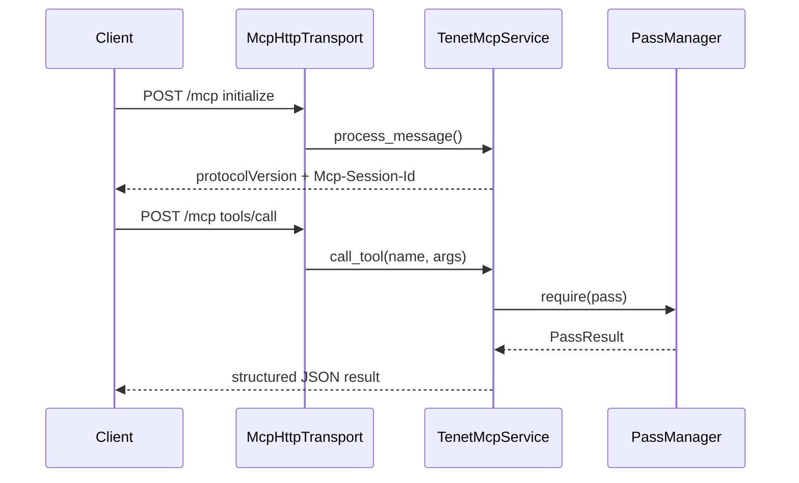

# UI / Service 层

这一层负责把 tenet 的核心能力暴露成“人能用、脚本能调、AI 能接”的入口。它本身不实现分析算法，而是复用 Core 与 Analysis 的结果。

## 入口总览

| 入口 | 文件 | 触发方式 | 适用场景 |
|------|------|----------|----------|
| GUI | `src/gui/` | 默认（macOS 且启用 GUI） | 图形化浏览、大 trace 交互分析 |
| TUI | `src/tui/` | `--tui` | 终端环境、远程 SSH |
| CLI 批处理 | `src/cli_options.cpp` + `src/batch_analysis.cpp` | 任意分析选项 | 批量分析、导出、脚本化 |
| RPC | `src/io/rpc_server.cpp` | `--rpc [path]` | 本地工具经 Unix socket 接入 |
| MCP stdio | `src/io/mcp/` | `--mcp` | AI 客户端通过子进程 stdio 接入 |
| MCP HTTP | `src/io/mcp/` | `--mcp-http [host:port]` | 远程 / GUI 宿主 / 无 stdio 场景 |
| Streaming | `src/io/streaming_index.*` | `--streaming` | 边录制边索引边分析 |

```mermaid
flowchart TD
    A[main.cpp] --> B{has_analysis_option?}
    B -- yes --> C[run_batch_analysis]
    B -- no --> D{--tui or no GUI?}
    D -- no --> E[GuiApp]
    D -- yes --> F[TuiApp]
    C --> G{service mode?}
    G -- --rpc --> H[TenetRpcService]
    G -- --mcp --> I[TenetMcpService stdio]
    G -- --mcp-http --> J[TenetMcpService HTTP]
    C --> K{--streaming?}
    K -- yes --> L[StreamingIndex]
```

## GUI

### 组成

- `gui_app.h`：GuiApp 成员、状态与渲染入口声明。
- `gui_app.mm`：SDL3 + Metal + ImGui 生命周期、窗口与主循环。
- `panels_*.cpp`：把不同功能面板拆到独立翻译单元。
- `navigation.cpp` / `popups.cpp` / `gui_settings.cpp`：导航、弹窗、设置与持久化。

### 核心特性

- 多面板：指令、寄存器、内存、调用栈、函数、字符串、线程、CFG、分析结果等。
- 浏览器式导航历史。
- 右键上下文菜单触发污点、切片、导出 CFG、设断点等动作。
- 启动后可异步预热核心 pass，不阻塞 UI。
- 关闭时走异步 shutdown 流程，先取消分析、再安全回收。

### GUI 与 Analysis 的关系

- 即时显示（比如当前行、寄存器、Hex Dump）直接走 `RegisterFile` / `MemoryModel` / `InstructionDecoder`。
- 高层结果（比如 CFG、污点、函数列表）全部通过 `PassManager::require()` 获取。

## TUI

### 组成

- `tui_app.h/.cpp`：主循环、状态、键盘绑定、面板切换。
- `tui/panels/`：寄存器、内存、调用栈、函数、字符串、线程等面板。
- `hex_dump_view.*`：终端 Hex Dump 视图。
- `key_bindings.h`：按键绑定与命令分发。

### 核心特性

- 与 GUI 共享 `InstructionRow` 模型。
- 支持 Goto、搜索、书签、断点、污点跳转、XRef 跳转。
- 适合无图形环境下的长时间分析。

## CLI 批处理

CLI 由两部分组成：

- `CliOptions`：把参数解析成结构化配置。
- `run_batch_analysis()`：把配置映射到 pass 注册与结果序列化。

### CLI 的能力分组

| 类别 | 代表参数 |
|------|----------|
| 基础浏览 | `-c`, `-n`, `-s`, `-r`, `-m`, `-i` |
| 结构恢复 | `--export-cfg`, `--call-graph`, `--symbol-annotation` |
| 数据流 | `--taint*`, `--backward-taint*`, `--critical-path`, `--dataflow-graph*`, `--producer-chain` |
| 内存与字符串 | `--memread`, `--mem-history`, `--strings`, `--memory-strings`, `--memory-snapshot*`, `--mem-search*`, `--literal-search*`, `--entropy` |
| 算法与语义 | `--pattern`, `--constants*`, `--loop-semantics`, `--algorithm-summary`, `--objc*`, `--syscall-intercept*`, `--taint-source-annotation`, `--vm-abstract` |
| 轨迹与性能 | `--trace-diff`, `--trace-fold*`, `--reg-timeline*`, `--window-stats*`, `--cache-sim*`, `--yara-mem-scan*`, `--thread-filter` |
| 运行模式 | `--rpc`, `--mcp`, `--mcp-http`, `--streaming`, `--stats` |
| 调试 / 管理 | `--run-pass`, `--list-passes`, `--index-build`, `--cache-list`, `--cache-delete`, `--no-parallel-scan` |

### CLI 的特点

- 多个能力可以组合。
- 输出以 JSON / DOT / 文本为主，适合脚本消费。
- 日志始终走 stderr，避免污染 stdout 的结构化输出。

## RPC 服务

`TenetRpcService` 提供本地 JSON-RPC over Unix socket。

### 特点

- 适合本地工具链接入。
- 默认是单连接串行处理。
- 与 GUI / CLI 共用相同的 reader / index / regfile / memory / pass manager。

### 适合的场景

- 本地 Python / shell / editor 插件想调用 tenet。
- 不需要完整 MCP 语义，只要本地 JSON-RPC。

## MCP 服务

MCP 是 tenet 面向 AI 的核心服务模式，当前实现位于 `src/io/mcp/`。

### 当前实现特征

- 协议版本：**MCP 2025-03-26**
- 传输模式：
  - stdio（`--mcp`）
  - Streamable HTTP（`--mcp-http`）
- 工具总数：**46 个**
- 注册入口：`register_all_tools()`
- 工具分成 10 组：
  - `register_trace_tools()`
  - `register_query_tools()`
  - `register_taint_tools()`
  - `register_graph_tools()`
  - `register_analysis_tools()`
  - `register_search_tools()`
  - `register_pass_tools()`
  - `register_evidence_tools()`
  - `register_batch_tools()`
  - `register_hypothesis_tools()`

### MCP 工具能力分布

| 类型 | 代表工具 | 用途 |
|------|----------|------|
| trace / query | `trace_info`, `disasm`, `get_regs`, `memread`, `mem_write_history`, `search_pc` | 基础 trace 查询 |
| taint / graph | `taint_forward`, `taint_backward`, `critical_path`, `cfg_export`, `call_graph`, `dataflow_graph` | 数据流与图恢复 |
| analysis | `pattern_scan`, `strings_scan`, `constants_scan`, `loop_semantics`, `algorithm_summary`, `objc_messages`, `memory_snapshot` | 高层语义分析 |
| search / pass | `mem_search`, `reg_timeline`, `literal_search`, `producer_chain`, `call_context`, `window_stats`, `entropy_analysis`, `functions`, `loops`, `xref`, `trace_diff`, `find_function` | 搜索、摘要、按名发现 pass |
| AI tools | `verify_evidence`, `batch_query`, `hypothesis_*` | 证据校验、批量查询、假设账本 |

### MCP HTTP 模式补充

`McpHttpTransport` 提供：

- `POST /mcp`：发送 JSON-RPC 请求
- `GET /health`：活性探针
- Basic Auth（可选）
- Session ID 校验
- 每个客户端一个 handler 线程



### AI 专用能力

MCP 不只是把 CLI 包了一层，而是额外提供了：

- `verify_evidence`：把 AI 的结论回到 trace 上做寄存器 / 内存 / 指令级验证
- `batch_query`：合并多次工具查询，减少往返
- `hypothesis_*`：把“猜测 → 补证据 → 下结论”建模成显式状态机

这让 AI 使用 tenet 时更像“受约束的分析员”，而不是随意生成文本摘要。

## Streaming 模式

`--streaming` 通过 `StreamingIndex` tail 一个正在增长的 trace 文件。

### 适用场景

- 一边录制 trace，一边观察索引进度
- 为后续分析提前预热索引
- 在录制尚未完成时做粗粒度统计

### 行为

- 周期性轮询文件增长
- 按 batch 刷新新增记录到索引
- 直到 idle timeout 或收到中断后结束

## UI / Service 层设计准则

1. **不重复实现分析逻辑**：入口层只触发 pass，不复写算法。
2. **保持结构化输出**：CLI / RPC / MCP 优先返回 JSON / DOT / 文本摘要，而不是不可解析日志。
3. **共享核心对象**：同一个服务实例里所有请求共享 reader / index / regfile / memory / pass manager。
4. **入口语义清晰**：GUI/TUI 偏交互；CLI 偏批处理；RPC/MCP 偏集成；streaming 偏实时索引。

## 继续阅读

- 想理解这些入口背后的分析实现：看 [`analysis-layer.md`](analysis-layer.md)
- 想知道怎样把一个新 pass 接进 CLI / MCP：看 [`pass-cookbook.md`](pass-cookbook.md)
- 想理解寄存器 / 内存 / 解码如何提供给入口层：看 [`core-layer.md`](core-layer.md)
- 想理解整体装配：看 [`ARCHITECTURE.md`](ARCHITECTURE.md)
