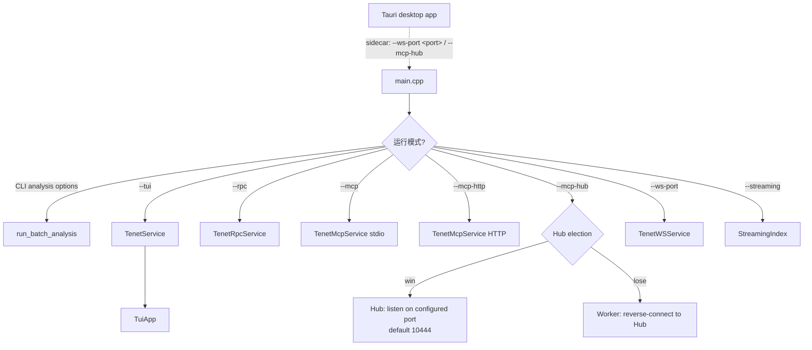
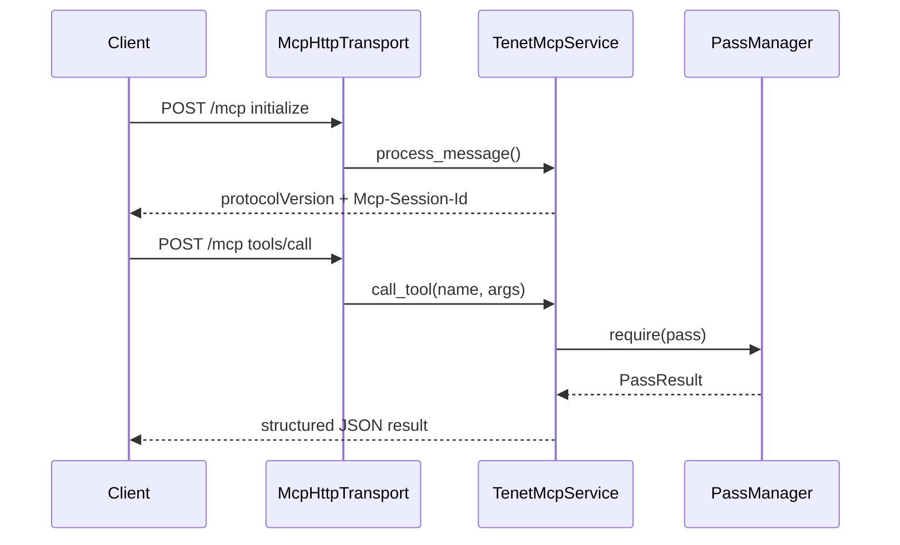
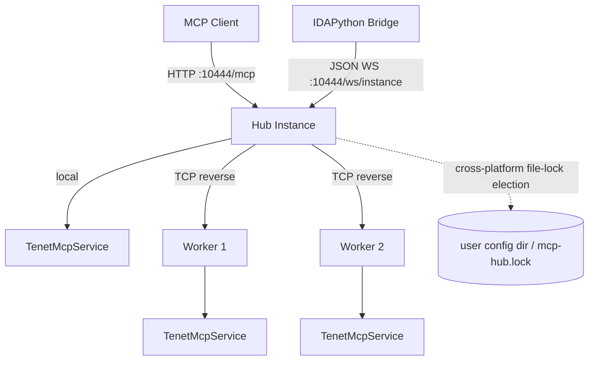

# Frontend / Service 层

这一层负责把 tenet 的核心能力暴露成"人能用、脚本能调、AI 能接"的入口。它本身不实现分析算法，而是通过 `TenetService` 统一访问 Core 与 Analysis 的结果。`TenetService` 的详细职责见 [`ARCHITECTURE.md` — Service Layer](ARCHITECTURE.md#service-layer)。

## 入口总览

| 入口 | 文件 | 触发方式 | 适用场景 |
|------|------|----------|----------|
| Tauri 前端 | `tools/tenet/web/` | 独立启动 Tauri 应用，通过 sidecar 拉起 `tenet` 子进程 | 图形化浏览、大 trace 交互分析 |
| TUI | `src/tui/` | `--tui` | 终端环境、远程 SSH |
| CLI 批处理 | `src/cli_options.cpp` + `src/batch_analysis.cpp` | 任意分析选项 | 批量分析、导出、脚本化 |
| RPC | `src/io/rpc_server.cpp` | `--rpc [[host:]port]` | TCP JSON-RPC；默认 loopback，可自定义 host |
| MCP stdio | `src/io/mcp/` | `--mcp` | AI 客户端通过子进程 stdio 接入 |
| MCP HTTP | `src/io/mcp/` | `--mcp-http [host:port]` | AI 客户端 / 远程 / 无 stdio 场景 |
| MCP Hub | `src/io/mcp/mcp_hub.*` | `--mcp-hub [host:port]` | AI 工具、IDA 插件等外部客户端的多实例统一入口 |
| WS | `src/ws/` | `--ws-port <port>` | 高性能二进制 WebSocket，面向 Tauri / Web 前端 |
| Streaming | `src/io/streaming_index.*` | `--streaming` | 边录制边索引边分析 |



## Tauri 前端（Web UI）

图形化体验由 `tools/tenet/web/` 下的独立 Tauri 桌面应用提供。Tauri 的 Rust shell 位于 `web/src-tauri/`，Web 前端位于 `web/src/`，使用 React + TypeScript；`web/src/layout/` 等目录实现窗口框架、侧边栏、标签页、时间线与对话框等交互组件。

### 进程与通信模型

1. 用户独立启动 Tauri 应用并选择 trace（可选 pass 预设 Minimal/Standard/Full/Custom）。
2. Rust shell 通过 Tauri sidecar 机制启动、监控和回收独立的 `tenet` 后端子进程。
3. Rust sidecar 以 `--ws-port <port> --progress-json <trace_path> --mcp-hub` 启动后端，同时开启 FlatBuffers WebSocket 服务和 MCP Hub。
4. 浏览器端 Web UI 仅连接 `ws://127.0.0.1:<port>`，所有浏览与分析请求都使用 uWebSockets + FlatBuffers 二进制协议；不存在 MCP HTTP fallback。并行启动的 MCP Hub 面向 AI 工具、IDAPython 插件等外部客户端，与 Web UI 渲染路径相互独立。
5. WS 握手成功后，前端按所选预设逐个发送 `RunPassReq`（Custom 预设同样生效），AnalysisPanel 中的 "Run Default" 按钮对应 `RunDefaultPassesReq`。

### 打开阶段的进度侧信道

WS 服务要到索引构建完成之后才启动，而首次打开大 trace 的 RocksDB 索引构建可达分钟级——这段窗口期前端无法通过 WS 获取进度。解决方案是 `--progress-json`：后端把每个 `ProgressManager` 任务更新以 `TENET-PROGRESS {json}` 行（100ms 节流）写到 stderr，Rust shell 解析后以 `backend-progress` 事件转发给 webview，loading 页据此渲染真实进度条（含索引扫描速度、compaction 阶段）。前端等待超时模型为“绝对上限 10 分钟 + 90 秒无进度窗口”，只要进度事件持续就不放弃。

### 推送事件与轮询的分工

服务端主动推送（msg_id=0）中，`EvtNavigation` 用于跨客户端导航同步，`EvtPassCompleted` 驱动 pass 结束时的即时刷新（目录状态 + 任务快照补拉），`EvtBookmarkChanged` 驱动书签集合的跨客户端同步。运行中百分比由前端的**全局任务监视器**（`web/src/store/taskStore.ts`，随主窗口 Shell 启动）以 500ms 轮询 `GetProgress` 获取，它是全量任务快照的单一数据源，供 AnalysisPanel（pass 进度 + 非 pass 后台任务）与 StatusBar（运行中任务指示器，点击跳转 Analysis 面板）共享消费。pass 结束事件同时写入前端统一日志流（LogPanel 可见，`backendLog.appendUiLog`）；失败时弹全局 toast，成功只记日志避免刷屏。WS 不可用时前端降级 mock 数据，但 StatusBar 实时显示警示 + toast 提醒（live/mock 状态订阅自 service 层，不再静默切换）。弹出面板子窗口通过 URL 参数 `?panel=<id>&ws=<port>` 继承正确的后端端口（多 trace 并行时为 9090+n）。

Web 前端的 Log 面板聚合两类日志源：Tauri `backend-log` 事件转发的后端（sidecar）stdout/stderr，以及 UI 层事件（pass 完成/失败、启动失败等）；支持级别过滤、关键字过滤、跟随/暂停滚动（手动上滚自动暂停）与清空缓冲。

Tauri 是 `tenet` 进程之外的客户端，而不是 `main.cpp` 中的 UI 分支。`tenet` 可执行文件只负责 trace 数据、状态重建、分析 pass 和 RPC / MCP / WS 服务，不创建窗口，也不执行任何图形渲染。

### 职责边界

- 多面板浏览、CFG 与调用图可视化、寄存器/内存查看、pass 参数输入和结果展示均由 Tauri / Web 前端实现。
- 后端通过 `TenetService` 和 `PassManager` 维护统一的导航与分析语义；`src/ws/` 向 Web UI 暴露结构化接口，`src/io/mcp/` 则向 AI 工具、IDA 插件等外部客户端提供独立接入能力。
- 前端不复制分析算法；新增图形交互应修改 `tools/tenet/web/`，Web UI 所需的新后端数据应扩展 WS 接口。

原生 ImGui + Metal + SDL3 GUI、整个 `src/gui/` 目录及 `TENET_ENABLE_GUI` CMake 选项均已完全移除。历史上的多面板、CFG、寄存器/内存等能力正在 Tauri 前端中重新实现；具体交互设计不在本文档范围内，以 `tools/tenet/web/` 中的实现为准。

### 跨平台状态

Tauri 前端与 `tenet` 后端面向 Windows、Linux、macOS 的 x86_64 / arm64 构建。Windows 和 Linux 的 sidecar 准备脚本已提供；但 Windows 上 `TENET_ENABLE_WS` 当前默认关闭，而浏览器端 Web UI 仅实现 FlatBuffers WebSocket 通道，因此 Windows Web UI 暂时无法连接后端获取实时数据。这是需要后续补齐 Windows WS 支持的已知限制，不存在 MCP HTTP 回退。Windows / Linux CI 正在持续运行，尚未在真实物理机上完成完整人工验收。

## TUI

### 组成

- `tui_app.h/.cpp`：主循环、状态、键盘绑定、面板切换、`wire_pass_result()`（把 `PassResult` 分发进 `TuiContext` 的各个结果指针）。
- `tui/tui_context.h`：面板间共享状态，除导航/寄存器/内存引用外，还持有各类 pass 结果指针（`cfg_result`、`pattern_result`、`vm_abstract_result` 等），以及 `run_pass_fn` 回调（供面板发起 pass 运行请求而无需直接持有 `PassManager`）。
- `tui/panels/`：寄存器、内存、调用栈、函数、字符串、线程、断点等面板。
- `tui/panels/results_panel.h/.cpp`：**Analysis Results 面板**（详见下）。
- `hex_dump_view.*`：终端 Hex Dump 视图。
- `key_bindings.h`：按键绑定与命令分发。

### 与 TenetService 的关系

`TuiApp` 的唯一构造参数是 `TenetService&`。先前 TUI 自行维护的 `pass_manager_` 和 `row_cache_` 已移除，统一由 TenetService 提供。导航、书签、行获取和 pass 管理全部委托给 TenetService，TUI 只负责终端渲染和键盘事件处理。

### 核心特性

- 使用 `InstructionRow` 模型和由 TenetService 管理的同一套 `PassManager` / `pass_catalog()`。
- 支持 Goto、搜索、书签、断点、污点跳转、XRef 跳转。
- 适合无图形环境下的长时间分析（远程 SSH）。

### Analysis Results 面板：TUI 版统一控制台

原生 GUI 时代曾用 ~20 个独立悬浮窗口展示各 pass 结果，现由 Tauri 前端另行实现；终端空间有限，TUI 使用一个**两级结果浏览器**（`A` 键呼出，`ResultsPanel`）：

- **Level 0（目录视图）**：遍历 `tenet::pass_catalog()`，逐行显示状态图标（NotRun `·` / Running `▶` / Completed `✓` / Failed `×`）、显示名、`summarize_pass_result()` 摘要或运行进度。`Enter` 对 NotRun/Failed 的 pass 发起运行（经 `ctx_.run_pass()` → `TuiApp::run_pass_by_name()`），对 Completed 的 pass 直接进入详情；`R` 强制重跑。
- **Level 1（详情视图）**：由 `build_result_entries()` 把当前 pass 的结构化结果（CFG blocks、pattern matches、objc messages、mem_search hits、vm_abstract handlers 等）统一适配成 `ResultEntry{text, jump_inst_id, jumpable}` 列表；`Enter` 对可跳转条目导航指令游标到对应位置，`Esc` 返回目录视图。
- `run_pass_by_name()` 成功后自动调用 `results_panel_->focus_pass(name)` 直接跳进详情视图（`:pass <name>` 命令同样受益），无需用户手动二次导航。
- 这一设计让**每个 catalog pass 在 TUI 里都有真实可浏览的结果**，而不是过去仅有的 `last_pass_status_` 单行摘要；同时只需一份 `build_result_entries()` 实现即可覆盖所有 pass，避免为每个 pass 单独维护一个 TUI 面板类。
- `:pass <name>` / `:passes` / `:analyze` 命令与 `A` 键共享同一套 `pass_registry` 注册与摘要逻辑，保证 TUI 命令行路径与面板路径结果一致。

## WebSocket 服务

`TenetWSService`（`src/ws/`）是面向 Tauri / Web 前端的高性能二进制服务，使用 uWebSockets 做传输、FlatBuffers 做序列化。

### 组成

- `tenet_ws_service.h/.cpp`：WS 服务生命周期（start/stop）、uWS 事件循环、消息分发、观察者回调。
- `ws_handlers_hotpath.cpp`：高频操作——FetchRows、GetRegs、ReadMemory。
- `ws_handlers_nav.cpp`：导航、书签、trace 信息、搜索。
- `ws_handlers_analysis.cpp`：pass 管理、调用栈、内存写历史、函数列表等数据查询。
- `schema/tenet_ws.fbs`：FlatBuffers 协议定义（40+ 消息类型）。

### 协议设计

所有消息包装在 Envelope 中：`{msg_id, type: MessageType, payload: [ubyte]}`。msg_id 由客户端分配，服务端原样返回；服务端主动推送事件时 msg_id 为 0。payload 里装各 MessageType 对应的 FlatBuffers 表。

### 线程模型

uWS 事件循环在独立线程运行。由于 TenetService 不是线程安全的，所有 handler 均在事件循环线程上同步执行（包括重操作如 RunPass）。观察者回调（on_navigation、on_pass_completed、on_bookmark_changed）可能从任意线程触发，通过 `uWS::Loop::defer()` 安全地转回事件循环线程。

### 与 TenetService 的关系

`TenetWSService` 实现 `TenetServiceObserver` 接口，通过 `TenetService&` 共享全部核心对象。它与 TUI、MCP 等后端入口并列，并作为 Tauri 前端的主要数据通道，不重复实现分析逻辑。

### 开启方式

`--ws-port <port>` 启动 WS 服务，可与 TUI、MCP 等其他入口同时运行。port=0 时由操作系统分配端口。CMake 选项 `TENET_ENABLE_WS=ON/OFF` 控制是否编译 WS 服务；macOS / Linux 默认开启，Windows 当前默认关闭。

## CLI 批处理

CLI 由两部分组成：

- `CliOptions`：把参数解析成结构化配置。
- `run_batch_analysis()`：把配置映射到 pass 注册与结果序列化。

### CLI 的能力分组

| 类别 | 代表参数 |
|------|----------|
| 基础浏览 | `-c`, `-n`, `-s`, `-r`, `-m`, `-i` |
| 结构恢复 | `--export-cfg`, `--call-graph`, `--symbol-annotation` |
| 数据流 | `--taint*`, `--backward-taint*`, `--critical-path`, `--dataflow-graph*` |
| 内存与字符串 | `--memread`, `--mem-history`, `--strings`, `--memory-strings`, `--memory-snapshot*`, `--mem-search*`（`--literal-search*` 为弃用别名）, `--entropy` |
| 算法与语义 | `--pattern`, `--constants*`, `--loop-semantics`, `--algorithm-summary`, `--objc*`, `--syscall-intercept*`, `--taint-source-annotation`, `--vm-abstract` |
| 轨迹与性能 | `--trace-diff`, `--trace-fold*`, `--reg-timeline*`, `--window-stats*`, `--yara-mem-scan*`, `--thread-filter` |
| 运行模式 | `--rpc`, `--mcp`, `--mcp-http`, `--mcp-hub`, `--ws-port`, `--streaming`, `--stats` |
| 调试 / 管理 | `--run-pass`, `--list-passes`, `--index-build`, `--cache-list`, `--cache-delete`, `--no-parallel-scan` |

### CLI 的特点

- 多个能力可以组合。
- 输出以 JSON / DOT / 文本为主，适合脚本消费。
- 日志始终走 stderr，避免污染 stdout 的结构化输出。

## RPC 服务

`TenetRpcService` 提供 JSON-RPC over TCP。默认绑定 `127.0.0.1`（loopback）；`--rpc [[host:]port]` 可显式指定其他 host，端口为 `0` 时由操作系统自动分配。

### 特点

- 默认监听 loopback，也可按需绑定显式指定的其他 host；兼容 POSIX / Windows。
- 默认是单连接串行处理。
- 通过 `TenetService` 与 TUI / CLI / MCP / WS 共用相同的 reader / index / regfile / memory / pass manager。

### 适合的场景

- 本地 Python / shell / editor 插件想调用 tenet。
- 不需要完整 MCP 语义，只要本地 JSON-RPC。

## MCP 服务

MCP 是 tenet 面向 AI 的核心服务模式，当前实现位于 `src/io/mcp/`。

### 当前实现特征

- 协议版本：**MCP 2025-03-26**
- 传输模式：
  - stdio（`--mcp`）
  - Streamable HTTP（`--mcp-http`）
  - Hub 模式（`--mcp-hub [host:port]`）：多实例统一入口，默认端口 10444；Worker 断线后自动重连
- 工具数量是动态的：基础服务由 `register_all_tools()` 注册；VM query 工具已拆到 `mcp_tools_vm.cpp`；Hub/session 模式还会追加协调工具。不要在文档中依赖固定总数，启动日志会打印当前实例的准确值。
- 注册入口：`register_all_tools()`，Hub 模式额外注册 `list_instances` / `select_instance`
- 基础工具分成 11 组（Hub 模式额外 1-2 个）：
  - `register_trace_tools()`
  - `register_query_tools()`
  - `register_taint_tools()`
  - `register_graph_tools()`
  - `register_analysis_tools()`
  - `register_search_tools()`
  - `register_pass_tools()`
  - `register_vm_query_tools()`
  - `register_evidence_tools()`
  - `register_batch_tools()`
  - `register_hypothesis_tools()`

### MCP 工具能力分布

| 类型 | 代表工具 | 用途 |
|------|----------|------|
| trace / query | `trace_info`, `disasm`, `get_regs`, `memread`, `mem_write_history`, `search_pc` | 基础 trace 查询 |
| taint / graph | `taint_forward`, `taint_backward`, `critical_path`, `cfg_export`, `call_graph`, `dataflow_graph` | 数据流与图恢复 |
| analysis | `pattern_scan`, `strings_scan`, `constants_scan`, `loop_semantics`, `algorithm_summary`, `objc_messages`, `memory_snapshot` | 高层语义分析 |
| search / pass | `mem_search`, `reg_timeline`, `call_context`, `window_stats`, `entropy_analysis`, `functions`, `loops`, `xref`, `trace_diff`, `find_function` | 搜索、摘要、按名发现 pass（`literal_search` 已合并进 `mem_search`，`producer_chain` 已被 `backward_taint` 取代，不再作为独立 MCP 工具）|
| VM query | `vm_steps_query`, `vm_handlers_query` 等 | 查询 VM steps、handler、寄存器、内存和控制流视图 |
| AI tools | `verify_evidence`, `batch_query`, `hypothesis_*` | 证据校验、批量查询、假设账本 |

### MCP HTTP 模式补充

`McpHttpTransport` 提供：

- `POST /mcp`：发送 JSON-RPC 请求
- `GET /health`：活性探针
- Basic Auth（可选）
- Session ID 校验
- 每个客户端一个 handler 线程



### MCP Hub 模式（多实例协调）

`--mcp-hub [host:port]` 启用 Hub 架构，解决多 tenet 实例端口管理问题。实现位于 `src/io/mcp/mcp_hub.h/.cpp`。

**架构**：第一个启动的 tenet 实例通过跨平台文件锁选举成为 Hub，在配置端口（默认 10444）监听；后续实例自动成为 Worker，通过反向 TCP 连接到 Hub，不监听任何端口。MCP 客户端只需连接 Hub 的单一端口即可访问所有实例。

**两种工作模式**：

- **无 Session 模式（默认）**：每个工具调用必须显式指定 `instance` 参数，`select_instance` 工具不注册。这是默认模式，因为不同 AI 工具对会话管理实现各异，共享 session 可能导致路由混乱。
- **Session 模式（`--mcp-hub-session` 开启）**：`select_instance` 工具设置会话默认实例，后续调用可省略 `instance` 参数。适合单用户、单会话场景。

**Hub 新增工具**：

- `list_instances`：列出所有已注册的实例（Hub + Workers），返回实例 ID、PID、trace 文件路径等信息。始终注册。
- `select_instance`：设置当前会话的默认实例。仅 Session 模式注册。

**工具 schema 注入**：Hub 模式下，所有现有工具的 schema 自动注入 `instance` 参数（无 Session 模式下为 required，Session 模式下为 optional）。

**请求转发**：Hub 收到 `tools/call` 请求后，从参数中提取 `instance`，移除该参数后将剩余 JSON-RPC 转发给目标 Worker。Hub 自身的实例请求在本地处理。

**故障行为**：Hub 通过 `platform_file_lock.h` 封装的 POSIX / Windows 文件锁完成启动时选举，进程崩溃后锁会被释放。Worker 会检测连接断开并持续重连，但当前运行主路径不会让存量 Worker 自动重新竞选并接管 Hub；需要新实例启动或外部拉起完成重新选主。因此这里只保证自动重连，不承诺无缝自动 failover。

**协议复用**：Hub 在单一端口上承载三类本地连接，通过握手内容区分：以 `WORKER/1.0\n` 开头的是 Worker 反向连接（newline-delimited JSON-RPC over TCP），普通 HTTP 请求进入 `/mcp`，WebSocket Upgrade 请求进入 `/ws/<instance-id>`。Hub WebSocket 使用 JSON 文本帧承载 JSON-RPC/MCP 调用，按 URL 中的实例 ID 固定路由，并仅接受回环地址；它与 `--ws-port` 提供的 FlatBuffers 二进制 WebSocket 是两个不同协议。



**CLI 用法**：

```bash
# 第一个实例成为 Hub
./tenet --mcp-hub trace1.bin
# 后续实例自动成为 Worker
./tenet --mcp-hub trace2.bin
# 指定 Hub 端口
./tenet --mcp-hub 0.0.0.0:10444 trace.bin
# 启用 Session 模式
./tenet --mcp-hub --mcp-hub-session trace.bin
# 指定实例名称
./tenet --mcp-hub --mcp-hub-name "app-analysis" trace.bin
```

**与 Tauri 的关系**：Rust sidecar 会并行启动 `--mcp-hub`，但浏览器端 Web UI 不连接 MCP HTTP/Hub，也没有 MCP fallback。Hub 服务用于 AI 工具、IDAPython 插件等外部客户端接入同一个 tenet 实例，与 Web UI 使用的 `--ws-port` FlatBuffers 通道相互独立。

### IDAPython Bridge

`python/tenet_ida.py` 是 IDA 插件入口，具体实现位于 `python/tenet/ida/`。插件先通过 `http://127.0.0.1:10444/mcp` 调用 `list_instances`，优先按 IDA 输入模块 basename 匹配实例，再连接 `ws://127.0.0.1:10444/ws/<instance-id>`。连接成功后会将 MCP image base 设置为当前 IDB image base。

插件在 `Edit → Plugins` 注册四个动作：Connect、Disconnect、Toggle Sync、Show Current Registers。开启同步后：

- Tenet 光标变化会跳转 IDA；
- IDA 地址变化会通过 `search_pc(nearest_to_inst_id=...)` 选择距当前 Trace 光标最近的执行实例，再导航 Tenet；
- generation token 与显式连接状态会丢弃过期异步连接，断线后停止同步并允许重新连接；
- 所有 IDA UI 操作回到 UI 线程执行，网络请求留在后台线程。

Hub 会把 WebSocket 会话绑定到目标 Worker；Worker 下线时关闭对应会话，避免客户端继续使用失效实例。

### AI 专用能力

MCP 不只是把 CLI 包了一层，而是额外提供了：

- `verify_evidence`：把 AI 的结论回到 trace 上做寄存器 / 内存 / 指令级验证
- `batch_query`：合并多次工具查询，减少往返
- `hypothesis_*`：把“猜测 → 补证据 → 下结论”建模成显式状态机

这让 AI 使用 tenet 时更像“受约束的分析员”，而不是随意生成文本摘要。

### MCP 请求生命周期日志

`mcp_server.cpp` 用 `LOG_*_M(log::Module::Mcp, ...)` 记录每个请求的完整生命周期，便于排查 AI 客户端的调用行为：

- 启动：`service initialized: N tools registered (M write tools)`、`tenet-mcp server vX starting (...)`
- 握手：`initialize: client=... version=...`、`client initialized (handshake complete)`
- 每次 `tools/call`：分配自增序号 `seq`，依次打印
  - Debug 级：`tools/call #seq name args={...}`（请求）
  - Info 级：`tools/call #seq name OK  N.Nms  result=NB`（成功）
  - Info 级：`tools/call #seq name PENDING  N.Nms  pass='...' progress=N%`（`PassNotReady`，异步 pass 未就绪）
  - Warn 级：`tools/call #seq name FAILED  N.Nms  error=...`（异常）
- 高频/低价值事件（`tools/list`、`ping`、stdio 收发原文）降级为 Debug/Trace，避免淹没关键日志。

## 日志系统

tenet 的日志（`src/common/logger.h`，纯头文件）在 Level 之外叠加了 **Module** 维度，用于聚焦排查某个子系统：

- **Level**：`Off/Error/Warn/Info/Debug/Trace`，由环境变量 `TENET_LOG` 控制（`0-4` 或名字）。
- **Module**：`General/Mcp/Io/Core/Analysis/Gui/Tui/Batch`（8 个，`Module::Count` 为哨兵），由环境变量 `TENET_LOG_MODULES=mcp,io` 控制（逗号分隔白名单；不设置 = 全部模块开启）。其中 `Gui` 是为日志兼容保留的分类，不代表原生 GUI 仍然存在。
- 新代码推荐使用 `LOG_INFO_M(Module::Mcp, "...")` 等带模块标签的宏；旧代码不加标签等价于 `Module::General`，行为不变。
- Tauri Rust shell 捕获 sidecar 的 stdout / stderr，并把日志事件转发给 Web 前端的 Output 面板；`TENET_LOG_MODULES` 仍只控制后端 stderr 的模块过滤。
- Web 前端负责日志级别、关键字文本过滤、跟随/暂停滚动与清空等展示行为，后端日志系统不依赖任何图形 UI。

## Streaming 模式

`--streaming` 通过 `StreamingIndex` tail 一个正在增长的 trace 文件。

### 适用场景

- 一边录制 trace，一边观察索引进度
- 为后续分析提前预热索引
- 在录制尚未完成时做粗粒度统计

### 行为

- 周期性轮询文件增长
- 按 batch 刷新新增记录到索引
- 直到 idle timeout 或收到中断后结束

## Frontend / Service 层设计准则

1. **不重复实现分析逻辑**：前端只通过 TenetService 触发 pass，不复写算法。
2. **保持结构化输出**：CLI / RPC / MCP 优先返回 JSON / DOT / 文本摘要，而不是不可解析日志。
3. **共享核心对象**：进程内入口通过同一个 `TenetService` 实例共享 reader / index / regfile / memory / pass manager；Tauri 的浏览器端 Web UI 经 FlatBuffers WS 间接访问，MCP 则供外部客户端独立接入。
4. **入口语义清晰**：Tauri 前端 / TUI 偏交互；CLI 偏批处理；RPC / MCP / WS 偏集成；streaming 偏实时索引。

## 继续阅读

- 想理解这些入口背后的分析实现：看 [`analysis-layer.md`](analysis-layer.md)
- 想知道怎样把一个新 pass 接进 CLI / MCP：看 [`pass-cookbook.md`](pass-cookbook.md)
- 想理解寄存器 / 内存 / 解码如何提供给入口层：看 [`core-layer.md`](core-layer.md)
- 想理解整体装配：看 [`ARCHITECTURE.md`](ARCHITECTURE.md)
